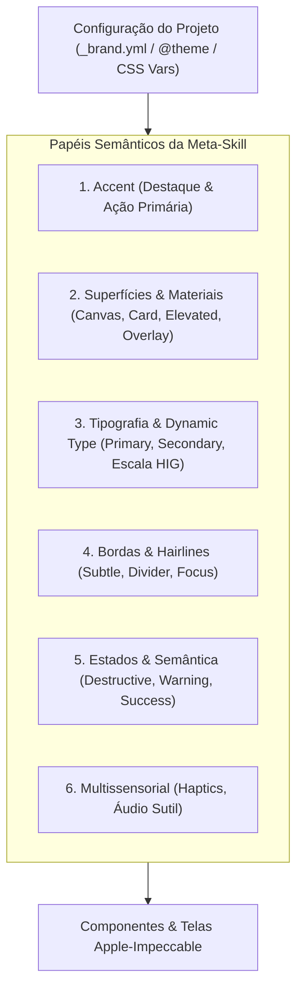

# Sistema Universal de Tokens Semânticos

A meta-skill **`apple-impeccable`** adota uma abordagem estritamente agnóstica a temas e paletas de cores. A estética refinada, a tipografia proporcional e os materiais do Apple HIG são mapeados para **papéis funcionais e semânticos**, permitindo que qualquer projeto preserve integralmente sua identidade de marca enquanto se beneficia da ergonomia, tipografia e acabamento tátil da Apple com paridade total Chromium e Safari.

---

## 1. Arquitetura de Papéis Semânticos

Em vez de valores literais como `#007AFF` (SystemBlue) ou `#8E8E93` (SystemGray), todos os estilos e componentes utilizam abstrações semânticas divididas em camadas fundamentais:



---

## 2. Dicionário de Tokens Semânticos

| Token Semântico (CSS Var) | Papel Funcional | Regra Apple HIG / Impeccable | Valor Padrão Semântico (Paridade 1:1) |
| :--- | :--- | :--- | :--- |
| `--app-accent` | Cor principal de ação, botões primários, links ativos, seleção. | Substitui `SystemBlue`. Toma a cor institucional da marca. | `#0066CC` |
| `--app-accent-contrast` | Texto ou ícone sobre a cor de destaque. | Garantir WCAG AA (mínimo 4.5:1 contra `--app-accent`). | `#FFFFFF` |
| `--app-surface-canvas` | Fundo principal da aplicação / viewport base. | Base opaca sobre a qual os materiais repousam. | `#F8F9FA` / `#0A0A0A` |
| `--app-surface-card` | Superfície secundária (cards, itens agrupados de lista). | Superfície ligeiramente contrastante com o canvas. | `#FFFFFF` / `#161618` |
| `--app-surface-elevated` | Elementos suspensos (modais, popovers, floating bars). | Suporte a reflexos e profundidade física. | `#FFFFFF` / `#1C1C1E` |
| `--app-surface-overlay` | Camadas com translucidez (`backdrop-filter`). | Base para frosted glass / materiais com Liquid Glass. | `color-mix(in srgb, var(--app-surface-canvas) 80%, transparent)` |
| `--app-text-primary` | Títulos, rótulos principais e corpo de leitura. | Máximo contraste e nitidez tipográfica. | `#1A1A1A` / `#F5F5F7` |
| `--app-text-secondary` | Metadados, subtítulos, legendas e rótulos de apoio. | Contraste suavizado (mínimo 4.5:1 acessível). | `#636366` / `#8E8E93` |
| `--app-text-tertiary` | Placeholders, separadores e ícones inativos. | Contraste mínimo de 3:1 para elementos de interface. | `#8E8E93` / `#636366` |
| `--app-border-hairline` | Separadores de lista e contornos de cards (0.5px / 1px). | Linha sutil de definição estrutural. | `rgba(0, 0, 0, 0.08)` / `rgba(255, 255, 255, 0.12)` |
| `--app-status-destructive` | Ações perigosas, erros, cancelamentos irreversíveis. | Papel crítico de segurança do usuário. | `#DC2626` |
| `--app-status-warning` | Avisos, pendências, estados parciais que requerem atenção. | Visibilidade sem alarmismo. | `#D97706` |
| `--app-status-success` | Confirmações, conclusões bem-sucedidas. | Feedback positivo imediato. | `#16A34A` |

---

## 3. Tokens de Tipografia e Dynamic Type HIG

Para que a tipografia preserve as proporções e hierarquia do Apple Human Interface Guidelines em ambos os navegadores (Chrome e Safari):

```css
:root {
  /* Escala Dynamic Type Apple com proporções fluidas e legíveis */
  --type-large-title: clamp(2rem, 1.8rem + 1vw, 2.125rem); /* 34pt */
  --type-title-1: clamp(1.625rem, 1.5rem + 0.6vw, 1.75rem); /* 28pt */
  --type-title-2: clamp(1.25rem, 1.2rem + 0.3vw, 1.375rem); /* 22pt */
  --type-title-3: 1.25rem; /* 20pt */
  --type-headline: 1.0625rem; /* 17pt SemiBold */
  --type-body: 1.0625rem; /* 17pt Regular */
  --type-callout: 1rem; /* 16pt */
  --type-subhead: 0.9375rem; /* 15pt */
  --type-footnote: 0.8125rem; /* 13pt */
  --type-caption-1: 0.75rem; /* 12pt */
  --type-caption-2: 0.6875rem; /* 11pt */
}
```

---

## 4. Mapeamento no Tailwind CSS v4 e v3

### No Tailwind v4 (`@theme`)

```css
@import "tailwindcss";

@theme {
  --color-accent: var(--app-accent);
  --color-accent-contrast: var(--app-accent-contrast);
  --color-surface-canvas: var(--app-surface-canvas);
  --color-surface-card: var(--app-surface-card);
  --color-surface-elevated: var(--app-surface-elevated);
  --color-surface-overlay: var(--app-surface-overlay);
  
  --color-text-primary: var(--app-text-primary);
  --color-text-secondary: var(--app-text-secondary);
  --color-text-tertiary: var(--app-text-tertiary);
  
  --color-border-hairline: var(--app-border-hairline);
  
  --font-brand-display: var(--font-headings, system-ui, sans-serif);
  --font-brand-body: var(--font-base, -apple-system, BlinkMacSystemFont, "Segoe UI", Roboto, sans-serif);
}
```

### No Tailwind v3 (`tailwind.config.cjs / js`)

```javascript
module.exports = {
  theme: {
    extend: {
      colors: {
        app: {
          accent: 'var(--app-accent)',
          'accent-contrast': 'var(--app-accent-contrast)',
          'surface-canvas': 'var(--app-surface-canvas)',
          'surface-card': 'var(--app-surface-card)',
          'surface-elevated': 'var(--app-surface-elevated)',
          'surface-overlay': 'var(--app-surface-overlay)',
          'text-primary': 'var(--app-text-primary)',
          'text-secondary': 'var(--app-text-secondary)',
          'border-hairline': 'var(--app-border-hairline)',
        }
      }
    }
  }
}
```

---

## 5. Algoritmo de Descoberta de Contexto e Tema

Ao iniciar qualquer operação de design, auditoria ou hardening, a meta-skill executa a **Fase 0: Context Discovery**:

1. **Varredura de Arquivos de Marca**:
   - `_brand.yml` ou `brand.json` (padrão institucional como no CAGP).
   - `tailwind.config.*` ou bloco `@theme` em arquivos CSS principais.
   - `_variables.scss`, `tokens.css`, `variables.css`.
   - `DESIGN.md` ou `PRODUCT.md` pré-existentes.
2. **Extração das Cores Primárias**:
   - Mapear a cor `primary` ou institucional identificada para `--app-accent`.
   - Mapear `background` para `--app-surface-canvas`.
   - Mapear superfícies intermediárias (`surface-low`, `surface-high`) para `--app-surface-card` e `--app-surface-elevated`.
   - Mapear `foreground` ou `dark` para `--app-text-primary`.
3. **Extração Tipográfica**:
   - Fontes de títulos (`headings`) associadas à hierarquia proeminente do HIG (Large Title / Title 1).
   - Fontes de corpo (`base`) associadas ao Body / Subhead.

---

## 6. Exemplo Real: Mapeamento do `_brand.yml` (CAGP)

No repositório do CAGP, a configuração de marca em `_brand.yml` é imediatamente vinculada sem nenhuma cor hardcoded da Apple:

```yaml
# Arquivo _brand.yml do CAGP
color:
  primary: cagp-wine-inst (#8B1E2D)
  background: cagp-paper (#FBF8F3)
  foreground: cagp-dark (#0A0A0A)
  surface-low: cagp-surface-low (#F4F1EA)
  surface-high: cagp-surface-high (#EAE5DC)
  border: cagp-border (#DFDBD2)
typography:
  headings: Oswald
  base: Inter
```

**Mapeamento Semântico Resultante:**
```css
:root {
  --app-accent: #8B1E2D; /* cagp-wine-inst */
  --app-accent-contrast: #FFFFFF;
  --app-surface-canvas: #FBF8F3; /* cagp-paper */
  --app-surface-card: #F4F1EA; /* cagp-surface-low */
  --app-surface-elevated: #EAE5DC; /* cagp-surface-high */
  --app-surface-overlay: color-mix(in srgb, #FBF8F3 82%, transparent);
  --app-text-primary: #0A0A0A; /* cagp-dark */
  --app-text-secondary: #525252;
  --app-border-hairline: #DFDBD2; /* cagp-border */
  
  --font-headings: 'Oswald', sans-serif;
  --font-base: 'Inter', -apple-system, BlinkMacSystemFont, sans-serif;
}
```

O resultado é um componente que se comporta, responde e vibra com a precisão tátil do iOS/macOS, mas veste rigorosamente a identidade visual do projeto em ambos os motores de navegação.
