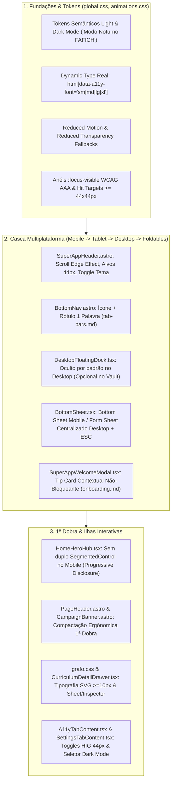

# Plano de Refinamento UI/UX — Apple HIG & Super App Multiplataforma

## 1. Diagnóstico Executivo (`/apple-design` Audit)

> **Tese do Design:** O **CAGP UFMG Super App** combina a autoridade editorial e gráfica do **Neo-Brutalismo Brite ("Prensa dos Candangos")** — bordas nanquim `#0A0A0A`, sombras angulares duras e tipografia `Oswald` + `Inter` + `JetBrains Mono` — com a ergonomia de um aplicativo nativo de bolso. Seu elemento de assinatura é o **Passaporte Discente & Grafo Curricular 10P** operando 100% offline.
> **Avaliação Atual (`SKILL.md`):** **Needs work** (possui excelente fundação técnica e identidade forte, mas apresenta falhas críticas de acessibilidade funcional e quebras de convenção multiplataforma entre Mobile e Desktop).

### Resumo das 5 Lentes da Auditoria Apple HIG

| Lente HIG | Severidade | Achado no Código Atual | Referência Oficial HIG |
| :--- | :--- | :--- | :--- |
| **1. Acessibilidade & Dynamic Type** | **Critical** | `A11ySheet.tsx` e `SettingsInteractive.tsx` gravam `data-a11y-font="sm\|md\|lg\|xl"` e `data-a11y-motion="reduced"` no `<html>`, mas **não existem regras CSS** em `global.css` ou `animations.css` para esses seletores — os botões não têm efeito prático. | `accessibility.md › Vision` & `typography.md › Supporting Dynamic Type` |
| **1. Acessibilidade & Alvos de Toque** | **Critical** | Diversos controles interativos têm tamanho inferior a `44x44pt` no mobile: botões da Topbar (`w-9 h-9` = `36px`), botão fechar do Drawer (`36x36px`), botão fechar do Dossiê (`32x32px`), e checkboxes de alarmes em `SettingsTabContent.tsx` (`w-4 h-4` = `16x16px`). | `accessibility.md › Mobility`: *"iOS, iPadOS default control size: 44x44 pt"* |
| **1. Legibilidade Tipográfica** | **High** | Uso recorrente de `text-[9px]`, `text-[10px]` em textos informativos e `7.5px` / `8.5px` nos nós do Grafo SVG (`grafo.css`), abaixo do piso de `11pt` (mobile) e `10pt` (desktop). | `typography.md › Ensuring legibility` |
| **2. Convenções de Plataforma (Tab Bar)** | **High** | `BottomNav.astro` exibe apenas ícones sem rótulos de texto visíveis no mobile e usa `role="toolbar"` dentro de `<nav>`. No Desktop (`lg+`), `DesktopFloatingDock.tsx` duplica na base da janela os mesmos 5 eixos já presentes na `SuperAppHeader` superior. | `tab-bars.md › Best practices`: *"Include tab labels to help with navigation"* & `layout.md › Desktop (macOS)`: *"Avoid placing controls or critical information at the bottom of a window."* |
| **2. Modalidade, Sheets & Onboarding** | **High** | `BottomSheet.tsx` permanece preso na borda inferior mesmo em telas Desktop widescreen, não bloqueia o scroll do `body` nem fecha com `Escape`. `SuperAppWelcomeModal.tsx` abre um modal de tela cheia automático após 800ms no 1º acesso. | `sheets.md › Platform considerations` & `onboarding.md › Best practices` |
| **3. Dark Mode & Semântica de Cores** | **High** | Apesar de o curso ser do **Turno Noturno**, todas as superfícies estão fixadas em cores claras (`#F7F5F0`, `#FFFFFF`) sem suporte a `prefers-color-scheme: dark` ou tema escuro semântico. | `dark-mode.md › Best practices` & `color.md › System colors` |
| **3. Liquid Glass & Densidade da 1ª Dobra** | **Medium** | Na Home (`index.astro`), há 5 blocos empilhados e **dois Segmented Controls seguidos** (`HomeHeroHub` + `SegmentedControl`). Nas superfícies `backdrop-blur`, falta fallback para `@media (prefers-reduced-transparency: reduce)` e *Scroll Edge Effect*. | `liquid-glass.md › Review checklist` & `segmented-controls.md` |

---

## 2. Decisões Alinhadas no Grill Me

> [!IMPORTANT]
> **Restrições e Diretrizes Confirmadas pelo Usuário:**
> 1. **Zero Alteração Factual:** Nenhuma ementa, texto normativo, regra de negócio, horário, nome ou rota será alterado. Todo o trabalho é estritamente de UI/UX, ergonomia, semântica, responsividade e acabamento visual.
> 2. **Zoom Nativo Fixo Preservado:** Manter o bloqueio de pinch-to-zoom em `BaseLayout.astro` para preservar a sensação de aplicativo nativo fixo, garantindo em contrapartida que o escalonamento via **Dynamic Type (`data-a11y-font`)** funcione perfeitamente de `92.5%` a `125%`.
> 3. **Navegação Multiplataforma:**
>    - **Mobile (`< lg`):** Tab Bar inferior com ícone + rótulo curto de 1 palavra (`Hoje`, `Curso`, `Grade`, `Acervo`, `CAGP` + `Ajustar`).
>    - **Desktop (`lg+`):** Navegação centralizada na Topbar superior (`SuperAppHeader`), tornando o `DesktopFloatingDock` inferior oculto por padrão e ativável sob demanda nas configurações/atalhos.
>    - **Landscape Curto / Dobráveis (`designing-for-iphone-duo.md`):** Compactação vertical automática das barras em telas baixas (`max-height: 500px`).
> 4. **Modo Noturno FAFICH (Dark Mode Semântico):** Suporte a `light`, `dark` e `system` (automático via `prefers-color-scheme: dark`), mantendo a personalidade Neo-Brutalista Candango e o modo de Alto Contraste AAA.
> 5. **1ª Dobra Enxuta & Progressive Disclosure:** Eliminar o duplo `SegmentedControl` na Home, integrando o status do "UFMG no Agora" diretamente como faixa/drawer acionável no cabeçalho do Passaporte no mobile e mantendo o grid de 2 colunas no Desktop.
> 6. **Sheets Adaptativas & Onboarding Contextual:** `BottomSheet` como gaveta inferior com detents no mobile e **Form Sheet centralizado** no Tablet/Desktop (`md+`), com suporte a `Escape` e scroll-lock. Substituição do pop-up bloqueante de boas-vindas por um card de dica contextual estilo Apple TipKit.

---

## 3. Arquitetura de Mudanças Propostas



---

### Componente 1: Sistema de Tokens Semânticos, Dark Mode, Dynamic Type & Liquid Glass

#### [MODIFY] [studentVault.ts](file:///home/gsathler/Nextcloud/Projects/cagp/src/lib/storage/studentVault.ts)
- Expandir `A11yPrefsSchema` (`cagp_a11y_prefs_v2`) com propriedades retrocompatíveis (`.default(...)`):
  - `theme: z.enum(['system', 'light', 'dark']).default('system')` para suportar o Modo Noturno FAFICH automático ou manual.
  - `showDesktopDock: z.boolean().default(false)` para permitir que o estudante ative opcionalmente o Dock inferior no Desktop caso deseje.

#### [MODIFY] [BaseLayout.astro](file:///home/gsathler/Nextcloud/Projects/cagp/src/layouts/BaseLayout.astro)
- Atualizar o script inline anti-FOUC no `<head>` para aplicar `data-theme="light|dark"` (resolvendo `system` via `window.matchMedia('(prefers-color-scheme: dark)')` em tempo real) e `data-desktop-dock="true|false"` antes do primeiro paint.
- Adicionar uma faixa sutil de *Scroll Edge Effect* no topo abaixo da `SuperAppHeader` (`liquid-glass.md › Review checklist #6`).

#### [MODIFY] [global.css](file:///home/gsathler/Nextcloud/Projects/cagp/src/styles/global.css)
- **Dynamic Type Real (`typography.md › Supporting Dynamic Type`):**
  ```css
  html[data-a11y-font="sm"] { font-size: 93.75%; } /* 15px base */
  html[data-a11y-font="md"] { font-size: 100%; }   /* 16px base */
  html[data-a11y-font="lg"] { font-size: 112.5%; } /* 18px base */
  html[data-a11y-font="xl"] { font-size: 125%; }   /* 20px base */
  ```
- **Dark Mode Semântico ("Modo Noturno FAFICH" — `dark-mode.md` & `color.md`):**
  - Definir variáveis CSS semânticas (`--cagp-bg-page`, `--cagp-bg-surface`, `--cagp-bg-elevated`, `--cagp-bg-muted`, `--cagp-text-primary`, `--cagp-text-secondary`, `--cagp-border-strong`, `--cagp-border-subtle`, `--cagp-shadow-color`) que se adaptam automaticamente sob `html[data-theme="dark"]` (quando `data-a11y-contrast` não for `"high"`).
  - Mapear superfícies claras hardcoded (`.bg-white`, `.bg-[#F7F5F0]`, `.text-[#0A0A0A]`, `.border-[#DFDBD2]`) em `html[data-theme="dark"]` para tons de carvão/ardósia (`#121316` fundo, `#1C1E22` card base, `#25282E` superfície elevada, `#F5F3EF` texto primário, `#A1A1AA` texto secundário, bordas `#3F3F46` / `#000000` e acento vinho luminoso `#B8293D` / `#E8A317` com contraste >= 4.5:1).
- **Focus Ring Universal (`focus-and-selection.md`):**
  - Adicionar `:focus-visible` global com `outline: 2.5px solid var(--color-cagp-gold); outline-offset: 2px;` para navegação por teclado clara tanto no modo claro quanto no escuro.
- **Adaptação para Poses de Landscape Curto / iPhone Duo (`designing-for-iphone-duo.md`):**
  - Adicionar media query `@media (max-height: 500px) and (orientation: landscape)` que reduz paddings verticais da casca e permite que o conteúdo utilize toda a largura com segurança.

#### [MODIFY] [animations.css](file:///home/gsathler/Nextcloud/Projects/cagp/src/styles/animations.css)
- Garantir que `html[data-a11y-motion="reduced"]` aplique exatamente o mesmo desligamento de animações espaciais que `@media (prefers-reduced-motion: reduce)` (`accessibility.md › Cognitive`).

#### [MODIFY] [components.css](file:///home/gsathler/Nextcloud/Projects/cagp/src/styles/components.css)
- **Disciplina de Liquid Glass (`liquid-glass.md › Review checklist #5`):**
  - Adicionar suporte a `@media (prefers-reduced-transparency: reduce)` removendo `backdrop-filter` e tornando `.cagp-glass-surface`, `.cagp-toast`, `SuperAppHeader`, `BottomNav` e `BottomSheet` 100% opacos.
  - Refinar `.cagp-badge` para tamanho mínimo legível (`0.72rem` / `11.5px`) e contraste verificado em ambos os modos.

---

### Componente 2: Casca de Navegação Multiplataforma (`SuperAppHeader`, `BottomNav`, `DesktopFloatingDock`, `MobileDrawer`)

#### [MODIFY] [SuperAppHeader.astro](file:///home/gsathler/Nextcloud/Projects/cagp/src/components/shell/SuperAppHeader.astro)
- **Alvos de Toque (`accessibility.md › Mobility`):** Elevar os botões da Ilha 3 (Buscar `⌘K`, Status do Campus, Avatar do Passaporte e Botão Menu Mobile) de `w-9 h-9` (`36px`) para `w-11 h-11 sm:w-auto sm:h-10 min-w-[44px] min-h-[44px]` no mobile e `min-h-[38px]` no desktop.
- **Acesso Rápido a Acessibilidade/Ajustes no Desktop:** Adicionar na Ilha 3 um botão compacto de Ajustes/Aparência (`bi-sliders2` / `Alt+A`) visível em `lg+`, já que o Dock inferior estará oculto por padrão no Desktop.
- **Navegação por Teclado nos Dropdowns (`keyboards.md`):** Permitir navegação com setas `ArrowDown`/`ArrowUp` dentro dos menus dropdown dos 4 eixos no Desktop.

#### [MODIFY] [BottomNav.astro](file:///home/gsathler/Nextcloud/Projects/cagp/src/components/shell/BottomNav.astro)
- **Conformidade com `tab-bars.md › Best practices`:**
  - Exibir **ícone + rótulo curto de 1 palavra** (`11px`, `font-semibold`, `leading-none`) abaixo de cada ícone na barra inferior mobile/tablet (`Hoje`, `Curso`, `Currículo`, `Acervo`, `O CAGP`, `Ajustar`).
  - Remover o `role="toolbar"` incorreto de dentro de `<nav>` para que leitores de tela (VoiceOver/TalkBack) anunciem corretamente uma barra de navegação com links e estado `aria-current="page"`.
  - Garantir que cada item tenha área mínima de toque de `min-w-[54px] min-h-[46px]` com espaçamento confortável e indicador ativo concêntrico à pílula.

#### [MODIFY] [DesktopFloatingDock.tsx](file:///home/gsathler/Nextcloud/Projects/cagp/src/components/shell/DesktopFloatingDock.tsx)
- **Conformidade com `layout.md › Desktop (macOS)`:**
  - Respeitar a preferência `showDesktopDock` de `cagp_a11y_prefs_v2` (por padrão `false`, evitando duplicar os 5 eixos da Topbar na borda inferior da janela desktop). Quando ativado pelo usuário, exibir com alvos adequados e suporte a Dark Mode e Reduced Transparency.

#### [MODIFY] [MobileDrawer.astro](file:///home/gsathler/Nextcloud/Projects/cagp/src/components/shell/MobileDrawer.astro) & [drawer.css](file:///home/gsathler/Nextcloud/Projects/cagp/src/styles/drawer.css)
- Aumentar o botão de fechar (`#cagp-drawer-close`) de `36x36px` para `44x44px` (`accessibility.md › Mobility`).
- Adicionar suporte a gesto de swipe horizontal para a esquerda (`touchstart`/`touchend`) no painel do drawer para fechamento natural no mobile (`gestures.md`, `designing-for-ios.md`).

---

### Componente 3: Modalidade, Sheets Adaptativas & Onboarding (`BottomSheet`, `SuperAppWelcomeModal`, `SpotlightModal`)

#### [MODIFY] [BottomSheet.tsx](file:///home/gsathler/Nextcloud/Projects/cagp/src/components/shell/BottomSheet.tsx)
- **Adaptação Multiplataforma (`sheets.md › Platform considerations`):**
  - **Mobile (`< md`):** Mantém-se como Bottom Sheet ancorado na base com *grabber* interativo (`medium` = `58dvh`, `large` = `90dvh`) e gesto de *swipe-to-dismiss*.
  - **Tablet & Desktop (`md+`):** Converte-se automaticamente em **Form Sheet centralizado** (`md:inset-0 md:items-center md:justify-center`, card `md:max-w-xl md:max-h-[85dvh] md:rounded-2xl md:border-2`) flutuando sobre o backdrop escurecido, exatamente como preconizado para iPadOS e macOS em `sheets.md`.
- **Ergonomia e Acessibilidade Modal (`modality.md`):**
  - Adicionar listener de teclado para fechar ao pressionar `Escape`.
  - Bloquear scroll do `document.body` enquanto a sheet estiver aberta e restaurar ao fechar.
  - Aumentar o botão de fechar para `min-w-[44px] min-h-[44px]` com rótulo claro.

#### [MODIFY] [SuperAppWelcomeModal.tsx](file:///home/gsathler/Nextcloud/Projects/cagp/src/components/shell/SuperAppWelcomeModal.tsx)
- **Conformidade com `onboarding.md › Best practices`:**
  - Em vez de bloquear a tela inteira com um modal `fixed inset-0` após 800ms no primeiro acesso, renderizar um **Banner/Card de Boas-Vindas Contextual (estilo Apple TipKit)** discreto e flutuante na parte inferior/topo da vista inicial, com dois botões claros: `"Conhecer em 30s"` (que abre o tour de 3 passos apenas se o estudante quiser) e `"Dispensar"` (`✕`).

#### [MODIFY] [SpotlightModal.tsx](file:///home/gsathler/Nextcloud/Projects/cagp/src/components/shell/SpotlightModal.tsx)
- Adicionar atributo `role="dialog" aria-modal="true" aria-label="Busca rápida Spotlight"`, garantir alvo de `44x44px` no botão de limpar busca e um botão `"Fechar"` visível em telas touch (onde a tecla `ESC` física não existe).

---

### Componente 4: Refinamento da 1ª Dobra & Progressive Disclosure (`HomeHeroHub`, `PageHeader`, `CampaignBanner`)

#### [MODIFY] [HomeHeroHub.tsx](file:///home/gsathler/Nextcloud/Projects/cagp/src/components/home/HomeHeroHub.tsx)
- **Eliminação do Duplo Segmented Control no Mobile (`segmented-controls.md`, `layout.md › Visual hierarchy`):**
  - Remover a barra de abas duplicada (`[Passaporte] [UFMG no Agora]`) que competia diretamente com o `SegmentedControl` principal da Home (`[1. Bússola & Hoje] [2. Sistemas & Apps] [3. Módulos & CAGP]`).
  - No Mobile (`< lg`), apresentar o **Card do Passaporte Compacto** integrado com uma **Faixa Ao Vivo "UFMG no Agora"** (mostrando status do RU II 17h30–19h30 e Circular 22h15/35/45 com botão de expansão instantânea `"Plantão & Alarmes"` que abre a `CampusSheet` ou expande in-place via disclosure), economizando ~95px verticais na 1ª dobra.
  - No Desktop (`lg+`), manter o layout panorâmico de 2 colunas (7 colunas Passaporte + 5 colunas UFMG no Agora) com espaçamento e tipografia refinados.

#### [MODIFY] [CampaignBanner.astro](file:///home/gsathler/Nextcloud/Projects/cagp/src/components/shell/CampaignBanner.astro)
- Refinar o layout compacto para ocupar menos altura vertical no mobile (1 linha limpa com logo + texto + botão de ação com ícone claro e alvo de `44x44px`), preservando 100% do texto oficial da Chapa Semente ao expandir.

---

### Componente 5: Ilhas Interativas, Grafo Curricular 10P & Painéis de Ajuste

#### [MODIFY] [grafo.css](file:///home/gsathler/Nextcloud/Projects/cagp/src/styles/grafo.css) & [CurriculumDetailDrawer.tsx](file:///home/gsathler/Nextcloud/Projects/cagp/src/components/curriculum/CurriculumDetailDrawer.tsx)
- **Legibilidade no SVG (`typography.md`):** Ajustar `.grafo-node text.node-code` para `11px` e `.grafo-node text.node-name` para `9.5px`, melhorando a leitura em telas retina e no Modo Noturno.
- **Alvos de Toque e Inspector (`CurriculumDetailDrawer.tsx`):** Elevar o botão fechar para `w-11 h-11` (`44x44px`) e os chips de pré-requisitos (`← ECN 140`) para `min-h-[36px] px-2.5 py-1 text-xs` para toque confortável no mobile.

#### [MODIFY] [A11yTabContent.tsx](file:///home/gsathler/Nextcloud/Projects/cagp/src/components/shell/A11yTabContent.tsx), [SettingsTabContent.tsx](file:///home/gsathler/Nextcloud/Projects/cagp/src/components/shell/SettingsTabContent.tsx) & [SettingsA11ySection.tsx](file:///home/gsathler/Nextcloud/Projects/cagp/src/components/settings/SettingsA11ySection.tsx)
- Adicionar o seletor de **Aparência (Modo Claro / Modo Noturno FAFICH / Automático do Sistema)** no painel de Acessibilidade e Configurações.
- Adicionar o toggle opcional **"Exibir Dock Inferior no Desktop"** para quem usa telas grandes.
- Substituir os `<input type="checkbox" class="w-4 h-4">` em `SettingsTabContent.tsx` por **Switches/Toggles táteis estilo iOS (`role="switch"`)** com área de toque de `44x44px` (`toggles.md`).

---

## 4. Plano de Verificação

### Testes Automatizados
1. **Verificação de Tipos (TypeScript Strict):**
   ```bash
   npm run typecheck
   ```
2. **Suíte de Testes Unitários e de Integração (Vitest):**
   ```bash
   npm test
   ```
   *(Incluindo atualização/adição de testes em `tests/storage.test.ts` para validar os novos campos `theme` e `showDesktopDock` com fallback seguro no Zod).*
3. **Build Estático Completo + Manifesto PWA:**
   ```bash
   npm run build
   ```

### Verificação Visual e Ergonômica (Checklist Apple HIG)
- Confirmar funcionamento imediato dos 4 níveis de **Dynamic Type** (`A-`, `A`, `A+`, `A++`) e do **Modo Noturno FAFICH** (`light` / `dark` / `system`) além do **Alto Contraste AAA**.
- Confirmar que todos os botões da Topbar, Tab Bar mobile, Sheets e controles de formulário possuem área de toque `>= 44x44px` no mobile.
- Confirmar que a `BottomNav` mobile exibe rótulos claros sob cada ícone e que as `BottomSheet`s se comportam como Bottom Sheet no mobile e Form Sheet centralizado no Desktop, fechando com `ESC`.
