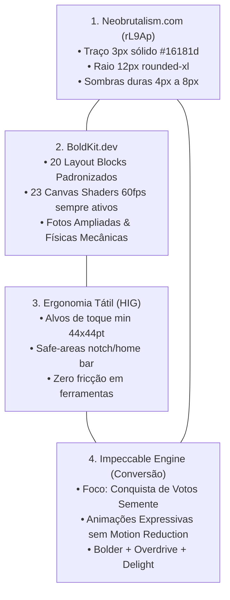
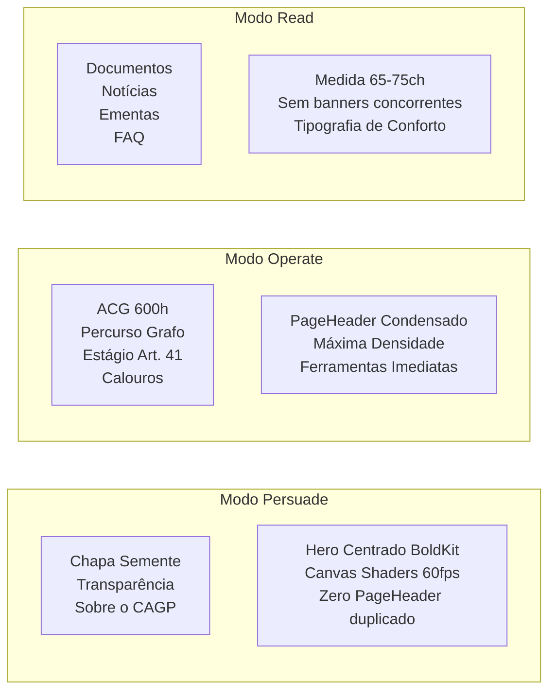

# Part 1C: Quadripartite Design Architecture & Dynamic Modes (`00-design-system-specification.md`)
## SuperApp CAGP FAFICH/UFMG — Chapa Semente

> [!IMPORTANT]
> **Especificação Arquitetural do Design System & Diretriz de Unificação BoldKit + Neobrutalism**: Este documento formaliza a padronização visual estrita nos estilos **BoldKit.dev** e **Neobrutalism.com**, a política de **Animações Expressivas Incondicionais (ignorando `prefers-reduced-motion`)**, o **Destaque e Ampliação Fotográfica com Movimento**, e o alinhamento de toda a UX/UI para o foco principal do SuperApp: **ser uma Proposta da Chapa Semente Materializada para Conquistar Votos**.

---

## 1. Unificação e Padronização Estrita BoldKit.dev + Neobrutalism.com

O SuperApp CAGP unifica e padroniza todas as suas páginas, blocos e componentes estritamente sob a estética **BoldKit.dev + Neobrutalism.com (rL9Ap)**, governada pelas habilidades `bolder`, `overdrive`, `animate`, `delight` e `polish` do `/impeccable`:



### Regras de Ouro da Unificação Estética:
1. **Padronização Estrita BoldKit & Neobrutalist**:
   - Toda superfície, card, modal, banner, tabela ou container de foto carrega obrigatoriamente **borda sólida de 3px na cor tinta (`#16181d`)**, cantos de `12px` (`0.75rem`) e **sombra offset rígida sem desfoque** (`4px 4px 0 0 #16181d` em cards padrão; `6px 6px 0 0 #16181d` ou `8px 8px 0 0 #16181d` em cards protagonistas, heróis de campanha e molduras de fotos).
   - Proibido o uso de cards sem borda, sombras esfumaçadas genéricas ou estilos desconectados do vocabulário BoldKit/Neobrutalist.
2. **Animações Expressivas Incondicionais (Ignorando `prefers-reduced-motion`)**:
   - **Nenhuma animação deve ser desativada, pausada ou suprimida por `prefers-reduced-motion`**. Regras CSS como `@media (prefers-reduced-motion: reduce)` que zeram durações ou desativam animações e checagens JS que bloqueiam `motion/react` ou Canvas Shaders devem ser removidas/ignoradas.
   - Todas as interações de hover, clique mecânico (`translate-x-[3px] translate-y-[3px] shadow-none`), entrada escalonada (`staggerContainer`), letreiros (`marquee`) e efeitos de fundo Canvas rodam sempre com máxima expressividade.
3. **Destaque no Aumento das Fotos & Fotografia Animada**:
   - **Proporções Ampliadas**: As fotografias (integrantes e candidatos da Chapa Semente em `TeamSection` / `/chapa-semente`, fotos históricas e do campus em `/sobre`, `/curso`, `/calouros` e avatares do Passaporte) devem ter **tamanho significativamente aumentado** (molduras grandes `aspect-[4/5]` ou `min-h-[280px]` a `min-h-[360px]` em cards de destaque, avatares ampliados de `w-16 h-16` para `w-28 h-28` / `w-36 h-36` ou formato retrato completo), dando protagonismo visual imediato às pessoas e à vivência da FAFICH.
   - **Animações Fotográficas (`photoZoomSpring`)**: Toda foto possui moldura neobrutalista interativa com zoom elástico (`scale: 1.06`), leve rotação expressiva (`rotate: -1.5deg` ou `1.5deg`), transição de filtro/contraste vibrante, elevação da sombra dura para `8px 8px 0px #16181d` e badges/stickers animados sobrepostos.
4. **Paleta Semente de Alta Conversão & Restrição Estrita de Dark Mode**:
   - **Proibição Absoluta de Dark Mode (`Light Mode Editorial Exclusivo`)**: O SuperApp **não suporta nem permite Dark Mode** (`dark:*`, `.dark` ou `@media (prefers-color-scheme: dark)` devem ser expurgados/bloqueados; `html { color-scheme: light !important; }`). A estética BoldKit + Neobrutalism da Chapa Semente exige fundo **Papel Quente (`#f4f5f7` / `#f4f0ea`)**, superfícies de **Cartão Branco (`#ffffff`)** e traço **Tinta Preta (`#16181d`)** com opacidade 100% (zero `backdrop-blur` ou glassmorphism). A única exceção cromática é o modo de acessibilidade **Alto Contraste AAA (`data-a11y-contrast="high"` preto/amarelo)**.
   - Primária: **Roxo Semente** (`#5B2A86`) — Liderança e identidade institucional da Chapa Semente.
   - Destaque/CTA Eleitoral: **Laranja Germinar** (`#FF8811`) — Botões de ação principal, chamadas de voto e destaques de proposta materializada.
   - Secundária: **Rubro CAGP** (`#9E2424`) — Memória histórica da FAFICH e alertas críticos (120 dias).
   - Apoio: **Verde Petróleo** (`#134E4A`) — Conquista acadêmica (600h, Estágio Art. 41, Transparência).
5. **Responsividade Multi-Tela & Ergonomia Tátil (320px a Ultrawide)**:
   - **Mobile Compacto (`320px–360px`)**: Layout em 1 coluna sem qualquer corte ou `overflow-x`, tipografia fluida (`clamp()`), abas com `.scroll-mask-x` e `BottomNav` fixa.
   - **Smartphones Modernos (`375px–430px`)**: Respeito a `env(safe-area-inset-top)` e `env(safe-area-inset-bottom)`, alvos táteis mínimos de **44x44pt** (com pseudo-envelope `before:inset-[-4px]` em botões compactos) e `CampaignBanner` com Smart Scroll (colapsa para 24px ao rolar).
   - **Tablets / iPads em Retrato e Paisagem (`768px–1024px`)**: Gaveta da Sidebar (`AppShellSidebarIsland.tsx`) com `z-[1100]` sobrepondo o banner e transição de mola (`drawerSpring`), grids de 2 colunas equilibrados e tabelas/grafos redimensionáveis sem distorção.
   - **Notebooks & Desktops (`1280px–1440px`)**: Sidebar lateral persistente colapsável com highlight animado em pílula, Bento Grids de 3–4 colunas e D3 Curriculum Graph panorâmico.
   - **Monitores Ultrawide (`1920px+`)**: Container máximo centralizado com respiro editorial generoso e `GlobalCanvasBackdrop.tsx` rodando shaders a 60fps.
6. **Foco Central nas Animações por Componente (Sidebar, Tour, Cards, Fotos, Shaders)**:
   - **Sidebar (`AppShellSidebarIsland.tsx` / `sidebar.tsx`)**: Expansão e colapso com física de mola (`drawerSpring`), itens com deslocamento tátil no hover (`translate-x-1`), indicador ativo animado (`layoutId="sidebar-active-pill"`) e gaveta mobile/tablet fluida.
   - **Tour Guiado & Onboarding (`tour.tsx` / `onboarding-flow.tsx` / `SuperAppWelcomeModal.tsx`)**: Spotlight com recorte animado, popover neobrutalista com entrada `bounceSpring`, barra de progresso mecânica e transição entre passos com `<AnimatePresence mode="wait">`.
   - **Cards, Botões & Fotos (`card.tsx`, `button.tsx`, `team-section.tsx`)**: Elevação no hover (`-translate-x-[2px] -translate-y-[2px] shadow-[6px_6px_0_0_#16181d]`), compressão mecânica no clique (`translate-x-[3px] translate-y-[3px] shadow-none`) e zoom elástico nas fotos (`photoCardHover`).

---

## 2. Modos Dinâmicos de Layout por Tipo de Visita

Para eliminar a duplicação crônica entre o [PageHeader.astro](file:///home/gsathler/Nextcloud/Projects/cagp/src/components/ui/PageHeader.astro) e os blocos de apresentação do BoldKit, as páginas de `src/pages/` operam sob 3 modos de visitação:



### 2.1. Modo `Persuade` (Campanha & Prestação de Contas)
- **Rotas**: `/chapa-semente`, `/transparencia`, `/sobre`, `/404`.
- **Comportamento**: O bloco [HeroCentered](file:///home/gsathler/Nextcloud/Projects/cagp/src/components/boldkit/blocks/hero-section.tsx) ou o banner visual BoldKit com canvas shader atua como o cabeçalho mestre da rota, absorvendo os badges institucionais e a barra de ferramentas do eixo. **O `PageHeader.astro` é sumariamente omitido**, economizando 200px de rolagem no mobile.

### 2.2. Modo `Operate` (Ferramentas Utilitárias Discentes)
- **Rotas**: `/acg`, `/percurso`, `/optativas`, `/cursos`, `/estagio`, `/carreira`, `/calouros`, `/permanencia`, `/configuracoes`.
- **Comportamento**: A prioridade absoluta é a velocidade e a densidade de dados. Utiliza o `PageHeader.astro` em sua variante condensada (apenas título direto, 1 badge essencial e pílulas de navegação [AxisNavBar.astro](file:///home/gsathler/Nextcloud/Projects/cagp/src/components/shell/AxisNavBar.astro)), colocando as calculadoras, formulários e tabelas dentro do primeiro viewport móvel.

### 2.3. Modo `Read` (Documentação Normativa & Notícias)
- **Rotas**: `/documentos`, `/documentos/[slug]`, `/noticias`, `/noticias/[slug]`, `/tcc`, `/faq`, `/mapa-do-site`.
- **Comportamento**: Foco em conforto de leitura prolongada. Largura de leitura estritamente limitada a 65–75 caracteres (`max-w-prose`), com ausência de banners concorrentes e sumários flutuantes recolhidos em gavetas sob demanda no mobile.

---

## 3. Política do CampaignBanner Dinâmico Inteligente

O [CampaignBanner.astro](file:///home/gsathler/Nextcloud/Projects/cagp/src/components/shell/CampaignBanner.astro) permanente adota o comportamento de **Sticky com Colapso no Scroll**:
1. **Carga Inicial**: Exibido normalmente com logo Semente, micro-faixa tricolor, badges e resumo do compromisso.
2. **Scroll para Baixo (> 80px)**: Colapsa suavemente em uma micro-faixa tricolor de **24px de altura** com o botão tátil `"Compromisso ▼"`, liberando mais de 50px de viewport útil para o conteúdo discente.
3. **Scroll para Cima**: Restaura o banner completo instantaneamente com física suave.
4. **Persistência**: O discente pode clicar em *"Minimizar"*, persistindo a preferência em `localStorage.getItem('cagp_banner_minimized')`.

---

## 4. Dicionário Canônico de Microcopy Discente

| Área / Componente | Rótulo Burocrático / Anterior | Rótulo Discente & Direto Canônico | Ação e Contexto |
| :--- | :--- | :--- | :--- |
| **Top Global** | Buscar disciplina, norma, sala... (⌘K) | **Buscar (⌘K)** | Input compacto de busca |
| **Campanha** | Expandir ou recolher compromisso | **Compromisso ▼** | Botão tátil do banner |
| **Home (Modo)** | Meu momento: Calouro / Veterano | **Perfil Discente** | Carrossel horizontal |
| **Eixo 3 (ACG)** | Central de Horas & Certificados (600h) | **Horas & 600h** | Cabeçalho do Eixo 3 |
| **Eixo 3 (ACG)** | Guardião 120 Dias Corridos | **Alerta 120 Dias** | Card de prescrição normativa |
| **Eixo 3 (ACG)** | Simulação Paramétrica de Carga Horária | **Simular Horas** | Botão principal de cálculo |
| **Eixo 4 (Estágio)** | Integralização por Experiência Art. 41 | **Aproveitamento Servidor** | Trilha especial de servidor |
| **Eixo 5 (Transparência)** | Balancete Demonstrativo RREO | **Livro-Caixa Aberto** | Portal de contas da entidade |
| **Eixo 5 (Ouvidoria)** | Canal de Denúncias e Reclamações | **Fala com o CA** | Ouvidoria acolhedora |
| **PWA / Mobilização** | Credenciamento Discente Chapa Semente | **Ativar Meu App** | Pílula flutuante mobile |

---

## 5. Tokens Canônicos de Motion Expressivo (`motion/react` — Sem Motion Reduction)

Exportados centralmente em `src/lib/motion.ts` para garantir consistência sensorial hiper-tátil em todas as ilhas React, **operando sempre em capacidade plena (ignorando `prefers-reduced-motion`)**:

```typescript
// src/lib/motion.ts
export const FORCE_EXPRESSIVE_MOTION = true; // Ignora prefers-reduced-motion em todo o SuperApp

export const tactileSpring = {
  type: "spring" as const,
  stiffness: 450,
  damping: 30,
};

export const bounceSpring = {
  type: "spring" as const,
  stiffness: 500,
  damping: 22,
};

export const photoZoomSpring = {
  type: "spring" as const,
  stiffness: 380,
  damping: 24,
};

export const drawerSpring = {
  type: "spring" as const,
  stiffness: 350,
  damping: 35,
};

export const photoCardHover = {
  scale: 1.06,
  rotate: -1.5,
  y: -4,
  transition: photoZoomSpring,
};

export const staggerContainer = (staggerDelay = 0.05) => ({
  hidden: { opacity: 0 },
  show: {
    opacity: 1,
    transition: { staggerChildren: staggerDelay },
  },
});

export const staggerItem = {
  hidden: { opacity: 0, y: 14, scale: 0.97 },
  show: {
    opacity: 1,
    y: 0,
    scale: 1,
    transition: tactileSpring,
  },
};
```