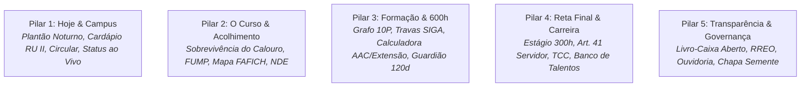

# Part 1B: Product Requirements Document & User Journeys (`00-product-spec-and-journeys.md`)
## SuperApp CAGP FAFICH/UFMG — Chapa Semente

<!-- impeccable:product-schema 1 -->

> [!IMPORTANT]
> **Especificação Funcional de Produto & Schema Canônico do Impeccable (`impeccable:product-schema 1`)**: Este documento consolida a verdade durável do produto (`PRODUCT.md` integrado), os 5 Pilares Funcionais do SuperApp e as Jornadas Ponta a Ponta das 4 Personas Discentes. **O objetivo primário do produto é materializar antecipadamente a Proposta 3 do Eixo 1 da Chapa Semente para conquistar votos na eleição do CAGP FAFICH/UFMG (25 e 26 de Novembro de 2026)**, entregando utilidade real com design unificado **BoldKit.dev + Neobrutalism.com**, fotos ampliadas em destaque e animações expressivas incondicionais.

---

## 0. Impeccable Product Schema (`impeccable:product-schema 1`)

### Platform
`web` (Progressive Web App responsivo mobile-first e desktop com estética unificada BoldKit + Neobrutalism e ergonomia tátil 44x44pt).

### Stack
Astro 7 + React 19 Islands + Tailwind CSS v4 + `motion/react` (v14) + Radix UI / Vaul + Recharts + 23 WebGL/Canvas2D Shaders BoldKit + LocalStorage (`studentVault.ts`).

### Users
- **Primários**: Estudantes de graduação do Bacharelado em Gestão Pública da FAFICH/UFMG (majoritariamente turno noturno, trabalhadores e estagiários), divididos em 4 momentos: **Calouros** (`1º–2º período`), **Veteranos** (`3º–7º período`), **Formandos** (`8º–10º+ período`) e **Ingressantes/Candidatos SiSU** (`ingressar`).
- **Contexto de Uso**: Corredores da FAFICH, ônibus circular no campus Pampulha à noite (18h30–22h45), fila do RU Setorial II, ou planejamento semestral de matrícula no SIGA e entrega de certificados de extensão/AAC.

### Product Purpose
- **Por que existe**: Ser a **Proposta da Chapa Semente Materializada em Ação** antes mesmo da abertura das urnas.
- **O que define sucesso**:
  1. **Conversão Eleitoral Direta**: Conquistar o voto consciente e entusiasmado do estudante na Chapa Semente através da prova tangível de trabalho, competência e transparência.
  2. **Resolução Imediata de Dores Acadêmicas**: Evitar perda de certificados pelo prazo fatal de 120 dias (Art. 15), descomplicar as 600h (300h Extensão + 300h AAC), guiar o aproveitamento de estágio para servidores públicos (Art. 41) e abrir o livro-caixa do CAGP.
  3. **Impacto Visual e Sensorial Memorável**: Encantar o eleitor através de uma interface padronizada em **BoldKit + Neobrutalism**, com fotos ampliadas e animadas da chapa e do campus, e animações expressivas sempre ativas.

### Positioning
Diferente de páginas eleitorais estáticas ou promessas vagas em PDF, o SuperApp CAGP é uma **infraestrutura utilitária viva, código aberto (MIT) e 100% operacional antes do pleito**, combinando calculadoras normativas reais do PPC 2020 da UFMG com o vigor estético e cinético do design Neobrutalista e BoldKit.

### Operating Context
- Regulamento de Extensão e AAC do Colegiado de Gestão Pública (Resolução CEPE 10/2019 e N-20229, Art. 15 dos 120 dias corridos).
- Regulamento de Estágio Supervisionado (300h obrigatórias e dispensa/aproveitamento pelo Art. 41 para servidores públicos).
- Vivência noturna na FAFICH/UFMG (Sala do CAGP F-4000, Secretaria do Colegiado F-2039, RU Setorial II, ônibus Circular Interno).

### Capabilities and Constraints
- **Padronização Visual Estrita**: Todos os componentes seguem rigorosamente o padrão **BoldKit.dev + Neobrutalism.com** (`border-3 border-[#16181d]`, sombras duras `4px` a `8px`, tipografia `Bricolage Grotesque` / `Space Grotesk` / `Space Mono`, stickers e carimbos).
- **Foco Central em Animações Expressivas (Sempre Ativas)**: Proibido desativar animações via `prefers-reduced-motion`; todas as físicas de mola (`motion/react`), aberturas de Sidebar, passos do Tour guiado (`tour.tsx` / `onboarding-flow.tsx`), transições de abas, letreiros contínuos e shaders Canvas operam de forma incondicional e com máxima expressividade.
- **Responsividade Multi-Tela Absoluta (`320px` a `1920px+`)**: Layout testado e refinado para todos os formatos de tela usados pelos estudantes:
  - **Mobile Compacto (`320px–360px`)**: Zero truncamento ou estouro horizontal (`overflow-x`), pílulas com `.scroll-mask-x` e `BottomNav` ancorada.
  - **Smartphones Modernos (`375px–430px`)**: Respeito total a `safe-area-inset-top` e `safe-area-inset-bottom`, alvos de toque de `44x44pt` e `CampaignBanner` com Smart Scroll (24px ao rolar).
  - **Tablets / iPads Retrato e Paisagem (`768px–1024px`)**: Gaveta da Sidebar com `z-[1100]` e transição de mola, grids de 2 colunas equilibrados e tabelas com rolagem suave.
  - **Notebooks & Desktops (`1280px–1440px`)**: Sidebar persistente colapsável com animações táteis, Bento Grids completos e visualização panorâmica do Grafo Curricular.
  - **Monitores Ultrawide (`1920px+`)**: Containers centrados com respiro editorial e fundo reativo com Canvas Shaders a 60fps.
- **Restrição Estrita de Dark Mode (Modo Claro Exclusivo)**: É estritamente proibido o uso de Dark Mode (`dark:*`, `.dark` ou `@media (prefers-color-scheme: dark)`). O SuperApp opera exclusivamente em **Modo Claro Editorial** (`color-scheme: light`, fundo Papel Quente `#f4f5f7`/`#f4f0ea`, cartões `#ffffff` e tinta `#16181d`). Apenas o modo de **Alto Contraste AAA (`data-a11y-contrast="high"`)** é mantido para acessibilidade extrema.
- **Destaque Fotográfico Ampliado**: Fotos de integrantes da Chapa Semente, lideranças, eventos e espaços da FAFICH exibidas em formato ampliado (`aspect-[4/5]` ou molduras editoriais de grande porte) com animações interativas de zoom e inclinação no hover/toque.
- **Privacidade Total (Zero Telemetria Remota)**: Dados acadêmicos e simulações do aluno ficam salvos exclusivamente no navegador via `studentVault.ts`.

### Brand Commitments
- **Identidade**: **Chapa Semente — Potencial em Ação** (CAGP FAFICH/UFMG).
- **Paleta Tri-Camada + Petróleo**: Roxo Semente (`#5B2A86`), Laranja Germinar (`#FF8811`), Rubro CAGP (`#9E2424`) e Verde Petróleo (`#134E4A`) sobre fundo Papel Quente (`#f4f0ea`) e Tinta Preta (`#16181d`).
- **Compromisso Perene**: Manutenção pública do portal para o curso independentemente do resultado das urnas (Proposta 3 do Eixo 1).

### Evidence on Hand
- Carta-Programa oficial da Chapa Semente (4 eixos, 14 propostas) em `/chapa-semente`.
- Acervo de 95 disciplinas optativas e grade obrigatória de 10 períodos do PPC 2020 em `src/data/`.
- Fotografias reais e avatares ilustrados em `public/images/` e `src/components/passport/`.

### Product Principles
1. **A Proposta Materializada Conquista o Voto**: Toda ferramenta utilitária deve lembrar sutil ou explicitamente que é uma entrega real da Chapa Semente para o estudante.
2. **Rigor BoldKit & Neobrutalist Inegociável**: Zero componentes pálidos ou sem borda; contraste máximo, sombras mecânicas duras e hierarquia destemida (`bolder` + `overdrive`).
3. **Cinética Plena e Fotos Protagonistas**: Movimento expressivo constante (sem bloqueio por motion reduction) e fotografias grandes, vibrantes e interativas que humanizam a chapa.
4. **Clareza Discente Acima do Juridiquês**: Traduzir resoluções do CEPE e do Colegiado em ações diretas de 1 clique.

---

## 1. Os 5 Pilares Funcionais do SuperApp (Integrados à Conversão Eleitoral)

### Pilar 1: Hoje & Campus (Apoio Operacional Imediato)
- **Rotas Centrais**: `/` ([index.astro](file:///home/gsathler/Nextcloud/Projects/cagp/src/pages/index.astro)), `/noticias` ([noticias/index.astro](file:///home/gsathler/Nextcloud/Projects/cagp/src/pages/noticias/index.astro)).
- **Componentes**: [HomeWorkspaceA.tsx](file:///home/gsathler/Nextcloud/Projects/cagp/src/components/features/home/HomeWorkspaceA.tsx), [HomeCampusStatusWidget.tsx](file:///home/gsathler/Nextcloud/Projects/cagp/src/components/features/home/HomeCampusStatusWidget.tsx), [CampusSheet.tsx](file:///home/gsathler/Nextcloud/Projects/cagp/src/components/shell/CampusSheet.tsx), [PassportCard.tsx](file:///home/gsathler/Nextcloud/Projects/cagp/src/components/features/passport/PassportCard.tsx).
- **Proposta de Valor**: Entrega imediata de utilidade operacional para o estudante noturno: horários de alimentação, transporte e situação cadastral do dia.

### Pilar 2: O Curso & Acolhimento (Permanência & Informação)
- **Rotas Centrais**: `/curso`, `/calouros`, `/permanencia`, `/pesquisa`.
- **Componentes**: [CalouroCentralOverview.astro](file:///home/gsathler/Nextcloud/Projects/cagp/src/components/features/calouros/CalouroCentralOverview.astro), [CalourosOnboardingGuide.tsx](file:///home/gsathler/Nextcloud/Projects/cagp/src/components/features/calouros/CalourosOnboardingGuide.tsx), [PermanenciaInteractiveHub.tsx](file:///home/gsathler/Nextcloud/Projects/cagp/src/components/features/permanencia/PermanenciaInteractiveHub.tsx).
- **Proposta de Valor**: Desmistificar a universidade para os ingressantes e estudantes vulneráveis; mapa dos espaços da FAFICH (Auditório Sônia Viegas, Sala F-2039, Diretórios).

### Pilar 3: Formação Acadêmica & 600h (Navegação Curricular)
- **Rotas Centrais**: `/acg`, `/percurso`, `/optativas`, `/cursos`.
- **Componentes**: [AcgCalculatorCore.tsx](file:///home/gsathler/Nextcloud/Projects/cagp/src/components/features/acg/calculator/AcgCalculatorCore.tsx), [AcgGuardianCore.tsx](file:///home/gsathler/Nextcloud/Projects/cagp/src/components/features/acg/guardian/AcgGuardianCore.tsx), [PercursosComparativeMatrix.tsx](file:///home/gsathler/Nextcloud/Projects/cagp/src/components/features/percurso/PercursosComparativeMatrix.tsx).
- **Proposta de Valor**: Eliminar a assimetria informacional sobre as 300h de Extensão e 300h de AAC, monitorar o prazo de 120 dias do Art. 15 e visualizar travas de pré-requisito entre períodos.

### Pilar 4: Reta Final & Carreira (Transição para o Mercado)
- **Rotas Centrais**: `/estagio`, `/tcc`, `/estagio-tcc`, `/carreira`.
- **Componentes**: [EstagioDocumentDrawerAndGuide.tsx](file:///home/gsathler/Nextcloud/Projects/cagp/src/components/features/estagio/EstagioDocumentDrawerAndGuide.tsx), [CarreiraTalentosTab.tsx](file:///home/gsathler/Nextcloud/Projects/cagp/src/components/features/carreira/CarreiraTalentosTab.tsx).
- **Proposta de Valor**: Descomplicar a entrega de relatórios de estágio supervisionado, guiar o aproveitamento do servidor público pelo Art. 41, orientar os depósitos de monografia e conectar estudantes a vagas.

### Pilar 5: Transparência, Governança & Campanha (Controle Social)
- **Rotas Centrais**: `/transparencia`, `/sobre`, `/gestao`, `/ouvidoria`, `/documentos`, `/chapa-semente`.
- **Componentes**: [CagpTransparenciaPortal.tsx](file:///home/gsathler/Nextcloud/Projects/cagp/src/components/features/cagp/CagpTransparenciaPortal.tsx), [CartaPropostaInteractive.tsx](file:///home/gsathler/Nextcloud/Projects/cagp/src/components/features/semente/CartaPropostaInteractive.tsx), [OuvidoriaInteractiveCenter.tsx](file:///home/gsathler/Nextcloud/Projects/cagp/src/components/features/ouvidoria/OuvidoriaInteractiveCenter.tsx).
- **Proposta de Valor**: Livro-caixa discente com balancetes abertos, canal de escuta sigilosa e apresentação interativa das 14 propostas da Chapa Semente.

---

## 2. As 4 Personas Discentes & Jornadas Ponta a Ponta

O SuperApp armazena no cofre local ([studentVault.ts](file:///home/gsathler/Nextcloud/Projects/cagp/src/lib/storage/studentVault.ts)) a persona ativa do discente, adaptando a experiência da tela inicial:

### Persona 1: O Calouro (`calouro`)
- **Perfil**: Ingressante no 1º ou 2º período, desorientado com a dinâmica universitária da UFMG, precisa entender o SIGA, horários do noturno e localização física.
- **Dores Principais**: Como pegar a carteirinha, onde jantar no campus, horários dos circulares e como solicitar auxílio da FUMP.
- **Jornada Crítica**:
  1. Acessa a Home ➔ Seleciona `"Calouro"`.
  2. Vê o widget do Plantão Noturno com horários do RU II e linhas do Circular 22h45.
  3. Navega para `/calouros` ➔ Realiza o Checklist dos Primeiros 30 Dias ➔ Salva progresso no cofre.
  4. Consulta os contatos da Secretaria do Colegiado (Sala F-2039) e mapa de salas.

### Persona 2: O Veterano (`veterano`)
- **Perfil**: Estudante do 3º ao 7º período, focado em integralização curricular, optativas e acúmulo de horas de extensão.
- **Dores Principais**: Atingir a meta de 300h de Extensão (CEPE 10/19) sem deixar certificados prescreverem pelo prazo de 120 dias do Art. 15.
- **Jornada Crítica**:
  1. Acessa a Home ➔ Visualiza o KPI discente de horas de extensão acumuladas.
  2. Clica no atalho para `/acg` ➔ Abre a Calculadora 600h ➔ Simula horas de um certificado recente.
  3. Recebe o alerta no Guardião 120d com contagem regressiva da data de emissão.
  4. Acessa `/optativas` para simular disciplinas complementares de DCP, Economia ou Sociologia sem colisão de horário.

### Persona 3: O Formando (`formando`)
- **Perfil**: Estudante do 8º ao 10º período (ou além), com urgência em finalizar pendências para colar grau.
- **Dores Principais**: Tramitação das 300h de Estágio Obrigatório, requerimento de dispensa pelo Art. 41 (se for servidor) e aprovação de banca de TCC.
- **Jornada Crítica**:
  1. Acessa `/estagio` ➔ Utiliza o simulador do Art. 41 ou baixa o modelo oficial de Termo de Compromisso FAFICH.
  2. Acessa `/tcc` ➔ Consulta prazos de depósito de monografia na Congregação.
  3. Confere o Checklist de Formatura em `/estagio-tcc` ➔ Preenche o perfil no Banco de Talentos (`/carreira`).

### Persona 4: O Candidato / Ingressante (`ingressar`)
- **Perfil**: Aluno do ensino médio, candidato SiSU, transferência ou reopção de curso querendo conhecer o Bacharelado em Gestão Pública.
- **Dores Principais**: Nota de corte, turno, empregabilidade e corpo docente.
- **Jornada Crítica**:
  1. Acessa a Home ➔ Visualiza a visão panorâmica do curso e valores da Chapa Semente.
  2. Navega para `/curso` ➔ Conhece a história dos Candangos de 1959 e o perfil dos egressos.
  3. Consulta a grade curricular de 10 períodos em `/percurso`.