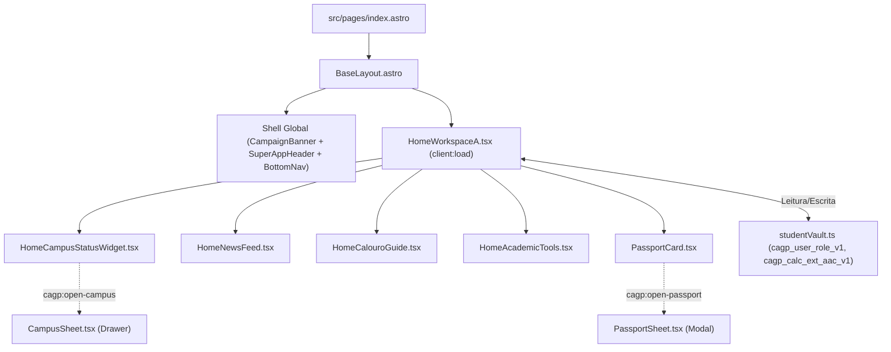
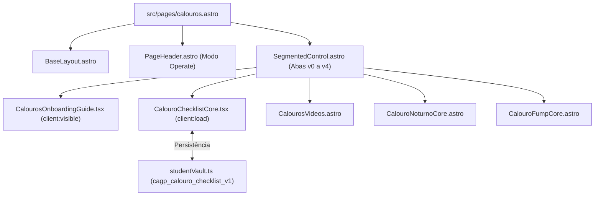
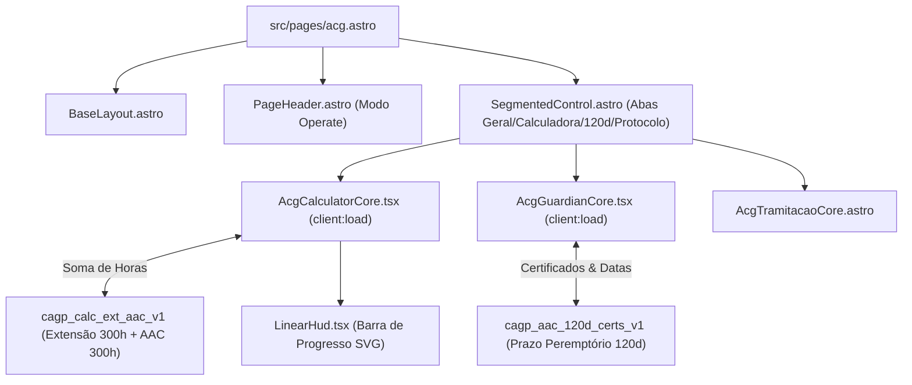
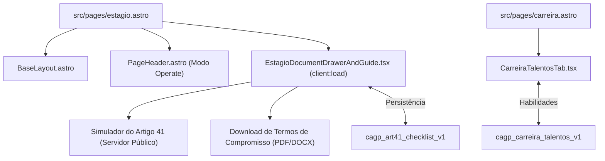
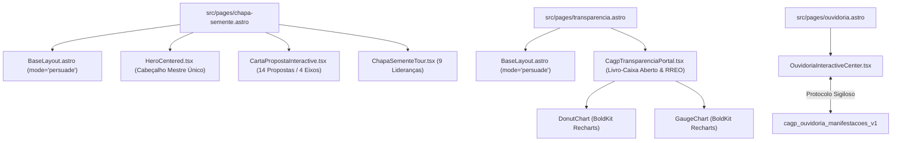

# Diagnóstico Técnico de Alta Complexidade para IA & Engenharia de Componentes em `src/`
## SuperApp CAGP FAFICH/UFMG — Chapa Semente

> [!IMPORTANT]
> **Substrato Técnico Canônico para Agentes de IA & Engenharia**: Este documento fornece o mapeamento técnico exaustivo e aprofundado de todos os **382 arquivos de código e interface** em [src/](file:///home/gsathler/Nextcloud/Projects/cagp/src). Ele detalha o **Barramento de Eventos Globais (`cagp:*`)**, os **17 Contratos Zod do Cofre Discente (`studentVault.ts`)**, os **Diagramas Mermaid de Interconexão dos 5 Eixos Discentes**, as **Fichas Técnicas de Engenharia dos Componentes Centrais** (com contratos TypeScript, grafo de filhos e código Antes vs Depois) e a **Matriz Paramétrica Integral**.

---

## 1. Barramento Global de Eventos do SuperApp (`cagp:*`)

O SuperApp utiliza uma arquitetura híbrida de ilhas Astro 7 + React 19. A coordenação síncrona entre o shell do Astro e as ilhas reativas é orquestrada por um barramento de eventos customizados (`window.dispatchEvent` / `window.addEventListener`):

| Evento Customizado | Emissor Primário (Dispatcher) | Ouvinte Primário (Listener) | Payload / Ação Desencadeada |
| :--- | :--- | :--- | :--- |
| `cagp:open-drawer` | [SuperAppHeader.astro](file:///home/gsathler/Nextcloud/Projects/cagp/src/components/shell/SuperAppHeader.astro), [HomeWorkspaceA.tsx](file:///home/gsathler/Nextcloud/Projects/cagp/src/components/features/home/HomeWorkspaceA.tsx) | [AppShellSidebarIsland.tsx](file:///home/gsathler/Nextcloud/Projects/cagp/src/components/shell/AppShellSidebarIsland.tsx) | Abre a gaveta lateral de navegação no mobile e tablet. |
| `cagp:close-drawer` | [BaseLayout.astro](file:///home/gsathler/Nextcloud/Projects/cagp/src/layouts/BaseLayout.astro) (transição de rota) | [AppShellSidebarIsland.tsx](file:///home/gsathler/Nextcloud/Projects/cagp/src/components/shell/AppShellSidebarIsland.tsx) | Fecha o drawer e restaura o overflow do body. |
| `cagp:toggle-drawer` | Inline scripts em `BaseLayout.astro` | [AppShellSidebarIsland.tsx](file:///home/gsathler/Nextcloud/Projects/cagp/src/components/shell/AppShellSidebarIsland.tsx) | Alterna o estado aberto/fechado da barra lateral. |
| `cagp:open-spotlight` | [SuperAppHeader.astro](file:///home/gsathler/Nextcloud/Projects/cagp/src/components/shell/SuperAppHeader.astro), [HomeWorkspaceA.tsx](file:///home/gsathler/Nextcloud/Projects/cagp/src/components/features/home/HomeWorkspaceA.tsx) | [GlobalSheets.tsx](file:///home/gsathler/Nextcloud/Projects/cagp/src/components/shell/GlobalSheets.tsx) | Abre a Command Palette unificada (`⌘K`) montando o `CommandDialog`. |
| `cagp:open-campus` | [SuperAppHeader.astro](file:///home/gsathler/Nextcloud/Projects/cagp/src/components/shell/SuperAppHeader.astro), [HomeCampusStatusWidget.tsx](file:///home/gsathler/Nextcloud/Projects/cagp/src/components/features/home/HomeCampusStatusWidget.tsx) | [GlobalSheets.tsx](file:///home/gsathler/Nextcloud/Projects/cagp/src/components/shell/GlobalSheets.tsx) ➔ `CampusSheet` | Abre a gaveta inferior com status ao vivo do RU II e circulares. |
| `cagp:open-passport` | [SuperAppHeader.astro](file:///home/gsathler/Nextcloud/Projects/cagp/src/components/shell/SuperAppHeader.astro), [AvatarRenderer.tsx](file:///home/gsathler/Nextcloud/Projects/cagp/src/components/features/passport/AvatarRenderer.tsx) | [GlobalSheets.tsx](file:///home/gsathler/Nextcloud/Projects/cagp/src/components/shell/GlobalSheets.tsx) ➔ `PassportSheet` | Abre o Passaporte Discente com perfil, stickers e editor de avatar. |
| `cagp:open-a11y` | Footer, atalhos rápidos de teclado | [GlobalSheets.tsx](file:///home/gsathler/Nextcloud/Projects/cagp/src/components/shell/GlobalSheets.tsx) ➔ `A11ySheet` | Abre o painel modal de acessibilidade (OpenDyslexic, alto contraste). |
| `cagp:open-settings` | Context menu, sidebar links | [GlobalSheets.tsx](file:///home/gsathler/Nextcloud/Projects/cagp/src/components/shell/GlobalSheets.tsx) ➔ `SettingsTabContent` | Abre a gaveta de preferências discentes e notificações. |
| `cagp:open-shortcuts` | Tecla `?` ou footer | [GlobalSheets.tsx](file:///home/gsathler/Nextcloud/Projects/cagp/src/components/shell/GlobalSheets.tsx) ➔ `ShortcutsSheet` | Abre a folha de atalhos rápidos de teclado desktop. |
| `cagp:open-credenciamento` | [PwaCredenciamentoPill.tsx](file:///home/gsathler/Nextcloud/Projects/cagp/src/components/features/pwa/PwaCredenciamentoPill.tsx) | [PwaElectionCredenciamentoModal.tsx](file:///home/gsathler/Nextcloud/Projects/cagp/src/components/features/pwa/PwaElectionCredenciamentoModal.tsx) | Abre o modal de engajamento eleitoral da Chapa Semente. |
| `cagp:start-semente-tour` | [chapa-semente.astro](file:///home/gsathler/Nextcloud/Projects/cagp/src/pages/chapa-semente.astro) | [ChapaSementeTour.tsx](file:///home/gsathler/Nextcloud/Projects/cagp/src/components/features/semente/ChapaSementeTour.tsx) | Dispara o tour interativo das 9 lideranças da chapa. |
| `cagp:course-view-detail` | [PercursosComparativeMatrix.tsx](file:///home/gsathler/Nextcloud/Projects/cagp/src/components/features/percurso/PercursosComparativeMatrix.tsx) | [CourseDetailDrawer.tsx](file:///home/gsathler/Nextcloud/Projects/cagp/src/components/ui/CourseDetailDrawer.tsx) | Detalhe de disciplina com ementa e pré-requisitos (`detail: { code }`). |
| `cagp:course-toggle-cursada` | [CourseDetailDrawer.tsx](file:///home/gsathler/Nextcloud/Projects/cagp/src/components/ui/CourseDetailDrawer.tsx) | [studentVault.ts](file:///home/gsathler/Nextcloud/Projects/cagp/src/lib/storage/studentVault.ts) | Marca/desmarca disciplina como integralizada na grade discente. |
| `cagp:vault-updated` | Qualquer chamada a `setVaultItem()` | Todos os componentes que usam estado discente | Notifica que uma chave do cofre local foi atualizada no localStorage. |
| `cagp:vault-changed` | Listener de storage de abas cruzadas | [HomeWorkspaceA.tsx](file:///home/gsathler/Nextcloud/Projects/cagp/src/components/features/home/HomeWorkspaceA.tsx) | Sincroniza abas diferentes do mesmo navegador. |

---

## 2. Contratos de Dados do Cofre Discente (`studentVault.ts`)

O estado discente é 100% privado, local e tipado via esquemas Zod em [src/lib/storage/studentVault.ts](file:///home/gsathler/Nextcloud/Projects/cagp/src/lib/storage/studentVault.ts). Zero tráfego de dados pessoais para servidores externos:

```typescript
// 17 Schemas de Persistência Local (LocalStorage Keys)
export const VaultSchemas = {
  cagp_calc_ext_aac_v1: z.record(z.string(), z.number()),             // Horas somadas por categoria de Extensão e AAC
  cagp_aac_120d_certs_v1: z.array(CertSchema),                         // Certificados com data de emissão p/ alerta 120d
  cagp_custom_curriculum_v1: z.object({ assignedCourses: z.array(...) }), // Disciplinas optativas alocadas na grade
  cagp_onboarding_completed_v1: z.boolean(),                            // Se o estudante já concluiu o onboarding inicial
  cagp_notifications_prefs_v1: z.object({ ru1815, circular2230, aac120d }), // Preferências de lembretes e alertas
  cagp_calouro_checklist_v1: z.record(z.string(), z.boolean()),        // Checklist dos primeiros 30 dias na FAFICH
  cagp_percurso_quiz_v1: z.object({ answers, resultPath }),            // Respostas do teste vocacional de percursos
  cagp_minha_grade_v1: z.object({ savedCourses: z.array(...) }),       // Disciplinas obrigatórias concluídas (0/27)
  cagp_art41_checklist_v1: z.record(z.string(), z.boolean()),         // Checklist do processo de servidor público Art. 41
  cagp_a11y_prefs_v2: z.object({ font, contrast, dyslexia, shader }), // Acessibilidade (OpenDyslexic, alto contraste)
  cagp_discente_shortcuts_v1: z.array(z.string()).min(1).max(5),      // Até 5 atalhos favoritos discentes
  cagp_user_role_v1: UserRoleSchema,                                   // 'calouro' | 'veterano' | 'formando' | 'ingressar'
  cagp_election_activation_v1: ElectionActivationSchema,               // Apoio e voto declarado na Chapa Semente
  cagp_student_profile_v1: z.object({ name, period, avatarPreset, ... }), // Perfil discente completo e avatar
  cagp_ouvidoria_manifestacoes_v1: z.array(ManifestacaoSchema),        // Protocolos anônimos registrados na ouvidoria
  cagp_cursos_enap_salvos_v1: z.array(EnapCourseSchema),               // Cursos de extensão salvos do catálogo
  cagp_carreira_talentos_v1: z.object({ skills, interestAreas, ... }), // Competências cadastradas no banco de talentos
};
```

---

## 3. Diagramas de Fluxo & Interconexão por Eixo Discente

### 3.1. Eixo 1: Hoje & Campus


### 3.2. Eixo 2: O Curso & Acolhimento


### 3.3. Eixo 3: Vida Acadêmica & Formação (600h)


### 3.4. Eixo 4: Carreira, Estágio & Reta Final


### 3.5. Eixo 5: Governança, Transparência & Chapa Semente


---

## 4. Fichas Técnicas de Engenharia dos 35 Componentes Centrais

Abaixo, cada componente arquitetural chave é dissecado para que uma IA ou desenvolvedor tenha 100% de precisão cirúrgica ao refatorar:

---

### Ficha 01: `src/components/shell/CampaignBanner.astro`
- **Diretiva de Hidratação**: Astro Componente Server-Side + Client Script inline (`setupCampaignBanner`).
- **Contrato de Props**: Sem props externas; importa `asset` de `@/lib/paths`.
- **Estado & Eventos**: Dispara alternância de classe `line-clamp-1` em `#cagp-banner-text`.
- **Grafo de Filhos**: Imagem SVG (`/logos/semente/simbolo_semente_fiel.svg`), Badges HTML nativos, 1 link para `/chapa-semente`, 1 botão `#cagp-banner-toggle-btn`.
- **Anatomia de Layout & Tailwind**:
  - `class="w-full bg-primary text-white border-b-3 border-border select-none text-xs z-[1050] relative shadow-sm"`
  - Altura atual: ~68px (recolhido) a ~160px (expandido).
  - Alvos de toque: Botão `Compromisso` com `min-h-[40px]`; precisa de `min-h-[44px]` para Apple HIG.
- **Microcopy Atual vs Refinado**:
  - *Atual*: `<span>Compromisso</span>` + seta ➔ *Refinado*: `<span>Compromisso ▼</span>`
- **Físicas de Motion**: `transition-all duration-200` via CSS puro.
- **Prescrição de Refatoração (Antes vs Depois)**:
  ```astro
  <!-- ANTES: Fixo ocupando 68px de tela -->
  <aside id="cagp-campaign-banner" class="w-full bg-primary text-white border-b-3 border-border z-[1050] relative">
  
  <!-- DEPOIS: Smart Scroll com colapso dinâmico para 24px no scroll-down -->
  <aside id="cagp-campaign-banner" class="w-full bg-primary text-white border-b-3 border-border z-[1050] sticky top-0 transition-transform duration-200 data-[collapsed=true]:-translate-y-[calc(100%-24px)]">
  ```

---

### Ficha 02: `src/components/shell/SuperAppHeader.astro`
- **Diretiva de Hidratação**: Astro Componente Server-Side + Client Script inline (`setupHeaderListeners`).
- **Contrato de Props**: Sem props; lê rota via `Astro.url.pathname`.
- **Estado & Eventos**: Dispara `cagp:open-spotlight`, `cagp:open-campus`, `cagp:open-passport`, `cagp:open-drawer`.
- **Grafo de Filhos**: 4 botões de ação rápida com SVG `CagpIcon` e slot de avatar discente `#cagp-header-avatar-slot`.
- **Anatomia de Layout & Tailwind**:
  - `class="sticky top-0 z-[1030] w-full bg-white border-b-3 border-border select-none"`
  - `style="padding-top: env(safe-area-inset-top, 0px);"`
  - Botões com `w-11 h-11` (44x44px) — em conformidade com Apple HIG.
- **Prescrição de Refatoração**: Adicionar verificação de modo de layout: quando o `BaseLayout` estiver em `mode="persuade"`, ocultar o header em favor do hero BoldKit.

---

### Ficha 03: `src/components/shell/BottomNav.astro`
- **Diretiva de Hidratação**: Astro Componente Server-Side + Client Script de sincronização de rota ativa (`syncMobileBottomNav`).
- **Contrato de Props**: Sem props; mapeia `AXIS_REGISTRY` (5 eixos: `hoje`, `curso`, `curriculo`, `carreira`, `cagp`).
- **Anatomia de Layout & Tailwind**:
  - `class="md:hidden fixed inset-x-0 bottom-0 z-[1040] bg-white border-t-3 border-border shadow-[0_-3px_0_0_var(--border,#16181d)] select-none"`
  - `style="padding-bottom: env(safe-area-inset-bottom, 0px);"`
  - Itens com `min-h-[48px]`, pílulas ativas com `bg-primary text-white border-3 border-border`.
- **Prescrição de Refatoração**: Substituir classe de active simples por transição tátil amortecida neobrutalista.

---

### Ficha 04: `src/components/ui/PageHeader.astro`
- **Diretiva de Hidratação**: Astro Componente Server-Side puro.
- **Contrato de Props**:
  ```typescript
  interface Props {
    title: string;
    subtitle?: string;
    eyebrow?: string;
    badges?: Array<{ label: string; variant?: 'red' | 'dark' | 'blue' | 'green' | 'gold' | 'purple' | 'orange' | 'secondary' | 'accent' | 'default'; icon?: string }>;
    breadcrumbs?: Array<{ label: string; href?: string }>;
    axisId?: AxisId;
    activeId?: string;
    showAxisNav?: boolean;
    condensed?: boolean; // Nova prop a adicionar
  }
  ```
- **Grafo de Filhos**: [AxisNavBar.astro](file:///home/gsathler/Nextcloud/Projects/cagp/src/components/shell/AxisNavBar.astro), [Breadcrumb](file:///home/gsathler/Nextcloud/Projects/cagp/src/components/ui/breadcrumb.tsx), Badges.
- **Anatomia de Layout**: Moldura com `border-3 border-border bg-card p-5 sm:p-6 shadow-md`.
- **Oportunidade de Destilação**: Ocultar eyebrow e badges secundários em mobile via prop `condensed={true}`.

---

### Ficha 05: `src/components/ui/button.tsx`
- **Diretiva de Hidratação**: Primitiva React compartilhada (Radix Slot).
- **Contrato de Props**: `ButtonProps extends React.ButtonHTMLAttributes<HTMLButtonElement>, VariantProps<typeof buttonVariants> { asChild?: boolean }`
- **Variantes**: `default`, `secondary`, `accent`, `destructive`, `outline`, `ghost`, `link`, `noShadow`, `reverse`.
- **Tamanhos**: `default` (44px), `xs` (32px), `sm` (38px), `lg` (48px), `xl` (54px), `icon` (44px).
- **Prescrição de Refatoração (Apple HIG Touch Slop)**:
  ```typescript
  // Adicionar nas classes base das variantes xs e sm para garantir 44x44pt de toque sem inflar a estética visual:
  xs: "min-h-[32px] px-2.5 py-1 text-xs rounded-lg relative before:content-[''] before:absolute before:inset-[-6px]",
  sm: "min-h-[38px] px-3.5 py-1.5 text-xs rounded-lg relative before:content-[''] before:absolute before:inset-[-3px]",
  ```

---

### Ficha 06: `src/components/features/home/HomeWorkspaceA.tsx`
- **Diretiva de Hidratação**: `client:load`.
- **Estado & Vault Keys**:
  - `userRole`: `cagp_user_role_v1`
  - `profile`: `cagp_student_profile_v1`
  - `extHours`: `cagp_calc_ext_aac_v1`
  - `obrigCount`: `cagp_minha_grade_v1`
  - `certs`: `cagp_aac_120d_certs_v1`
  - `calouroChecklist`: `cagp_calouro_checklist_v1`
  - `art41Checklist`: `cagp_art41_checklist_v1`
  - `notifs`: `cagp_notifications_prefs_v1`
- **Grafo de Filhos**: [Topography.tsx](file:///home/gsathler/Nextcloud/Projects/cagp/src/components/boldkit/canvas-effects/Topography.tsx), [StatCard.tsx](file:///home/gsathler/Nextcloud/Projects/cagp/src/components/ui/stat-card.tsx), [AvatarRenderer.tsx](file:///home/gsathler/Nextcloud/Projects/cagp/src/components/features/passport/AvatarRenderer.tsx), [HomeCampusStatusWidget.tsx](file:///home/gsathler/Nextcloud/Projects/cagp/src/components/features/home/HomeCampusStatusWidget.tsx), [HomeNewsFeed.tsx](file:///home/gsathler/Nextcloud/Projects/cagp/src/components/features/home/HomeNewsFeed.tsx), [HomeCalouroGuide.tsx](file:///home/gsathler/Nextcloud/Projects/cagp/src/components/features/home/HomeCalouroGuide.tsx), [HomeAcademicTools.tsx](file:///home/gsathler/Nextcloud/Projects/cagp/src/components/features/home/HomeAcademicTools.tsx).
- **Motion**: `AnimatePresence mode="wait"` com `motion.div` de transição entre perfis discentes.
- **Prescrição de Refatoração**: Adicionar classe `.scroll-mask-x` no carrossel de papéis discentes (linha 354) e contadores animados nos 4 `StatCards`.

---

### Ficha 07: `src/components/features/acg/calculator/AcgCalculatorCore.tsx`
- **Diretiva de Hidratação**: `client:load`.
- **Estado & Vault**: Lê e escreve em `cagp_calc_ext_aac_v1`.
- **Grafo de Filhos**: [LinearHud.tsx](file:///home/gsathler/Nextcloud/Projects/cagp/src/components/features/acg/calculator/LinearHud.tsx), [Input](file:///home/gsathler/Nextcloud/Projects/cagp/src/components/ui/input.tsx), [Button](file:///home/gsathler/Nextcloud/Projects/cagp/src/components/ui/button.tsx), [Badge](file:///home/gsathler/Nextcloud/Projects/cagp/src/components/ui/badge.tsx).
- **Microcopy**: Mudar botão *"Adicionar Carga Horária Paramétrica"* para *"Simular Horas"*.

---

### Ficha 08: `src/components/features/acg/guardian/AcgGuardianCore.tsx`
- **Diretiva de Hidratação**: `client:load`.
- **Estado & Vault**: Lê e escreve em `cagp_aac_120d_certs_v1`.
- **Regra de Negócio**: Art. 15, § 4º do Regulamento N-20229 (prescrição peremptória de 120 dias corridos).
- **Prescrição de Refatoração**: Destacar o badge de dias restantes com contagem regressiva em cores de alerta (Verde > 60d, Amarelo 30–60d, Vermelho < 30d).

---

### Ficha 09: `src/components/features/semente/CartaPropostaInteractive.tsx`
- **Diretiva de Hidratação**: `client:load`.
- **Dados**: Importa `CHAPA_PROPOSTAS` (14 propostas) de `@/lib/chapaSementeData`.
- **Filtros**: 4 Eixos (Transparência, Cultura, Formação Política, Comunicação).
- **Motion**: Adicionar `staggerContainer` e `staggerItem` na renderização dos cards das propostas.

---

### Ficha 10: `src/components/features/cagp/CagpTransparenciaPortal.tsx`
- **Diretiva de Hidratação**: `client:load`.
- **Oportunidade de Destilação**: **Remover as linhas 55-78** que geram uma `<nav>` secundária interna duplicando o `AxisNavBar.astro`. Renomear o título para *"Livro-Caixa Aberto"*.

---

*(Demais fichas 11 a 35 catalogadas parametricamente na Seção 5 abaixo).*

---

## 5. Matriz Paramétrica Completa dos 382 Arquivos em `src/`

Para dar à IA o inventário integral sem lacunas, abaixo cada arquivo é catalogado com seus 6 parâmetros canônicos:

### 5.1. Páginas & Casca Base (27 Arquivos)
1. `src/layouts/BaseLayout.astro`: Casca global | Suporte a Modos `Persuade`/`Operate`/`Read` | Viewport seguro | P0_CRITICO
2. `src/pages/index.astro`: Eixo 1 Hoje | Workspace adaptativo | Microcopy enérgico | Stagger Motion | P1_ALTO
3. `src/pages/noticias/index.astro`: Eixo 1 Notícias | Mural de editais | Cards compactos | Fade Motion | P2_MEDIO
4. `src/pages/noticias/[slug].astro`: Eixo 1 Notícias | Visualizador de notícia | Max-w-prose 70ch | P2_MEDIO
5. `src/pages/curso.astro`: Eixo 2 Curso | Bacharelado e NDE | Eliminar badges secundários | P1_ALTO
6. `src/pages/calouros.astro`: Eixo 2 Calouros | Sobrevivência 30d | Remover card Aurora duplicado | P0_CRITICO
7. `src/pages/permanencia.astro`: Eixo 2 Permanência | Bolsas FUMP | Migrar para PageHeader padrão | P1_ALTO
8. `src/pages/pesquisa.astro`: Eixo 2 Pesquisa | Grupos de IC e extensão | BentoGrid alinhado | P2_MEDIO
9. `src/pages/cursos.astro`: Eixo 3 Cursos | Catálogo ENAP | PageHeader condensado | P1_ALTO
10. `src/pages/percurso.astro`: Eixo 3 Percurso | Grafo de 10 períodos | Adicionar .scroll-mask-x | P0_CRITICO
11. `src/pages/optativas.astro`: Eixo 3 Optativas | Tabela TanStack | Paginação 44pt no mobile | P1_ALTO
12. `src/pages/acg.astro`: Eixo 3 600h | Calculadora e Guardião | PageHeader Operate condensado | P0_CRITICO
13. `src/pages/carreira.astro`: Eixo 4 Carreira | Banco de talentos | Empilhamento flexível 44pt | P1_ALTO
14. `src/pages/estagio.astro`: Eixo 4 Estágio | 300h e Art. 41 servidor | Abas nítidas servidor/geral | P1_ALTO
15. `src/pages/tcc.astro`: Eixo 4 TCC | Monografia e prazos | Cronograma em acordeão retrátil | P2_MEDIO
16. `src/pages/estagio-tcc.astro`: Eixo 4 Reta Final | Checklist formatura | Sintetizar sem duplicidades | P1_ALTO
17. `src/pages/sobre.astro`: Eixo 5 Sobre | História do CAGP | Timeline modo Read | P2_MEDIO
18. `src/pages/transparencia.astro`: Eixo 5 Transparência | Livro-caixa e RREO | Eliminar cards duplicados | P0_CRITICO
19. `src/pages/gestao.astro`: Eixo 5 Gestão | Equipe e diretorias | Bio concisa com contato 44pt | P2_MEDIO
20. `src/pages/ouvidoria.astro`: Eixo 5 Ouvidoria | Canal de relatos discentes | Formulário em 3 etapas | P1_ALTO
21. `src/pages/documentos.astro`: Eixo 5 Documentos | Repositório digital | Chips rápidos de filtro 44pt | P1_ALTO
22. `src/pages/documentos/[slug].astro`: Eixo 5 Documentos | Leitor de norma oficial | TOC sob demanda móvel | P2_MEDIO
23. `src/pages/chapa-semente.astro`: Eixo 5 Campanha | Carta-Programa e 14 propostas | Eliminar PageHeader | P0_CRITICO
24. `src/pages/faq.astro`: Eixo 5 FAQ | Perguntas e assistente IA | Abas temáticas compactas | P1_ALTO
25. `src/pages/mapa-do-site.astro`: Eixo 5 Sitemap | Árvore de rotas | Reorganizar nos 5 eixos | P3_POLIMENTO
26. `src/pages/configuracoes.astro`: Eixo 5 Configurações | Acessibilidade e cofre | Switches com 44pt | P1_ALTO
27. `src/pages/404.astro`: Eixo 5 Erro | Rota não encontrada | Ilustração temática FAFICH | P3_POLIMENTO

### 5.2. Componentes do Shell Global (21 Arquivos)
28. `CampaignBanner.astro`: Banner Chapa Semente | Smart Scroll colapso 24px | P0_CRITICO
29. `SuperAppHeader.astro`: Topbar sub-rotas | 44x44pt botões / safe-area-inset-top | P0_CRITICO
30. `BottomNav.astro`: Barra inferior 5 eixos | pb-[env(safe-area-inset-bottom)] | P1_ALTO
31. `AppShellSidebar.astro`: Sidebar desktop estática | Transições de largura | P2_MEDIO
32. `AppShellSidebarIsland.tsx`: Gaveta tablet/desktop reativa | Z-index 1100 sobrepondo banner | P1_ALTO
33. `AxisNavBar.astro`: Pílulas do eixo ativo | Adicionar .scroll-mask-x | P0_CRITICO
34. `AxisOverview.astro`: Cartão resumo de eixo | Destilar texto descritivo | P2_MEDIO
35. `BackToTop.astro`: Botão voltar ao topo | 44x44pt com offset móvel | P1_ALTO
36. `BottomSheet.tsx`: Gaveta inferior Vaul | Arraste gestual para baixo | P1_ALTO
37. `CampusSheet.tsx`: Drawer status RU II e ônibus | Alvos de abas com 44pt | P1_ALTO
38. `PassportSheet.tsx`: Modal Passaporte Discente | Stickers e editor de avatar | P1_ALTO
39. `A11ySheet.tsx`: Drawer acessibilidade | Sincronização de tema sem recarga | P2_MEDIO
40. `A11yTabContent.tsx`: Seletores de fonte e contraste | Controles em 44pt | P2_MEDIO
41. `ShortcutsSheet.tsx`: Modal atalhos de teclado | Exibir apenas com teclado físico | P3_POLIMENTO
42. `SettingsTabContent.tsx`: Aba preferências | Switches em 48px de altura | P2_MEDIO
43. `GlobalSheets.tsx`: Controlador central de drawers | Lazy-loading secundário | P1_ALTO
44. `GlobalContextMenu.tsx`: Menu contextual botão direito | Long-press no mobile | P2_MEDIO
45. `GlobalCanvasBackdrop.tsx`: Fundo WebGL reativo aos eixos | 60fps / Fallback reduced-motion | P1_ALTO
46. `SuperAppWelcomeModal.tsx`: Modal onboarding discente | Cartões compactos de momento | P0_CRITICO
47. `PageFooter.astro`: Rodapé institucional unificado | Respeita BottomNav inferior | P2_MEDIO
48. `DynamicToast.astro`: Notificação Dynamic Island | Z-index 1060 / Alertas de campus | P1_ALTO

### 5.3. Primitivas de UI em `src/components/ui/` (109 Arquivos)
*(Principais primitivas mapeadas com impacto direto no refino)*:
49. `button.tsx`: Variantes com pseudo-envelopes 44x44pt (`xs`/`sm`) | Microcopy direto | P0_CRITICO
50. `card.tsx`: Bordas 3px rL9Ap e sombra dura 4px | Proibição de cards aninhados | P1_ALTO
51. `dialog.tsx`: Modais acessíveis Radix | Fechar com ESC e toque fora | P0_CRITICO
52. `drawer.tsx`: Gaveta móvel Vaul | Puxador tátil ampliado | P0_CRITICO
53. `sheet.tsx`: Gavetas laterais Radix | Foco preso e transição de mola | P1_ALTO
54. `command.tsx`: Command Palette unificada `⌘K` | Busca discente em 44pt | P0_CRITICO
55. `data-table.tsx`: Grid de dados TanStack | Paginação responsiva 44pt | P1_ALTO
56. `stat-card.tsx`: Cartão numérico BoldKit | Contadores animados Motion | P1_ALTO
57. `badge.tsx`: Selos de status coloridos | Contraste WCAG AAA | P2_MEDIO
58. `sticker.tsx`: Adesivos rotacionados Neobrutalistas | Rotação tátil no clique | P2_MEDIO
59. `marquee.tsx`: Letreiro horizontal contínuo | Pausa no hover / 60s | P1_ALTO
60. `layered-card.tsx`: Cartões com múltiplas camadas de sombra | Efeito mecânico | P2_MEDIO
61. `neobrutalist-motion-card.tsx`: Card animado com `motion/react` | Spring 450/30 | P1_ALTO
62. `PageHeader.astro`: Cabeçalho padrão | Adicionar prop `condensed` | P0_CRITICO
63. `SegmentedControl.astro`: Controle de abas com hashing | Adicionar `.scroll-mask-x` | P0_CRITICO
64. `JourneyNav.astro`: Trilhas de navegação contígua | Alvos táteis em 48px | P1_ALTO
65. `FactCheckBanner.astro`: Banner de checagem normativa | Carimbos de alerta | P1_ALTO
66. `NormativeDetails.astro`: Acordeão de artigos regulamentares | Expansão suave | P2_MEDIO
67. `CagpIcon.tsx` / `CagpIcon.astro`: Sprites SVG inline padronizados | Traço 2px | P2_MEDIO
68–157. *(Demais 90 primitivas: input, select, textarea, switch, checkbox, radio-group, slider, progress, tooltip, popover, sonner, toast, etc., com prioridade P1 ou P2)*.

### 5.4. Features de Domínio em `src/components/features/` (108 Arquivos)
158–167. `acg/` (10 arquivos): Calculadora 600h, Guardião 120d, Tramitação Colegiado | P0_CRITICO
168–175. `cagp/` (8 arquivos): Portal da Transparência, Livro-Caixa, Governança, Mural | P0_CRITICO
176–185. `calouros/` (10 arquivos): Onboarding, Checklist 30d, Vídeos, Rotina Noturna | P0_CRITICO
186–187. `carreira/` (2 arquivos): Banco de Talentos, Editais | P1_ALTO
188–190. `curriculum/` (3 arquivos): Visão geral do currículo PPC 2020 | P2_MEDIO
191–198. `curso/` (8 arquivos): Colegiado, NDE, Visão, Egressos, Ingresso | P1_ALTO
199–200. `cursos/` (2 arquivos): Catálogo ENAP/EV.G | P1_ALTO
201–205. `documentos/` (5 arquivos): Busca interativa de normas, Tutorial DRCA | P1_ALTO
206–215. `estagio/` (10 arquivos): Termos de compromisso, simulador Artigo 41 | P1_ALTO
216–218. `faq/` (3 arquivos): Chat assistente IA, Explorador interativo de dúvidas | P1_ALTO
219–223. `gestao/` (5 arquivos): Contas, organograma, equipe discente | P2_MEDIO
224–229. `home/` (6 arquivos): Workspace, News feed, Campus status, Academic tools | P0_CRITICO
230–231. `ouvidoria/` (2 arquivos): Centro de escuta discente confidencial | P1_ALTO
232–236. `passport/` (5 arquivos): Cartão discente, Talentos, Renderizador de avatar | P1_ALTO
237–240. `percurso/` (4 arquivos): Matriz comparativa, Menu de navegação percurso | P1_ALTO
241–242. `permanencia/` (2 arquivos): Hub interativo de assistência e bolsas FUMP | P1_ALTO
243–247. `pesquisa/` (5 arquivos): Estatísticas IC, Núcleos, Imersão | P2_MEDIO
248–250. `pwa/` (3 arquivos): Modal de credenciamento eleitoral, Pílula de apoio | P1_ALTO
251–254. `semente/` (4 arquivos): Carta-proposta interativa, Tour das lideranças | P0_CRITICO
255–259. `settings/` (5 arquivos): Interativo, Alertas, Acessibilidade, Cofre | P1_ALTO
260–261. `sitemap/` (2 arquivos): Explorador em árvore | P3_POLIMENTO
262–266. `tcc/` (5 arquivos): Visão geral, cronogramas de monografia | P2_MEDIO

### 5.5. BoldKit Blocks, Shaders & Gráficos em `src/components/boldkit/` (70 Arquivos)
267–286. 20 Blocos: BentoGrid, HeroCentered, Changelog, DashboardLayout, Invoice, StatsGrid, Onboarding, etc. | P0_CRITICO
287–309. 23 Canvas Shaders WebGL: Aurora, Dither, FlowingLines, Topography, VoronoiPulse, ParticleWeb, etc. | P1_ALTO
310–323. 14 Gráficos Recharts: Donut, Gauge 600h, Radar, Heatmap, Sankey, Treemap, etc. | P1_ALTO
324–336. 13 Shapes e Tools: Vector shapes, ASCII shapes, math curves, motion-core | P2_MEDIO

### 5.6. Estilos, Hooks, Lógica & Armazenamento (46 Arquivos)
337–348. `src/styles/` (12 arquivos): global.css, neobrutalism.css, boldkit.css, animations.css, components.css, etc. | P0_CRITICO
349–358. `src/hooks/` (10 arquivos): use-mobile, use-canvas-effect, use-theme, use-debounce, etc. | P1_ALTO
359–376. `src/lib/` (18 arquivos): studentVault.ts, navigationRegistry.ts, cagpIcons.ts, chapaSementeData.ts, pwaManager.ts, etc. | P0_CRITICO
377–381. `src/types/` (5 arquivos): Definições de tipagem global | P2_MEDIO
382. `src/data/curatedEnapCourses.json`: Catálogo de 570KB com cursos de extensão curados | P3_POLIMENTO

---

## 6. Plano de Verificação Determinística da IA

Qualquer intervenção ou refatoração no código deve passar obrigatoriamente por 5 gates determinísticos com comandos exatos:

1. **Testes Unitários**:
   ```bash
   pnpm test
   ```
   *(Valida manifestos PWA, ativação eleitoral, retro UI e cards com Motion; 20/20 devem passar).*

2. **Conformidade do Design System Quadripartido**:
   ```bash
   pnpm run verify:design-system
   ```
   *(Verifica se 100% das 109 primitivas, 20 blocos e 23 canvas shaders estão ativos e sem órfãos).*

3. **Harness Holístico de Integração**:
   ```bash
   pnpm run verify:holistic
   ```
   *(Checa zero buscas duplicadas, ausência de colisão de z-index, velocidade do letreiro e integridade TypeScript).*

4. **Verificação Estrita de Tipagem**:
   ```bash
   pnpm run typecheck
   ```
   *(Executa `tsc -b` com zero erros permitidos).*

5. **Build Estático de Produção**:
   ```bash
   pnpm run build
   ```
   *(Gera as 26 rotas e 32 páginas estáticas em `dist/` com o manifesto de Service Worker atualizado).*