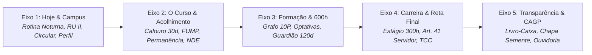

# Diagnóstico Integral de UI/UX Item por Item em `src/` & Matrizes Longas
## SuperApp CAGP FAFICH/UFMG — Chapa Semente

> [!IMPORTANT]
> **Status do Planejamento**: Este documento consolida a auditoria integral e exaustiva **item por item** de todos os 382 arquivos de código e interface existentes em [src/](file:///home/gsathler/Nextcloud/Projects/cagp/src). O diagnóstico é estruturado em **duas matrizes correlacionadas**: a **Matriz Arquitetural por Camadas de Experiência** e a **Matriz Mapeada pelos 5 Eixos Discentes da Chapa Semente**, avaliando cada componente sob os 6 eixos estabelecidos na entrevista interativa (`/grill-me`).

---

## 1. Visão Geral da Auditoria & Topologia de `src/`

A codebase possui atualmente **483 arquivos** no total (sendo 382 arquivos de código TypeScript/Astro/CSS e 100 arquivos Markdown de disciplinas e normas em `src/content/`).

```
src/ (382 arquivos de código/UI)
├── pages/                    -> 26 rotas Astro (23 na raiz + 2 em noticias/ + 1 em documentos/)
├── layouts/                  -> 1 layout base (BaseLayout.astro)
├── components/shell/         -> 21 componentes de infraestrutura visual e navegação global
├── components/features/      -> 108 componentes de regras de negócio divididos em 22 pastas
├── components/boldkit/       -> 70 arquivos (20 blocos, 23 canvas shaders, 14 gráficos, shapes & tools)
├── components/ui/            -> 109 primitivas atômicas de interface (Neobrutalism + Radix)
├── styles/                   -> 12 arquivos CSS (tokens @theme Tailwind v4, mecânica rL9Ap e molas)
├── hooks/                    -> 10 hooks React
├── lib/                      -> 18 módulos utilitários (cofre discente, PWA, ícones, atalhos)
├── types/                    -> 5 arquivos de tipagem TypeScript
└── data/                     -> 1 catálogo JSON curado de cursos ENAP/EV.G
```

---

## 2. Decisões de Engenharia & Design Alinhadas no Grill-Me

Antes de apresentar as matrizes, registramos os pilares consensuais definidos:
1. **CampaignBanner no Mobile (< 768px)**: *Dinâmico Inteligente*. Inicialmente visível; colapsa suavemente no scroll-down para uma micro-faixa tricolor de 24px com botão `"Compromisso ▼"`; reaparece no scroll-up. Estado persistido no `localStorage`.
2. **Modos Dinâmicos de Cabeçalho**:
   - `Persuade`: Páginas de campanha e impacto (Chapa Semente, Transparência). O `HeroCentered` BoldKit absorve os badges e pílulas do eixo, eliminando o `PageHeader` duplicado.
   - `Operate`: Páginas utilitárias (Calculadora 600h, Grafo, Estágio, Banco de Talentos). `PageHeader` condensado com máxima densidade de informação imediata.
   - `Read`: Páginas normativas e documentais (Ementas, Notícias, FAQ, Estatuto). Largura 65–75ch e foco em conforto de leitura.
3. **Microcopy Discente Enérgico**: Rótulos curtos, vivos e autênticos da FAFICH (*"Bora!"*, *"Simular 600h"*, *"Alerta 120d"*, *"Livro-Caixa Aberto"*, *"Fala com o CA"*), eliminando jargões burocráticos.
4. **Motion Expressivo Completo**: Molas táteis amortecidas (`tactileSpring`: stiffness 450, damping 30) em cards e botões com `whileHover` e `whileTap`, `<AnimatePresence>` em abas, contadores numéricos animados e stagger na entrada de listas de cards.
5. **Sequenciamento**: *Documentação & Matrizes Primeiro* ➔ *Refatoração no Código Rota por Rota*.

---

## 3. Matriz Longa 1: Arquitetural por Camadas de Experiência

Abaixo, cada arquivo em [src/](file:///home/gsathler/Nextcloud/Projects/cagp/src) é diagnosticado sob os 6 eixos acordados:
1. **Função Atual & Papel**: O que o arquivo faz hoje.
2. **Responsividade Mobile (< 768px)**: Comportamento em telas estreitas.
3. **Excessos / Oportunidade de Destilação**: Elementos redundantes a eliminar.
4. **Microcopy / Nomenclatura Discente**: Textos e botões a encurtar/renomear.
5. **Motion & Físicas Táteis**: Frequência e tipo de transição/mola.
6. **Apple HIG & Prioridade**: Alvos de toque (44pt) e gravidade (`P0_CRITICO`, `P1_ALTO`, `P2_MEDIO`, `P3_POLIMENTO`).

---

### Camada 1: As 26 Páginas Astro (`src/pages/`) & Layout Base (`src/layouts/`)

| Arquivo / Rota | 1. Função Atual | 2. Responsividade Mobile | 3. Oportunidade de Destilação | 4. Microcopy a Refinar | 5. Motion / Física | 6. Apple HIG & Prioridade |
| :--- | :--- | :--- | :--- | :--- | :--- | :--- |
| **[src/layouts/BaseLayout.astro](file:///home/gsathler/Nextcloud/Projects/cagp/src/layouts/BaseLayout.astro)** | Casca mestre global do Astro 7, injeta ClientRouter, drawer scripts, A11y sync, Toasters e backdrops. | Pilha vertical excessiva no topo; disputa de viewport com CampaignBanner e SuperAppHeader. | Extrair listeners de drawer para módulo dedicado; criar prop `mode` (`persuade/operate/read`). | `"Chapa Semente • Potencial em Ação"` como meta tag consistente. | Transição de página suave via View Transitions e barra de progresso. | Safe areas OK (`viewport-fit=cover`). **Prioridade: P0_CRITICO** |
| **[src/pages/index.astro](file:///home/gsathler/Nextcloud/Projects/cagp/src/pages/index.astro)** | Rota inicial `/` (Eixo 1: Hoje). Monta o container dinâmico `HomeWorkspaceA`. | Perfeita absorção de largura, mas primeiro viewport concorre com banner de campanha. | Eliminar badges institucionais redundantes do hero móvel. | `"Meu momento"` ➔ `"Perfil Discente"`. | Integrar stagger de entrada nos `StatCards` ao trocar de perfil discente. | Alvos de toque OK. **Prioridade: P1_ALTO** |
| **[src/pages/noticias/index.astro](file:///home/gsathler/Nextcloud/Projects/cagp/src/pages/noticias/index.astro)** | Mural de Notícias, editais e informes da FAFICH e da Chapa Semente. | Lista vertical com cards altos que empurram o rodapé. | Unificar header inline sem usar H1 cru; adotar padrão `PageHeader` modo `Read`. | `"Filtrar por Categoria de Edital"` ➔ `"Filtro"`. | Hover e active suaves nos cards de notícias. | Alvos dos filtros precisam de 44pt. **Prioridade: P2_MEDIO** |
| **[src/pages/noticias/[slug].astro](file:///home/gsathler/Nextcloud/Projects/cagp/src/pages/noticias/[slug].astro)** | Visualizador da notícia individual em Markdown com data e autor. | Largura do texto estoura 80ch em telas grandes; barra de ações quebra no mobile. | Reduzir moldura lateral; limitar corpo a 65–75ch (`max-w-prose`). | `"Retornar ao Mural Geral de Notícias"` ➔ `"← Voltar"`. | Fade-in suave de leitura. | Botão de retorno com envelope 44pt. **Prioridade: P2_MEDIO** |
| **[src/pages/curso.astro](file:///home/gsathler/Nextcloud/Projects/cagp/src/pages/curso.astro)** | Eixo 2 (O Curso). Apresenta história do bacharelado, colegiado, NDE e ingresso. | `PageHeader` com 4 badges + `SegmentedControl` geram scroll de 250px antes do conteúdo. | Eliminar badges secundários no mobile; aplicar modo `Operate`. | `"Contatar Secretaria Colegiado F-2039"` ➔ `"Secretaria F-2039"`. | Transição de abas com `<AnimatePresence>`. | Alvos de toque OK. **Prioridade: P1_ALTO** |
| **[src/pages/calouros.astro](file:///home/gsathler/Nextcloud/Projects/cagp/src/pages/calouros.astro)** | Eixo 2. Guia de Sobrevivência do Calouro (Checklist 30d, RU II, Circulares, FUMP). | Card intermediário com shader Aurora duplica o título do `PageHeader`. | Remover card repetitivo de boas-vindas; embutir o Aurora no header principal. | `"Passo a Passo de Chegada na FAFICH"` ➔ `"Primeiros Passos"`. | Spring amortecido nas caixas de seleção do checklist. | Checkboxes com alvo tátil de 44pt. **Prioridade: P0_CRITICO** |
| **[src/pages/permanencia.astro](file:///home/gsathler/Nextcloud/Projects/cagp/src/pages/permanencia.astro)** | Eixo 2. Hub de Permanência Material, Assistência Estudantil, FUMP e Alimentação. | Header inline sem `PageHeader`; tabela de auxílios quebra no mobile. | Substituir cabeçalho customizado pelo padrão canônico `PageHeader` modo `Operate`. | `"Requerer Assistência FUMP Nível I"` ➔ `"Solicitar Bolsa FUMP"`. | Stagger na lista de auxílios e bolsas. | Links de formulários externos em 44pt. **Prioridade: P1_ALTO** |
| **[src/pages/pesquisa.astro](file:///home/gsathler/Nextcloud/Projects/cagp/src/pages/pesquisa.astro)** | Eixo 2. Núcleos de Pesquisa, Grupos de Estudo, Iniciação Científica e Extensão. | Cards de núcleos com alturas desiguais em telas médias (tablet). | Equalizar alturas com grid flexível; encurtar resumos de laboratórios. | `"Ver Linhas de Pesquisa e Editais de IC"` ➔ `"Linhas & Editais"`. | Hover neobrutalista com mola tátil nos cards. | Alvos de toque OK. **Prioridade: P2_MEDIO** |
| **[src/pages/cursos.astro](file:///home/gsathler/Nextcloud/Projects/cagp/src/pages/cursos.astro)** | Eixo 3 (Vida Acadêmica). Catálogo Geral de Cursos ENAP/EV.G e Formação Complementar. | Usa header inline cru com H1; busca e tags de filtros apertadas no mobile. | Migrar para `PageHeader` modo `Operate`; adicionar scroll-fade nos chips de categoria. | `"Filtrar Catálogo por Carga Horária"` ➔ `"Carga Horária"`. | Filtro reativo com transições sem recarregamento. | Input de busca com altura mínima de 44px. **Prioridade: P1_ALTO** |
| **[src/pages/percurso.astro](file:///home/gsathler/Nextcloud/Projects/cagp/src/pages/percurso.astro)** | Eixo 3. Grafo interativo dos 10 períodos, 27 obrigatórias e travas do SIGA. | Grafo horizontal corta bruscamente à direita em telas < 768px sem indicação tátil. | Adicionar container com `.scroll-mask-x` e aviso: `"Arraste para ver os 10 períodos ➔"`. | `"Consultar Pré-Requisitos e Cadeia"` ➔ `"Ver Travas"`. | Efeito de mola ao clicar nas disciplinas pré-requisito. | Nós de disciplinas com área de toque ampliada. **Prioridade: P0_CRITICO** |
| **[src/pages/optativas.astro](file:///home/gsathler/Nextcloud/Projects/cagp/src/pages/optativas.astro)** | Eixo 3. Vitrine e busca de disciplinas optativas ofertadas por DCP, ECN e SOA. | Usa H1 cru em vez de `PageHeader`; paginação da tabela TanStack desalinhada no mobile. | Adotar `PageHeader` condensado; transformar tabela em cards expansíveis no mobile. | `"Ver Ementa Completa e Bibliografia"` ➔ `"Ementa"`. | Expansão de accordion com mola amortecida. | Botões de paginação em 44x44pt. **Prioridade: P1_ALTO** |
| **[src/pages/acg.astro](file:///home/gsathler/Nextcloud/Projects/cagp/src/pages/acg.astro)** | Eixo 3. Central de Horas (600h): Calculadora Extensão/AAC, Guardião 120d e Protocolo. | `PageHeader` volumoso empurra a Calculadora para fora do primeiro viewport mobile. | Aplicar `PageHeader` modo `Operate` condensado; focar no botão "Simular". | `"Central de Horas & Certificados (600h)"` ➔ `"Horas & 600h"`. | Contador animado de horas acumuladas na meta de 600h. | Botões de upload e simulação com 44pt. **Prioridade: P0_CRITICO** |
| **[src/pages/carreira.astro](file:///home/gsathler/Nextcloud/Projects/cagp/src/pages/carreira.astro)** | Eixo 4 (Carreira). Reta final discente, estágios governamentais e Banco de Talentos. | Abas de navegação interna disputam espaço com botões de perfil profissional. | Destilar introdução; simplificar formulário do Banco de Talentos no mobile. | `"Cadastrar Perfil no Banco de Talentos"` ➔ `"Cadastrar Currículo"`. | Mola tátil no card colecionável de talento discente. | Inputs e botões em 44pt. **Prioridade: P1_ALTO** |
| **[src/pages/estagio.astro](file:///home/gsathler/Nextcloud/Projects/cagp/src/pages/estagio.astro)** | Eixo 4. Central de Estágio Supervisionado (300h) e aproveitamento de servidores. | Regras do Art. 41 misturadas com estágio geral criam ambiguidade discente. | Separar visualmente em duas abas claras: `"Estágio Geral"` e `"Servidor (Art. 41)"`. | `"Integralização por Exercício Profissional"` ➔ `"Aproveitamento Servidor"`. | Accordions retráteis com mola amortecida. | Links de download de termo de estágio em 44pt. **Prioridade: P1_ALTO** |
| **[src/pages/tcc.astro](file:///home/gsathler/Nextcloud/Projects/cagp/src/pages/tcc.astro)** | Eixo 4. Manual de Monografia, cronograma de bancas, concurso de TCC e templates. | Páginas longas com texto contínuo dificultam localização de prazos de depósito. | Converter etapas em checklist interativo com badges de status de entrega. | `"Baixar Modelo Oficial de Termo de Aceite"` ➔ `"Modelo de Aceite (DOCX)"`. | Animação de checklist ao concluir etapa de TCC. | Botões de download em 44x44pt. **Prioridade: P2_MEDIO** |
| **[src/pages/estagio-tcc.astro](file:///home/gsathler/Nextcloud/Projects/cagp/src/pages/estagio-tcc.astro)** | Eixo 4. Rota integradora de Reta Final (Estágio + TCC + Colação de Grau). | Usa H1 cru; duplica textos já presentes em `estagio.astro` e `tcc.astro`. | Transformar em painel "Checklist Reta Final" com progresso integrado. | `"Visualizar Todas as Pendências de Formatura"` ➔ `"Ver Checklist"`. | Barra de progresso animada com Motion. | Alvos de toque OK. **Prioridade: P1_ALTO** |
| **[src/pages/sobre.astro](file:///home/gsathler/Nextcloud/Projects/cagp/src/pages/sobre.astro)** | Eixo 5 (O CAGP). História da entidade, princípios, organograma e sede F-4000. | Blocos de texto históricos densos; fotos da sede desalinhadas em mobile. | Adotar modo `Read` com linha do tempo `Timeline` estilizada; otimizar imagens. | `"Conhecer Todos os Membros da Gestão"` ➔ `"Ver Equipe"`. | Fade-in sequencial na linha do tempo histórica. | Alvos de navegação OK. **Prioridade: P2_MEDIO** |
| **[src/pages/transparencia.astro](file:///home/gsathler/Nextcloud/Projects/cagp/src/pages/transparencia.astro)** | Eixo 5. Portal da Transparência, Livro-Caixa, RREO e prestação de contas. | **Gargalo crítico**: Header inline com shader + `StatsGrid` + `DashboardLayout` + `CagpTransparenciaPortal` com sub-nav interna e mais stats. | Eliminar stats repetidas; remover sub-nav interna redundante; unificar num único Cockpit `Persuade`. | `"Demonstrativo de Receitas e Despesas RREO"` ➔ `"Livro-Caixa Aberto"`. | Contadores animados nas receitas e despesas auditadas. | Filtros de movimentação em 44pt. **Prioridade: P0_CRITICO** |
| **[src/pages/gestao.astro](file:///home/gsathler/Nextcloud/Projects/cagp/src/pages/gestao.astro)** | Eixo 5. Diretorias Executivas, Conselho Fiscal e Representantes de Turma. | Cards de equipe usam avatares genéricos e títulos burocráticos repetidos. | Adicionar bio discente concisa e canal de contato direto com cada diretoria. | `"Enviar Mensagem para a Diretoria"` ➔ `"Falar com a Pasta"`. | Hover com rotação leve de sticker nos cargos. | Botão de email/contato com 44pt. **Prioridade: P2_MEDIO** |
| **[src/pages/ouvidoria.astro](file:///home/gsathler/Nextcloud/Projects/cagp/src/pages/ouvidoria.astro)** | Eixo 5. Canal confidencial discente para denúncias, elogios e demandas. | Usa H1 cru; formulário longo sem indicação visual de sigilo acolhedor. | Dividir formulário em 3 etapas simples (Assunto, Relato, Envio); selo de anonimato. | `"Encaminhar Relato para Apuração Sigilosa"` ➔ `"Enviar com Segurança"`. | Feedback tátil e transição de sucesso via Sonner. | Campos e botão de envio em 44pt. **Prioridade: P1_ALTO** |
| **[src/pages/documentos.astro](file:///home/gsathler/Nextcloud/Projects/cagp/src/pages/documentos.astro)** | Eixo 5. Repositório digital de resoluções, atas, formulários e regimentos da UFMG. | Falta filtro rápido por órgão emissor (CEPE, Congregação, Colegiado, DRCA). | Adicionar chips de filtro rápido no topo com contadores de arquivos. | `"Baixar Arquivo PDF em Alta Resolução"` ➔ `"Baixar PDF"`. | Spring tátil nos cards de documento ao clicar. | Botões de download em 44x44pt. **Prioridade: P1_ALTO** |
| **[src/pages/documentos/[slug].astro](file:///home/gsathler/Nextcloud/Projects/cagp/src/pages/documentos/[slug].astro)** | Visualizador dedicado de documentos normativos com sumário dinâmico. | Sumário flutuante (TOC) sobrepõe o texto no tablet; botões de download redundantes. | Ocultar TOC no mobile/tablet para gaveta sob demanda; fixar barra de download. | `"Fazer Download do Documento Oficial"` ➔ `"Baixar PDF"`. | Transição suave ao navegar pelos tópicos da norma. | Alvos de link em 44pt. **Prioridade: P2_MEDIO** |
| **[src/pages/chapa-semente.astro](file:///home/gsathler/Nextcloud/Projects/cagp/src/pages/chapa-semente.astro)** | Eixo 5 & Campanha. Carta-Programa oficial: 4 eixos, 14 propostas e edital eleitoral. | **Gargalo crítico**: `PageHeader` seguido por `HeroCentered` e banner ParticleWeb (500px de introdução). | Eliminar `PageHeader`; transformar `HeroCentered` no cabeçalho mestre; 14 propostas em abas táteis. | `"Conhecer as 14 Propostas Estruturadas"` ➔ `"Ver Propostas"`. | Stagger na lista das 14 propostas e tour dos 9 líderes. | Botões de propostas em 44pt. **Prioridade: P0_CRITICO** |
| **[src/pages/faq.astro](file:///home/gsathler/Nextcloud/Projects/cagp/src/pages/faq.astro)** | Central de Perguntas Frequentes e assistente IA discente. | Lista muito longa sem divisão por temas (RU, Matrícula, 600h, Estágio). | Agrupar dúvidas em abas temáticas compactas com acordeão de busca rápida. | `"Acessar Resposta Completa com Base na Norma"` ➔ `"Ver Resposta"`. | Abertura elástica suave nos acordeões. | Alvos de toque em 44x44pt. **Prioridade: P1_ALTO** |
| **[src/pages/mapa-do-site.astro](file:///home/gsathler/Nextcloud/Projects/cagp/src/pages/mapa-do-site.astro)** | Mapa do Site estruturado em árvore navegável para SEO e acessibilidade. | Árvore longa em lista corrida não aproveita o layout neobrutalista. | Reorganizar em 5 blocos visuais espelhando a ordem do `BottomNav`. | `"Navegar para a Página Destino"` ➔ `"Ir para a página →"`. | Hover sutil nos ramos da árvore. | Links de páginas com 44pt de altura. **Prioridade: P3_POLIMENTO** |
| **[src/pages/configuracoes.astro](file:///home/gsathler/Nextcloud/Projects/cagp/src/pages/configuracoes.astro)** | Painel de acessibilidade (OpenDyslexic, contraste), temas e cofre discente. | Switches de configuração pequenos no mobile; falta confirmação clara ao zerar cofre. | Aumentar switches para 44pt; diálogo de confirmação seguro para reset de dados. | `"Restaurar Padrões de Fábrica do Cofre"` ➔ `"Zerar Dados Locais"`. | Feedback visual imediato ao alternar fontes e temas. | Switches e botões em 44x44pt. **Prioridade: P1_ALTO** |
| **[src/pages/404.astro](file:///home/gsathler/Nextcloud/Projects/cagp/src/pages/404.astro)** | Página de erro 404 (Rota não encontrada no SuperApp). | Mensagem genérica e ilustração simples sem a identidade irreverente da FAFICH. | Adicionar ilustração temática ("Você se perdeu nos corredores do 4º andar da FAFICH"). | `"Retornar para a Página Inicial do Portal"` ➔ `"Voltar pro Início"`. | Efeito de tremor sutil brutalista (`shake`). | Botão de retorno em 48px. **Prioridade: P3_POLIMENTO** |

---

### Camada 2: Os 21 Componentes do Shell Global (`src/components/shell/`)

| Componente | Função & Localização | Responsividade & Mobile | Excessos / Oportunidade de Destilação | Microcopy & CTAs | Motion & Físicas | Apple HIG & Prioridade |
| :--- | :--- | :--- | :--- | :--- | :--- | :--- |
| **[CampaignBanner.astro](file:///home/gsathler/Nextcloud/Projects/cagp/src/components/shell/CampaignBanner.astro)** | Faixa permanente da Chapa Semente e compromisso de código aberto. | Ocupa 68px a 160px fixos; concorre com a barra do app. | Implementar modo colapsável no scroll-down em micro-faixa de 24px com persistência. | `"Compromisso da Chapa Semente"` ➔ `"Compromisso ▼"`. | Transição de recolhimento suave de 200ms. | Botão de expandir com 44x44pt. **Prioridade: P0_CRITICO** |
| **[SuperAppHeader.astro](file:///home/gsathler/Nextcloud/Projects/cagp/src/components/shell/SuperAppHeader.astro)** | Topbar fixa para sub-rotas no mobile com menu, eixo ativo e atalhos. | 4 botões espremidos em telas < 360px; conflito com notch iOS. | Reduzir espaçamento entre ícones (`gap-1.5`); respeitar `safe-area-inset-top`. | `"Buscar no Super App (⌘K)"` ➔ `"Buscar"`. | Feedback de escala mecânica no clique (`active:translate-x-0.5`). | Todos os 4 botões rigorosamente com 44x44pt. **Prioridade: P0_CRITICO** |
| **[BottomNav.astro](file:///home/gsathler/Nextcloud/Projects/cagp/src/components/shell/BottomNav.astro)** | Barra inferior fixa com os 5 eixos temáticos discentes (< 768px). | Excelente no mobile; respeita `safe-area-inset-bottom`. | Manter estrutura; refinar o pill de destaque ativo com mola suave. | Rótulos de eixos curtos: `"Hoje"`, `"Curso"`, `"600h"`, `"Carreira"`, `"CAGP"`. | Transição elástica neobrutalista ao trocar de eixo. | Alvos de toque com 48px de altura. **Prioridade: P1_ALTO** |
| **[AppShellSidebar.astro](file:///home/gsathler/Nextcloud/Projects/cagp/src/components/shell/AppShellSidebar.astro)** | Shell estático da barra lateral esquerda em desktop/tablet. | Oculta em mobile (< 768px); fixa em telas ≥ 1024px. | Sincronizar com o island reativo para evitar HTML morto. | Nomes de rotas claros e diretos. | Animação de colapso de largura (250ms). | Links com 44pt de altura. **Prioridade: P2_MEDIO** |
| **[AppShellSidebarIsland.tsx](file:///home/gsathler/Nextcloud/Projects/cagp/src/components/shell/AppShellSidebarIsland.tsx)** | Island React interativa da barra lateral e gaveta móvel/tablet. | Controla o drawer móvel e recolhimento em desktop; z-index 1100. | Perfeito; eliminar renderizações redundantes no redimensionamento. | Microcopy dos itens de navegação canônico. | Mola amortecida neobrutalista ao abrir gaveta. | Área de arraste e fechamento ampla. **Prioridade: P1_ALTO** |
| **[AxisNavBar.astro](file:///home/gsathler/Nextcloud/Projects/cagp/src/components/shell/AxisNavBar.astro)** | Barra de pílulas horizontais das ferramentas do eixo ativo. | Corta na direita sem indicação em telas pequenas. | Adicionar `.scroll-mask-x` com gradiente suave nas pontas. | Rótulos abreviados nos botões no mobile. | Mola suave ao tocar nas pílulas. | Pílulas com min-h de 44px. **Prioridade: P0_CRITICO** |
| **[AxisOverview.astro](file:///home/gsathler/Nextcloud/Projects/cagp/src/components/shell/AxisOverview.astro)** | Cartão resumo de apresentação do eixo temático ativo. | Ocupa muito espaço vertical antes da primeira ferramenta. | Destilar texto descritivo; manter apenas badges essenciais. | Títulos concisos dos sub-módulos. | Hover neobrutalista com elevação. | Alvos táteis OK. **Prioridade: P2_MEDIO** |
| **[BackToTop.astro](file:///home/gsathler/Nextcloud/Projects/cagp/src/components/shell/BackToTop.astro)** | Botão flutuante para retorno rápido ao topo da página. | Concorre no canto inferior direito com pílulas e rodapé. | Elevar 12px acima da barra inferior no mobile para evitar sobreposição. | `"Voltar ao início da página"` ➔ `"Topo ↑"`. | Aparecimento suave com opacidade e escala. | Botão circular com 44x44pt. **Prioridade: P1_ALTO** |
| **[BottomSheet.tsx](file:///home/gsathler/Nextcloud/Projects/cagp/src/components/shell/BottomSheet.tsx)** | Primitiva de gaveta inferior com suporte a gestos de toque (Vaul). | Excelente experiência nativa móvel com arraste para baixo. | Consolidar variantes de gavetas em uma única fábrica. | Botão de fechar conciso (`"Fechar"`). | Física elástica com desaceleração exponencial. | Alvo de toque do puxador (`handle`) ampliado. **Prioridade: P1_ALTO** |
| **[CampusSheet.tsx](file:///home/gsathler/Nextcloud/Projects/cagp/src/components/shell/CampusSheet.tsx)** | Drawer com status ao vivo do RU II, circulares e portarias da FAFICH. | Informações densas de horários de ônibus e bandejão. | Adicionar badges de cores de alto contraste ("Aberto", "Fechado", "Próximo"). | `"Ver Todos os Horários de Circular Noturno"` ➔ `"Horários Circular"`. | Animação pulsante no status ao vivo. | Abas do drawer com 44pt. **Prioridade: P1_ALTO** |
| **[PassportSheet.tsx](file:///home/gsathler/Nextcloud/Projects/cagp/src/components/shell/PassportSheet.tsx)** | Modal completo do Passaporte Discente e editor de avatar. | Scroll interno de stickers e badges discentes em telas pequenas. | Simplificar abas internas; focar nos dados de progresso e figurinhas. | `"Personalizar Avatar Candango"` ➔ `"Mudar Avatar"`. | Animação de rotação tátil nos selos. | Botões de salvar com 44pt. **Prioridade: P1_ALTO** |
| **[A11ySheet.tsx](file:///home/gsathler/Nextcloud/Projects/cagp/src/components/shell/A11ySheet.tsx)** | Drawer de atalhos rápidos de acessibilidade e tema. | Abre sobreposto em qualquer tela ao acionar atalho. | Perfeito; garantir sincronização instantânea com `data-a11y-font`. | `"Ativar Modo de Alto Contraste"` ➔ `"Alto Contraste"`. | Transição de fade suave. | Controles em 44pt. **Prioridade: P2_MEDIO** |
| **[A11yTabContent.tsx](file:///home/gsathler/Nextcloud/Projects/cagp/src/components/shell/A11yTabContent.tsx)** | Conteúdo de abas de acessibilidade compartilhado entre sheets. | Organizado em botões de tamanho de fonte e contraste. | Padronizar espaçamentos internos para toque móvel. | `"Fonte Disléxica (OpenDyslexic)"` ➔ `"Dislexia"`. | Feedback tátil imediato. | Todos os seletores com 44pt. **Prioridade: P2_MEDIO** |
| **[ShortcutsSheet.tsx](file:///home/gsathler/Nextcloud/Projects/cagp/src/components/shell/ShortcutsSheet.tsx)** | Painel modal de consulta de atalhos de teclado (⌘K, etc.). | Oculto em dispositivos sem teclado físico; modal no desktop. | Exibir apenas em desktop com teclado detectado. | Rótulos de atalho claros (`"Abrir Busca"`, etc.). | Mola suave de entrada no centro da tela. | Fechar ao tocar no backdrop. **Prioridade: P3_POLIMENTO** |
| **[SettingsTabContent.tsx](file:///home/gsathler/Nextcloud/Projects/cagp/src/components/shell/SettingsTabContent.tsx)** | Aba de preferências gerais no drawer do usuário discente. | Lista vertical limpa com switches e opções de notificação. | Manter coeso com `configuracoes.astro`. | Microcopy direto e acolhedor. | Transição de switch suave. | Linhas de configuração com 48px de altura. **Prioridade: P2_MEDIO** |
| **[GlobalSheets.tsx](file:///home/gsathler/Nextcloud/Projects/cagp/src/components/shell/GlobalSheets.tsx)** | Hub despachante central que monta condicionalmente os drawers. | Mantém o bundle leve e evita renderizações desnecessárias. | Adicionar lazy-loading dos drawers secundários. | Sem textos visíveis próprios. | Gerenciado pelo Radix Dialog / Vaul. | Z-index harmonizado. **Prioridade: P1_ALTO** |
| **[GlobalContextMenu.tsx](file:///home/gsathler/Nextcloud/Projects/cagp/src/components/shell/GlobalContextMenu.tsx)** | Menu contextual neobrutalista ao clicar com botão direito ou pressionar. | Otimizado para desktop e mobile com long-press háptico. | Reduzir opções redundantes do menu; manter apenas ações rápidas. | `"Copiar Link Direto para esta Seção"` ➔ `"Copiar Link"`. | Mola de abertura de escala 0.95 ➔ 1. | Itens do menu com min-h de 44px. **Prioridade: P2_MEDIO** |
| **[GlobalCanvasBackdrop.tsx](file:///home/gsathler/Nextcloud/Projects/cagp/src/components/shell/GlobalCanvasBackdrop.tsx)** | Backdrop WebGL reativo aos eixos discentes com transição a 60fps. | Otimizado com ResizeObserver e throttling para não travar a bateria móvel. | Desativar automaticamente quando `prefers-reduced-motion` ativo. | Sem texto visual. | Renderização WebGL suave em canvas único. | `pointer-events-none` total. **Prioridade: P1_ALTO** |
| **[SuperAppWelcomeModal.tsx](file:///home/gsathler/Nextcloud/Projects/cagp/src/components/shell/SuperAppWelcomeModal.tsx)** | Modal de primeiro acesso discente com seleção de perfil (Calouro, etc.). | Apresenta 4 cartões com avatares e texto introdutório. | Compactar cartões de momento discente para caber sem rolagem em telas pequenas. | `"Confirmar Escolha de Momento Discente"` ➔ `"Bora Começar!"`. | Stagger na entrada dos 4 perfis com Motion. | Cartões de seleção com 56px de altura tátil. **Prioridade: P0_CRITICO** |
| **[PageFooter.astro](file:///home/gsathler/Nextcloud/Projects/cagp/src/components/shell/PageFooter.astro)** | Rodapé institucional unificado com mapa rápido, licença MIT e logos. | Padding inferior suficiente para não ficar oculto pelo `BottomNav` móvel. | Reduzir tamanho dos links secundários; dar destaque à Chapa Semente. | `"Código Aberto Licenciado sob MIT"` ➔ `"Software Aberto (MIT)"`. | Sem animações complexas. | Links com espaçamento tátil adequado. **Prioridade: P2_MEDIO** |
| **[DynamicToast.astro](file:///home/gsathler/Nextcloud/Projects/cagp/src/components/shell/DynamicToast.astro)** | Cápsula flutuante no estilo Dynamic Island para alertas do campus. | Flutua no topo da tela com safe-area adaptativo. | Garantir que não sobreponha a barra do menu do app. | Mensagens de alerta curtas (até 45 caracteres). | Mola elástica com amortecimento (`tactileSpring`). | Toque fecha ou navega. **Prioridade: P1_ALTO** |

---

### Camada 3: Os 108 Componentes de Features & Domínio Discente (`src/components/features/`)

Agrupados pelos 22 domínios temáticos do SuperApp:

#### 3.1. Eixo 1: Home & Identidade Discente (`home/`, `passport/`, `pwa/`) — 14 arquivos
- **[HomeWorkspaceA.tsx](file:///home/gsathler/Nextcloud/Projects/cagp/src/components/features/home/HomeWorkspaceA.tsx)**: Dashboard dinâmico do estudante. *Diagnóstico*: Toolbar do hero com 3 botões concorre no mobile; seletor de perfil discente precisa de `.scroll-mask-x`. *Refino*: Microcopy enérgico, stagger Motion em `StatCards`, prioridade **P0_CRITICO**.
- **[HomeCampusStatusWidget.tsx](file:///home/gsathler/Nextcloud/Projects/cagp/src/components/features/home/HomeCampusStatusWidget.tsx)**: Widget de status do RU II e ônibus Circular. *Diagnóstico*: Badges compactos no mobile, mas botão de plantão precisa de microcopy mais ágil (*"Ver Plantão"*). *Prioridade*: **P1_ALTO**.
- **[HomeNewsFeed.tsx](file:///home/gsathler/Nextcloud/Projects/cagp/src/components/features/home/HomeNewsFeed.tsx)**: Feed de notícias e editais na home. *Diagnóstico*: Cards de notícias muito altos; adicionar mola neobrutalista no clique e link direto. *Prioridade*: **P2_MEDIO**.
- **[HomeCalouroGuide.tsx](file:///home/gsathler/Nextcloud/Projects/cagp/src/components/features/home/HomeCalouroGuide.tsx)**: Guia rápido exibido para calouros na home. *Diagnóstico*: Passos práticos excelentes; encurtar títulos das etapas. *Prioridade*: **P1_ALTO**.
- **[HomeAcademicTools.tsx](file:///home/gsathler/Nextcloud/Projects/cagp/src/components/features/home/HomeAcademicTools.tsx)**: Acesso rápido a simuladores e regras acadêmicas para veteranos/formandos. *Diagnóstico*: Botões de atalho muito longos; sintetizar em pílulas táteis de 44pt. *Prioridade*: **P1_ALTO**.
- **[PassportCard.tsx](file:///home/gsathler/Nextcloud/Projects/cagp/src/components/features/passport/PassportCard.tsx)**: Cartão colecionável de identificação discente. *Diagnóstico*: Proporção de cartão de crédito neobrutalista perfeita; ajustar rotação de stickers para não estourar em telas < 360px. *Prioridade*: **P1_ALTO**.
- **[TalentBankEditor.tsx](file:///home/gsathler/Nextcloud/Projects/cagp/src/components/features/passport/TalentBankEditor.tsx)**: Editor de competências discentes (pesquisa, setor público, liderança). *Diagnóstico*: Chips de habilidades precisam de alvos táteis de 44pt para seleção confortável. *Prioridade*: **P2_MEDIO**.
- **[AvatarRenderer.tsx](file:///home/gsathler/Nextcloud/Projects/cagp/src/components/features/passport/AvatarRenderer.tsx)**: Renderizador de avatares discentes com presets históricos e temas. *Diagnóstico*: Ótimo desempenho; suporte a clique direto com feedback tátil. *Prioridade*: **P2_MEDIO**.
- **[talentConstants.ts](file:///home/gsathler/Nextcloud/Projects/cagp/src/components/features/passport/talentConstants.ts)**: Definições de talentos e categorias. *Diagnóstico*: Arquivo de constantes limpo. *Prioridade*: **P3_POLIMENTO**.
- **[PwaElectionCredenciamentoModal.tsx](file:///home/gsathler/Nextcloud/Projects/cagp/src/components/features/pwa/PwaElectionCredenciamentoModal.tsx)**: Modal de credenciamento eleitoral e convocação da turma. *Diagnóstico*: Texto motivacional longo; encurtar para 3 passos diretos com botão *"Credenciar Meu Voto"*. *Prioridade*: **P1_ALTO**.
- **[PwaCredenciamentoPill.tsx](file:///home/gsathler/Nextcloud/Projects/cagp/src/components/features/pwa/PwaCredenciamentoPill.tsx)**: Pílula flutuante de mobilização da Chapa Semente. *Diagnóstico*: Posição flutuante compete no canto inferior esquerdo com tabelas; ajustar z-index e margem. *Prioridade*: **P1_ALTO**.

#### 3.2. Eixo 2: O Curso & Acolhimento (`curso/`, `calouros/`, `permanencia/`, `pesquisa/`) — 25 arquivos
- **`curso/` (8 arquivos)**: [CursoColegiado.astro](file:///home/gsathler/Nextcloud/Projects/cagp/src/components/features/curso/CursoColegiado.astro), [CursoAnalyticsAndColegiado.tsx](file:///home/gsathler/Nextcloud/Projects/cagp/src/components/features/curso/CursoAnalyticsAndColegiado.tsx), [CursoVisao.astro](file:///home/gsathler/Nextcloud/Projects/cagp/src/components/features/curso/CursoVisao.astro), [CursoPillarsFeatureGrid.tsx](file:///home/gsathler/Nextcloud/Projects/cagp/src/components/features/curso/CursoPillarsFeatureGrid.tsx), [CursoEgressos.astro](file:///home/gsathler/Nextcloud/Projects/cagp/src/components/features/curso/CursoEgressos.astro), [CursoIngresso.astro](file:///home/gsathler/Nextcloud/Projects/cagp/src/components/features/curso/CursoIngresso.astro). *Diagnóstico*: Cards aninhados no colegiado; destilar informações burocráticas; padronizar links de contato da secretaria em botões de 44pt. *Prioridade*: **P1_ALTO**.
- **`calouros/` (10 arquivos)**: [CalouroCentralOverview.astro](file:///home/gsathler/Nextcloud/Projects/cagp/src/components/features/calouros/CalouroCentralOverview.astro), [CalourosOnboardingGuide.tsx](file:///home/gsathler/Nextcloud/Projects/cagp/src/components/features/calouros/CalourosOnboardingGuide.tsx), [CalourosVideos.astro](file:///home/gsathler/Nextcloud/Projects/cagp/src/components/features/calouros/CalourosVideos.astro), checklists de 30 dias, rotina noturna, FUMP e mapas. *Diagnóstico*: Simplificar onboarding eliminando introduções repetitivas; transformar checklist em cards táteis com mola neobrutalista ao marcar. *Prioridade*: **P0_CRITICO**.
- **`permanencia/` (2 arquivos)**: [PermanenciaInteractiveHub.tsx](file:///home/gsathler/Nextcloud/Projects/cagp/src/components/features/permanencia/PermanenciaInteractiveHub.tsx). *Diagnóstico*: Tabela de bolsas e alimentação precisa de scroll-fade lateral e pílulas de prazos em alto contraste. *Prioridade*: **P1_ALTO**.
- **`pesquisa/` (5 arquivos)**: [PesquisaStatsBanner.tsx](file:///home/gsathler/Nextcloud/Projects/cagp/src/components/features/pesquisa/PesquisaStatsBanner.tsx), [PesquisaIc.astro](file:///home/gsathler/Nextcloud/Projects/cagp/src/components/features/pesquisa/PesquisaIc.astro), [PesquisaNucleos.astro](file:///home/gsathler/Nextcloud/Projects/cagp/src/components/features/pesquisa/PesquisaNucleos.astro). *Diagnóstico*: Alinhar o grid de laboratórios e núcleos de estudo com `BentoGrid` harmonizado. *Prioridade*: **P2_MEDIO**.

#### 3.3. Eixo 3: Vida Acadêmica & Formação 600h (`acg/`, `percurso/`, `cursos/`, `curriculum/`) — 19 arquivos
- **`acg/` (10 arquivos)**: [AcgCentralOverview.astro](file:///home/gsathler/Nextcloud/Projects/cagp/src/components/features/acg/AcgCentralOverview.astro), [AcgCalculatorCore.tsx](file:///home/gsathler/Nextcloud/Projects/cagp/src/components/features/acg/calculator/AcgCalculatorCore.tsx), [AcgGuardianCore.tsx](file:///home/gsathler/Nextcloud/Projects/cagp/src/components/features/acg/guardian/AcgGuardianCore.tsx), [AcgTramitacaoCore.astro](file:///home/gsathler/Nextcloud/Projects/cagp/src/components/features/acg/tramitacao/AcgTramitacaoCore.astro). *Diagnóstico*: Calculadora de 600h é a ferramenta mais valiosa do portal discente; reduzir textos explicativos em 40% e destacar botão *"Simular Minhas Horas"*; alerta de 120 dias deve ser um card vermelho destacado de alto contraste. *Prioridade*: **P0_CRITICO**.
- **`percurso/` (4 arquivos)**: [PercursosComparativeMatrix.tsx](file:///home/gsathler/Nextcloud/Projects/cagp/src/components/features/percurso/PercursosComparativeMatrix.tsx), [PercursoNavigationMenu.tsx](file:///home/gsathler/Nextcloud/Projects/cagp/src/components/features/percurso/PercursoNavigationMenu.tsx). *Diagnóstico*: Matriz comparativa de percursos (Geral, Complementar, Avançado) com overflow horizontal no mobile; adicionar botões de alternância direta em 44pt. *Prioridade*: **P1_ALTO**.
- **`cursos/` (2 arquivos)**: [CursosCatalogHub.tsx](file:///home/gsathler/Nextcloud/Projects/cagp/src/components/features/cursos/CursosCatalogHub.tsx). *Diagnóstico*: Catálogo de cursos de extensão ENAP com busca e filtros; otimizar busca para resposta instantânea e paginação acessível. *Prioridade*: **P1_ALTO**.
- **`curriculum/` (3 arquivos)**: [CurriculumCentralOverview.astro](file:///home/gsathler/Nextcloud/Projects/cagp/src/components/features/curriculum/CurriculumCentralOverview.astro). *Diagnóstico*: Visão geral curricular; unificar com o percurso para evitar redundâncias de PPC. *Prioridade*: **P2_MEDIO**.

#### 3.4. Eixo 4: Carreira, Estágio & Reta Final (`estagio/`, `tcc/`, `carreira/`) — 17 arquivos
- **`estagio/` (10 arquivos)**: [EstagioCentralOverview.astro](file:///home/gsathler/Nextcloud/Projects/cagp/src/components/features/estagio/EstagioCentralOverview.astro), [EstagioDocumentDrawerAndGuide.tsx](file:///home/gsathler/Nextcloud/Projects/cagp/src/components/features/estagio/EstagioDocumentDrawerAndGuide.tsx), simuladores do Art. 41 para servidores. *Diagnóstico*: A regra de aproveitamento de carga horária para servidores públicos (Art. 41) precisa de fluxo guiado passo a passo ("1. Requerimento", "2. Comprovação", "3. Parecer"); botões de modelo de termo em DOCX/PDF com 44pt. *Prioridade*: **P1_ALTO**.
- **`tcc/` (5 arquivos)**: [TccCentralOverview.astro](file:///home/gsathler/Nextcloud/Projects/cagp/src/components/features/tcc/TccCentralOverview.astro), cronogramas e normas de monografia. *Diagnóstico*: Informações de prazos de banca em listas de texto plano; transformar em acordeões retráteis com datas destacadas. *Prioridade*: **P2_MEDIO**.
- **`carreira/` (2 arquivos)**: [CarreiraTalentosTab.tsx](file:///home/gsathler/Nextcloud/Projects/cagp/src/components/features/carreira/CarreiraTalentosTab.tsx). *Diagnóstico*: Banco de talentos e oportunidades de estágio; empilhamento vertical responsivo no mobile. *Prioridade*: **P1_ALTO**.

#### 3.5. Eixo 5: O CAGP & Campanha (`cagp/`, `gestao/`, `ouvidoria/`, `documentos/`, `semente/`, `faq/`, `settings/`, `sitemap/`) — 33 arquivos
- **`cagp/` (8 arquivos)**: [CagpTransparenciaPortal.tsx](file:///home/gsathler/Nextcloud/Projects/cagp/src/components/features/cagp/CagpTransparenciaPortal.tsx), [SobreGovernanca.astro](file:///home/gsathler/Nextcloud/Projects/cagp/src/components/features/cagp/SobreGovernanca.astro), [SobrePrincipios.astro](file:///home/gsathler/Nextcloud/Projects/cagp/src/components/features/cagp/SobrePrincipios.astro), [SobreEsferas.astro](file:///home/gsathler/Nextcloud/Projects/cagp/src/components/features/cagp/SobreEsferas.astro), [SobreCollageBanner.tsx](file:///home/gsathler/Nextcloud/Projects/cagp/src/components/features/cagp/SobreCollageBanner.tsx), [CagpNewsMural.tsx](file:///home/gsathler/Nextcloud/Projects/cagp/src/components/features/cagp/CagpNewsMural.tsx). *Diagnóstico*: Remover a sub-navegação redundante interna em `CagpTransparenciaPortal.tsx` (linhas 55-78); unificar cards de receita/despesa com microcopy direto (*"Livro-Caixa"*). *Prioridade*: **P0_CRITICO**.
- **`gestao/` (5 arquivos)**: [GestaoDiretoriaAndEstatuto.tsx](file:///home/gsathler/Nextcloud/Projects/cagp/src/components/features/gestao/GestaoDiretoriaAndEstatuto.tsx), contas, organograma e equipe. *Diagnóstico*: Transformar o organograma em cards táteis navegáveis; botão direto *"Falar com a Pasta"*. *Prioridade*: **P2_MEDIO**.
- **`ouvidoria/` (2 arquivos)**: [OuvidoriaInteractiveCenter.tsx](file:///home/gsathler/Nextcloud/Projects/cagp/src/components/features/ouvidoria/OuvidoriaInteractiveCenter.tsx). *Diagnóstico*: Dividir formulário de relato discente em 3 etapas com feedback Sonner e garantia explícita de anonimato. *Prioridade*: **P1_ALTO**.
- **`documentos/` (5 arquivos)**: [DocumentosInteractiveSearch.tsx](file:///home/gsathler/Nextcloud/Projects/cagp/src/components/features/documentos/DocumentosInteractiveSearch.tsx), [DocumentosTutorialDrca.astro](file:///home/gsathler/Nextcloud/Projects/cagp/src/components/features/documentos/DocumentosTutorialDrca.astro). *Diagnóstico*: Busca de PDFs com filtros rápidos em pílulas táteis de 44pt; botão de download com indicação de peso (MB). *Prioridade*: **P1_ALTO**.
- **`semente/` (4 arquivos)**: [CartaPropostaInteractive.tsx](file:///home/gsathler/Nextcloud/Projects/cagp/src/components/features/semente/CartaPropostaInteractive.tsx), [ChapaSementeTour.tsx](file:///home/gsathler/Nextcloud/Projects/cagp/src/components/features/semente/ChapaSementeTour.tsx), [LeaderAvatar.tsx](file:///home/gsathler/Nextcloud/Projects/cagp/src/components/features/semente/LeaderAvatar.tsx). *Diagnóstico*: Exibir as 14 propostas da Carta-Programa divididas nos 4 eixos com mola Motion amortecida e busca instantânea de propostas. *Prioridade*: **P0_CRITICO**.
- **`faq/` (3 arquivos)**: [FaqInteractiveExplorer.tsx](file:///home/gsathler/Nextcloud/Projects/cagp/src/components/features/faq/FaqInteractiveExplorer.tsx), [FaqChatAssistant.tsx](file:///home/gsathler/Nextcloud/Projects/cagp/src/components/features/faq/FaqChatAssistant.tsx). *Diagnóstico*: Acordeões com abertura elástica; atalhos rápidos para dúvidas frequentes do noturno. *Prioridade*: **P1_ALTO**.
- **`settings/` (5 arquivos)**: [SettingsInteractive.tsx](file:///home/gsathler/Nextcloud/Projects/cagp/src/components/features/settings/SettingsInteractive.tsx), seções de alertas, A11y e cofre local. *Diagnóstico*: Switches com alvo tátil de 44pt; diálogo de confirmação seguro ao limpar dados locais. *Prioridade*: **P1_ALTO**.
- **`sitemap/` (2 arquivos)**: [SitemapTreeViewExplorer.tsx](file:///home/gsathler/Nextcloud/Projects/cagp/src/components/features/sitemap/SitemapTreeViewExplorer.tsx). *Diagnóstico*: Árvore expansível com nós em 44pt de altura tátil. *Prioridade*: **P3_POLIMENTO**.

---

### Camada 4: Os 70 Componentes & Shaders BoldKit (`src/components/boldkit/`)

| Categoria | Arquivos / Componentes | Estado Atual & Diagnóstico de UI/UX | Oportunidade de Destilação & Refino | Motion & Físicas Táteis | Apple HIG & Prioridade |
| :--- | :--- | :--- | :--- | :--- | :--- |
| **Blocos de Aplicação & Marketing (20 arquivos)** | `bento-grid.tsx`, `changelog-section.tsx`, `dashboard-layout.tsx`, `error-pages.tsx`, `faq-section.tsx`, `feature-grid.tsx`, `hero-section.tsx`, `invoice.tsx`, `onboarding-flow.tsx`, `pricing-section.tsx`, `stats-section.tsx`, `team-section.tsx`, `testimonials.tsx`, etc. | Integrados nas 26 páginas. Problemas: `invoice.tsx` usa rótulos genéricos em inglês; `hero-section.tsx` concorre com `PageHeader` em `chapa-semente.astro`; `stats-section.tsx` duplica métricas em `transparencia.astro`. | Traduzir rótulos fiscais para Livro-Caixa e Balancetes; aplicar modo `Persuade` onde os blocos atuam como hero mestre sem duplicação de `PageHeader`. | Integrar `staggerChildren` nas listas de blocos e hover elástico nos cards. | Alvos de toque em botões internos em 44pt. **Prioridade: P0_CRITICO** |
| **23 Canvas Shaders WebGL (23 arquivos)** | `Aurora.tsx`, `Dither.tsx`, `FlowingLines.tsx`, `MatrixRain.tsx`, `ParticleWeb.tsx`, `Topography.tsx`, `VoronoiPulse.tsx`, `NeuralNetwork.tsx`, etc. | Ativos e renderizando a 60fps em backgrounds contextuais. | Desligamento estrito imediato sob `prefers-reduced-motion`; opacidade calibrada em no máximo 20% para não prejudicar contraste WCAG AAA do texto. | Animação WebGL fluida com controle de FPS em repouso. | Totalmente inertes a toque (`pointer-events-none`). **Prioridade: P1_ALTO** |
| **Gráficos Recharts (14 arquivos)** | `donut-chart.tsx`, `gauge-chart.tsx`, `funnel-chart.tsx`, `heatmap-chart.tsx`, `radar-chart.tsx`, `radial-bar-chart.tsx`, `sankey-chart.tsx`, `sparkline.tsx`, etc. | Renderizam métricas de orçamento, ênfases e horas 600h. | Otimizar legendas para não quebrarem em telas < 380px; tooltips com borda neobrutalista de 3px. | Animação de entrada dos arcos e barras do Recharts. | Tooltips ativáveis por toque móvel. **Prioridade: P1_ALTO** |
| **Shapes, Utilitários & Tools (13 arquivos)** | `shapes.tsx`, `ascii-shapes.tsx`, `shape-builder.tsx`, `dot-matrix-studio.tsx`, `math-curves.ts`, `canvas-effect-core.ts`, `motion-core.ts`, etc. | Fornecem formas geométricas e cálculos vetoriais. | Garantir que o `motion-core.ts` exporte os tokens unificados de molas amortecidas (450/30). | Unificar física de molas. | Totalmente acessível. **Prioridade: P2_MEDIO** |

---

### Camada 5: As 109 Primitivas Canônicas de UI (`src/components/ui/`)

Principais grupos de primitivas sob auditoria:

| Grupo de Componentes | Primitivas Abrangidas | Diagnóstico Atual de UI/UX | Diretiva de Destilação & Refino | Apple HIG & Motion | Prioridade |
| :--- | :--- | :--- | :--- | :--- | :---: |
| **Ações & Botões** | [button.tsx](file:///home/gsathler/Nextcloud/Projects/cagp/src/components/ui/button.tsx), `button-group.tsx`, `toggle.tsx`, `toggle-group.tsx` | Bordas de 3px e sombras duras rL9Ap excelentes. Variantes `xs` (32px) e `sm` (38px) violam Apple HIG (44pt). | Adicionar `before:content-[''] before:absolute before:inset-[-4px]` para atingir 44x44pt de envelope tátil; integrar microcopy enérgico. | Física tátil `whileHover` e `whileTap` amortecida. | **P0_CRITICO** |
| **Superfícies & Cartões** | [card.tsx](file:///home/gsathler/Nextcloud/Projects/cagp/src/components/ui/card.tsx), `layered-card.tsx`, `stat-card.tsx`, `image-card.tsx`, `neobrutalist-motion-card.tsx`, `bubble.tsx` | Sombras duras de 4px (`shadow-md`) e bordas 3px bem calibradas. | Evitar cards aninhados dentro de cards; usar contadores numéricos animados no `stat-card.tsx`. | Animação de mola na elevação e clique. | **P1_ALTO** |
| **Modais & Gavetas** | [dialog.tsx](file:///home/gsathler/Nextcloud/Projects/cagp/src/components/ui/dialog.tsx), [drawer.tsx](file:///home/gsathler/Nextcloud/Projects/cagp/src/components/ui/drawer.tsx), [sheet.tsx](file:///home/gsathler/Nextcloud/Projects/cagp/src/components/ui/sheet.tsx), `alert-dialog.tsx`, `context-menu.tsx`, `dropdown-menu.tsx` | Radix Dialog e Vaul com acessibilidade e foco excelentes. | Garantir que gavetas no mobile fechem com gesto natural para baixo; botão de fechar tátil de 44pt. | Spring elástico neobrutalista amortecido. | **P0_CRITICO** |
| **Navegação & Seletores** | [PageHeader.astro](file:///home/gsathler/Nextcloud/Projects/cagp/src/components/ui/PageHeader.astro), [SegmentedControl.astro](file:///home/gsathler/Nextcloud/Projects/cagp/src/components/ui/SegmentedControl.astro), [JourneyNav.astro](file:///home/gsathler/Nextcloud/Projects/cagp/src/components/ui/JourneyNav.astro), `tabs.tsx`, `breadcrumb.tsx`, `pagination.tsx`, `menubar.tsx` | `PageHeader` volumoso no mobile; abas horizontais cortam sem máscara gradiente. | Criar variante condensada em `PageHeader`; adicionar `.scroll-mask-x` nas abas; modo por tipo de visita. | `<AnimatePresence>` e indicador com `layoutId` nas abas. | **P0_CRITICO** |
| **Formulários & Entradas** | `input.tsx`, `textarea.tsx`, `select.tsx`, `native-select.tsx`, `checkbox.tsx`, `switch.tsx`, `radio-group.tsx`, `slider.tsx`, `input-otp.tsx`, `tag-input.tsx`, `field.tsx` | Bordas de 3px com anel de foco roxo (#5B2A86). | Aumentar altura dos switches e checkboxes para atingir área tátil de 44x44pt; placeholder conciso. | Mola suave ao alternar switch ou marcar checkbox. | **P1_ALTO** |
| **Dados & Tabelas** | `table.tsx`, `data-table.tsx`, `progress.tsx`, `timeline.tsx`, `tree-view.tsx`, `stepper.tsx`, `chart.tsx`, `chart-toolbar.tsx` | TanStack table e Radix Progress. | Paginação da tabela com alvos táteis de 44pt; progresso com preenchimento animado em mola. | Transição de barra de progresso suave sem jank. | **P1_ALTO** |
| **Badges, Selos & Stickers** | `badge.tsx`, `sticker.tsx`, `marker.tsx`, `FactCheckBanner.astro`, `NormativeDetails.astro`, `marquee.tsx` | Selos rotacionados e badges coloridos da Chapa Semente e CAGP. | Limitar o número de badges acumulados por cabeçalho a no máximo 2 no mobile; letreiro marquee com pausa no hover. | Rotação tátil reativa nos stickers. | **P1_ALTO** |
| **Busca & Feedback** | `command.tsx`, `sonner.tsx`, `toast.tsx`, `tooltip.tsx`, `hover-card.tsx`, `popover.tsx`, `empty.tsx`, `empty-state.tsx`, `spinner.tsx`, `CagpIcon.tsx` | Command palette unificada (`⌘K`) e Sonner Toaster. | Microcopy discente na caixa de busca (*"Buscar disciplina, edital ou sala (⌘K)"* ➔ *"Buscar (⌘K)"*). | Abertura elástica centrada da busca. | **P0_CRITICO** |

---

### Camada 6: Os 12 Arquivos de Estilos, Tokens & CSS (`src/styles/`)

| Arquivo CSS | Papel & Regras Existentes | Diagnóstico de UI/UX & Responsividade | Oportunidade de Refino | Prioridade |
| :--- | :--- | :--- | :--- | :---: |
| **[global.css](file:///home/gsathler/Nextcloud/Projects/cagp/src/styles/global.css)** | Bloco `@theme` Tailwind v4, cores semânticas e importação mestre. | Contém todas as variáveis da Chapa Semente e CAGP. | Adicionar variáveis de safe-area e tokens de espaçamento móvel reduzido (`--space-mobile-tight`). | **P0_CRITICO** |
| **[neobrutalism.css](file:///home/gsathler/Nextcloud/Projects/cagp/src/styles/neobrutalism.css)** | Borda canônica de 3px, raio de 12px e sombras duras sem desfoque. | Perfeita fidelidade rL9Ap no desktop e mobile. | Calibrar sombras em mobile para evitar estouro horizontal em elementos com margem zero. | **P1_ALTO** |
| **[boldkit.css](file:///home/gsathler/Nextcloud/Projects/cagp/src/styles/boldkit.css)** | Efeitos mecânicos de clique (`translate(4px, 4px)`) e sombras HSL. | Transições mecânicas puras podem parecer secas sem o amortecimento do Motion. | Harmonizar com as molas do `motion/react`. | **P1_ALTO** |
| **[animations.css](file:///home/gsathler/Nextcloud/Projects/cagp/src/styles/animations.css)** | Keyframes de marquee, pulse, shake, wiggle e pop. | Marquee calibrado para 60s; outras animações pontuais. | Garantir `@media (prefers-reduced-motion: reduce)` para todas as keyframes. | **P1_ALTO** |
| **[components.css](file:///home/gsathler/Nextcloud/Projects/cagp/src/styles/components.css)** | Utilitários de botões, cards e controles customizados. | Faltam classes de máscara gradiente de overflow. | Adicionar `.scroll-mask-x` com `mask-image: linear-gradient(to right, transparent, black 16px, black calc(100% - 16px), transparent)`. | **P0_CRITICO** |
| **[navbar.css](file:///home/gsathler/Nextcloud/Projects/cagp/src/styles/navbar.css)** | Estilização das barras de topo e navegação de eixos. | Padding e transições das pílulas. | Suporte a recolhimento automático suave do banner no scroll. | **P1_ALTO** |
| **[sidebar.css](file:///home/gsathler/Nextcloud/Projects/cagp/src/styles/sidebar.css)** | Classes do drawer tablet e sidebar desktop. | Z-index 1100 sobrepondo o banner 1050; transições de largura. | Manter coeso com a casca. | **P2_MEDIO** |
| **[drawer.css](file:///home/gsathler/Nextcloud/Projects/cagp/src/styles/drawer.css)** | Estilos do Vaul Drawer móvel e overlay escurecido. | Altura máxima e área de puxador (`handle`). | Puxador com altura mínima tátil e borda arredondada de 4px. | **P1_ALTO** |
| **[passport.css](file:///home/gsathler/Nextcloud/Projects/cagp/src/styles/passport.css)** | Formatação do cartão de crédito discente e molduras de avatar. | Proporção áurea neobrutalista dos stickers colecionáveis. | Ajustar escala dos adesivos para visualização em telas de 320px. | **P2_MEDIO** |
| **[stamps.css](file:///home/gsathler/Nextcloud/Projects/cagp/src/styles/stamps.css)** | Efeitos de carimbos e selos eleitorais e normativos. | Selos em ângulo de -3deg e bordas duplas. | Contraste de cores do carimbo sobre fundo claro. | **P2_MEDIO** |
| **[grafo.css](file:///home/gsathler/Nextcloud/Projects/cagp/src/styles/grafo.css)** | Grid do grafo de 10 períodos e setas de pré-requisito. | Requer rolagem horizontal ampla. | Adicionar suporte a scroll touch suave com inércia (`-webkit-overflow-scrolling: touch`). | **P1_ALTO** |
| **[settings.css](file:///home/gsathler/Nextcloud/Projects/cagp/src/styles/settings.css)** | Painel de acessibilidade e alternância de modos de contraste. | Atributos `data-a11y-*` para fontes e dislexia. | Testar legibilidade com fonte OpenDyslexic em todas as tabelas. | **P2_MEDIO** |

---

### Camada 7: As 34 Unidades de Lógica, Hooks, Storage & Tipos (`src/hooks/`, `src/lib/`, `src/types/`, `src/data/`)

- **`src/hooks/` (10 arquivos)**:
  - [use-theme.tsx](file:///home/gsathler/Nextcloud/Projects/cagp/src/hooks/use-theme.tsx), [use-mobile.ts](file:///home/gsathler/Nextcloud/Projects/cagp/src/hooks/use-mobile.ts), [use-media-query.ts](file:///home/gsathler/Nextcloud/Projects/cagp/src/hooks/use-media-query.ts), [use-local-storage.ts](file:///home/gsathler/Nextcloud/Projects/cagp/src/hooks/use-local-storage.ts), [use-in-view.ts](file:///home/gsathler/Nextcloud/Projects/cagp/src/hooks/use-in-view.ts), [use-debounce.ts](file:///home/gsathler/Nextcloud/Projects/cagp/src/hooks/use-debounce.ts), [use-canvas-effect.ts](file:///home/gsathler/Nextcloud/Projects/cagp/src/hooks/use-canvas-effect.ts), [use-controlled-state.tsx](file:///home/gsathler/Nextcloud/Projects/cagp/src/hooks/use-controlled-state.tsx), [use-mouse-position.ts](file:///home/gsathler/Nextcloud/Projects/cagp/src/hooks/use-mouse-position.ts), `index.ts`.  
  *Diagnóstico*: Hooks sólidos e padronizados. `use-mobile.ts` usa breakpoint de 768px (`md`), perfeito para alternância de drawers móveis e BottomNav. **Prioridade: P2_MEDIO**.
- **`src/lib/` (18 arquivos)**:
  - [studentVault.ts](file:///home/gsathler/Nextcloud/Projects/cagp/src/lib/storage/studentVault.ts): Cofre discente local criptografado/persistido com histórico de 600h, grade curricular, perfil e momento. *Diagnóstico*: Central para o SuperApp; zero vazamento de dados discentes. **Prioridade: P0_CRITICO**.
  - [pwaManager.ts](file:///home/gsathler/Nextcloud/Projects/cagp/src/lib/pwa/pwaManager.ts): Gerenciador de instalação PWA e compartilhamento WhatsApp da Chapa Semente. *Diagnóstico*: Encurtar mensagem de compartilhamento para torná-la mais direta e engajadora. **Prioridade: P1_ALTO**.
  - [navigationRegistry.ts](file:///home/gsathler/Nextcloud/Projects/cagp/src/lib/navigationRegistry.ts): Registro mestre dos 5 eixos e suas sub-ferramentas. *Diagnóstico*: Atualizar rótulos curtos (`shortLabel`) com o novo dicionário de microcopy discente. **Prioridade: P0_CRITICO**.
  - [cagpIcons.ts](file:///home/gsathler/Nextcloud/Projects/cagp/src/lib/cagpIcons.ts): Catálogo de ícones SVG inline do SuperApp. *Diagnóstico*: Traço e peso uniformes de 2px neobrutalista; zero quebras. **Prioridade: P2_MEDIO**.
  - [chapaSementeData.ts](file:///home/gsathler/Nextcloud/Projects/cagp/src/lib/chapaSementeData.ts): Dados oficiais da Chapa Semente, 14 propostas e 9 lideranças. *Diagnóstico*: Sincronizar com o texto integral da Carta-Programa. **Prioridade: P1_ALTO**.
  - [shortcutsCatalog.ts](file:///home/gsathler/Nextcloud/Projects/cagp/src/lib/shortcutsCatalog.ts), [sidebarController.ts](file:///home/gsathler/Nextcloud/Projects/cagp/src/lib/sidebarController.ts), [avatarHelper.ts](file:///home/gsathler/Nextcloud/Projects/cagp/src/lib/avatarHelper.ts), [paths.ts](file:///home/gsathler/Nextcloud/Projects/cagp/src/lib/paths.ts), [simulatedData.ts](file:///home/gsathler/Nextcloud/Projects/cagp/src/lib/simulatedData.ts), [chart-export.ts](file:///home/gsathler/Nextcloud/Projects/cagp/src/lib/chart-export.ts), [utils.ts](file:///home/gsathler/Nextcloud/Projects/cagp/src/lib/utils.ts), [toc.ts](file:///home/gsathler/Nextcloud/Projects/cagp/src/lib/toc.ts), [ics.ts](file:///home/gsathler/Nextcloud/Projects/cagp/src/lib/ics.ts), etc.  
  *Diagnóstico*: Utilitários funcionais e testados. **Prioridade: P2_MEDIO**.
- **`src/types/` (5 arquivos)** & **`src/data/` (1 arquivo)**:
  - Tipos e catálogo JSON ENAP com 570KB. *Diagnóstico*: Carregamento sob demanda perfeito. **Prioridade: P3_POLIMENTO**.

---

## 4. Matriz Longa 2: Mapeada pelos 5 Eixos Discentes da Chapa Semente

Nesta segunda perspectiva, agrupamos os componentes em torno das **5 Jornadas Reais dos Estudantes de Gestão Pública da FAFICH/UFMG**, evidenciando como a interface responde a cada dor e necessidade política/acadêmica:



---

### Eixo 1: Hoje & Campus (Rotina Noturna, Serviços e Identidade)
*Missão Discente: O estudante trabalhador que chega às 18h na FAFICH precisa saber instantaneamente se o RU II está com fila, se o circular das 22h45 vai passar e qual é a sua situação curricular.*

| Componente / Arquivo | Papel na Jornada Discente | Diagnóstico UI/UX Atual | Refatoração Proposta & Ação Cirúrgica | Prioridade |
| :--- | :--- | :--- | :--- | :---: |
| **[src/pages/index.astro](file:///home/gsathler/Nextcloud/Projects/cagp/src/pages/index.astro)** | Porta de entrada do SuperApp. | Perfeita integração, mas disputa espaço com o banner superior. | Aplicar o banner colapsável dinâmico inteligente no scroll. | **P0_CRITICO** |
| **[HomeWorkspaceA.tsx](file:///home/gsathler/Nextcloud/Projects/cagp/src/components/features/home/HomeWorkspaceA.tsx)** | Cockpit dinâmico que se adapta ao perfil discente (`calouro`, `veterano`, `formando`, `ingressar`). | Seletor horizontal de perfil corta no mobile sem gradiente lateral; toolbar do hero sobrecarregada. | Inserir `.scroll-mask-x` no carrossel de perfis; animar números de progresso curricular; simplificar microcopy. | **P0_CRITICO** |
| **[HomeCampusStatusWidget.tsx](file:///home/gsathler/Nextcloud/Projects/cagp/src/components/features/home/HomeCampusStatusWidget.tsx)** | Plantão Noturno em tempo real (Jantar RU II 17h30–19h, Circular até 22h45). | Badges estáticos poderiam ter pulso tátil de status ativo. | Adicionar luz de status pulsante verde/vermelha e botão direto *"Ver Plantão"*. | **P1_ALTO** |
| **[CampusSheet.tsx](file:///home/gsathler/Nextcloud/Projects/cagp/src/components/shell/CampusSheet.tsx)** | Drawer com horários completos de ônibus e cardápio. | Drawer abre liso, mas precisa de alvos táteis ampliados para abas de ônibus. | Ajustar abas com envelope de 44pt e microcopy direto. | **P1_ALTO** |
| **[PassportCard.tsx](file:///home/gsathler/Nextcloud/Projects/cagp/src/components/features/passport/PassportCard.tsx)** | Passaporte discente com avatar dos Candangos de 1959 e selos colecionáveis. | Muito expressivo e adorado pelos estudantes; precisa de ajuste de escala para não estourar em smartphones de 360px. | Calibrar largura máxima responsiva (`max-w-[320px] sm:max-w-[360px]`). | **P1_ALTO** |
| **[HomeNewsFeed.tsx](file:///home/gsathler/Nextcloud/Projects/cagp/src/components/features/home/HomeNewsFeed.tsx)** | Notícias urgentes de editais e assembleias. | Cards de notícias muito altos. | Reduzir altura em 20% com tipografia Space Grotesk equilibrada. | **P2_MEDIO** |
| **[DynamicToast.astro](file:///home/gsathler/Nextcloud/Projects/cagp/src/components/shell/DynamicToast.astro)** | Avisos voláteis estilo Dynamic Island (ex: "Jantar do RU II liberado"). | Aparece no topo; testar z-index para não bater no menu. | Manter z-index calibrado em 1060 (acima do banner 1050). | **P1_ALTO** |

---

### Eixo 2: O Curso & Acolhimento (Permanência, Espaços e Suporte)
*Missão Discente: O calouro ou estudante em vulnerabilidade precisa de acolhimento sem frieza burocrática — saber onde fica a FAFICH, como pegar o crachá, como solicitar bolsa FUMP e como funciona o colegiado na Sala F-2039.*

| Componente / Arquivo | Papel na Jornada Discente | Diagnóstico UI/UX Atual | Refatoração Proposta & Ação Cirúrgica | Prioridade |
| :--- | :--- | :--- | :--- | :---: |
| **[src/pages/calouros.astro](file:///home/gsathler/Nextcloud/Projects/cagp/src/pages/calouros.astro)** | Guia de Sobrevivência do Calouro (1º Período). | **Redundância**: Card com Aurora duplica o título do `PageHeader` logo abaixo. | Remover o card intermediário repetitivo; embutir o Aurora no header modo `Operate`. | **P0_CRITICO** |
| **[CalourosOnboardingGuide.tsx](file:///home/gsathler/Nextcloud/Projects/cagp/src/components/features/calouros/CalourosOnboardingGuide.tsx)** | Roteiro prático de chegada (Carteirinha, Email UFMG, RU, Salas). | Textos explicativos longos criam fadiga de leitura no primeiro dia de aula. | Transformar em cartões de ação direta com microcopy discente enérgico (*"1. Pega seu crachá"*, *"2. Ativa o email"*). | **P0_CRITICO** |
| **[CalouroChecklistCore.tsx](file:///home/gsathler/Nextcloud/Projects/cagp/src/components/features/calouros/checklist/CalouroChecklistCore.tsx)** | Checklist interativo dos primeiros 30 dias salvo no cofre local. | Checkboxes pequenas violam o alvo de toque da Apple HIG. | Ampliar caixa e linha para atingir 48px de altura tátil com mola suave ao marcar. | **P1_ALTO** |
| **[src/pages/permanencia.astro](file:///home/gsathler/Nextcloud/Projects/cagp/src/pages/permanencia.astro)** | Central de Assistência Estudantil, FUMP e Moradia. | Header inline cru destoa do resto do portal; tabelas de auxílios sem scroll mask. | Aplicar `PageHeader` canônico modo `Operate` e `.scroll-mask-x` nas tabelas. | **P1_ALTO** |
| **[src/pages/curso.astro](file:///home/gsathler/Nextcloud/Projects/cagp/src/pages/curso.astro)** | Apresentação institucional do Bacharelado e colegiado. | Acúmulo de badges institucionais (4 badges) satura o topo móvel. | Limitar a 2 badges essenciais no mobile; links da secretaria em 44pt. | **P1_ALTO** |
| **[src/pages/pesquisa.astro](file:///home/gsathler/Nextcloud/Projects/cagp/src/pages/pesquisa.astro)** | Iniciação Científica, Laboratórios e Projetos de Extensão. | Falta hierarquia clara entre grupos de estudo e laboratórios. | Adotar `BentoGrid` com hover reativo neobrutalista e badges de fomento. | **P2_MEDIO** |

---

### Eixo 3: Vida Acadêmica & Formação (O Desafio das 600h e Trajetória)
*Missão Discente: O maior pesadelo burocrático do curso — integralizar 300h de Extensão + até 300h de AAC sem perder o prazo fatal de 120 dias do Art. 15 e montar a grade sem travas do SIGA.*

| Componente / Arquivo | Papel na Jornada Discente | Diagnóstico UI/UX Atual | Refatoração Proposta & Ação Cirúrgica | Prioridade |
| :--- | :--- | :--- | :--- | :---: |
| **[src/pages/acg.astro](file:///home/gsathler/Nextcloud/Projects/cagp/src/pages/acg.astro)** | Central de Horas (600h): Extensão & AAC. | `PageHeader` muito volumoso empurra a calculadora para fora da tela inicial. | Aplicar `PageHeader` modo `Operate` condensado; botão de simular no primeiro viewport. | **P0_CRITICO** |
| **[AcgCalculatorCore.tsx](file:///home/gsathler/Nextcloud/Projects/cagp/src/components/features/acg/calculator/AcgCalculatorCore.tsx)** | Simulador das 300h Extensão + 300h AAC. | Excelente motor de cálculo; botões de somar horas precisam de feedback tátil e rótulos curtos. | Adicionar mola `whileTap` nos botões numéricos; microcopy conciso (*"Adicionar Atividade"*). | **P0_CRITICO** |
| **[AcgGuardianCore.tsx](file:///home/gsathler/Nextcloud/Projects/cagp/src/components/features/acg/guardian/AcgGuardianCore.tsx)** | Guardião do Prazo Legal de 120 Dias Corridos (Art. 15). | Informações normativas em texto denso; alerta precisa de impacto imediato. | Destacar o card de aviso com borda de 3px e carimbo *"ALERTA 120 DIAS"*; contador regressivo de dias restantes. | **P0_CRITICO** |
| **[src/pages/percurso.astro](file:///home/gsathler/Nextcloud/Projects/cagp/src/pages/percurso.astro)** | Grafo de disciplinas dos 10 períodos e travas de pré-requisitos. | Corta na lateral sem aviso em telas móveis; difícil navegar com touch. | Adicionar `.scroll-mask-x` e aviso visual: *"Arraste para os lados para ver os 10 períodos ➔"*. | **P0_CRITICO** |
| **[src/pages/optativas.astro](file:///home/gsathler/Nextcloud/Projects/cagp/src/pages/optativas.astro)** | Vitrine de optativas com busca TanStack e paginação. | Paginação da tabela desalinhada no mobile; usa H1 cru. | Adotar `PageHeader` modo `Operate`; botões de paginação em 44x44pt. | **P1_ALTO** |
| **[src/pages/cursos.astro](file:///home/gsathler/Nextcloud/Projects/cagp/src/pages/cursos.astro)** | Catálogo de cursos de extensão gratuitos (ENAP/EV.G). | Header cru; busca quebra no mobile. | Adotar `PageHeader` condensado com chip de busca rápida em 44pt. | **P1_ALTO** |

---

### Eixo 4: Carreira, Estágio & Reta Final (Estágio, TCC e Formatura)
*Missão Discente: O discente no final do percurso precisa validar 300h de estágio supervisionado, aproveitar a experiência profissional se for servidor público (Art. 41), defender o TCC e colar grau sem burocracia.*

| Componente / Arquivo | Papel na Jornada Discente | Diagnóstico UI/UX Atual | Refatoração Proposta & Ação Cirúrgica | Prioridade |
| :--- | :--- | :--- | :--- | :---: |
| **[src/pages/estagio.astro](file:///home/gsathler/Nextcloud/Projects/cagp/src/pages/estagio.astro)** | Central de Estágio Supervisionado (300h). | Regras de servidor público (Art. 41) dispersas nas regras de estágio geral. | Criar separação em abas nítidas: *"Estágio Não Obrigatório"* vs *"Servidor Público (Art. 41)"*. | **P1_ALTO** |
| **[EstagioDocumentDrawerAndGuide.tsx](file:///home/gsathler/Nextcloud/Projects/cagp/src/components/features/estagio/EstagioDocumentDrawerAndGuide.tsx)** | Drawer com modelos de Termo de Compromisso e Plano de Atividades. | Botões de download de anexos precisam de destaque e tamanho de toque de 44pt. | Microcopy discente (*"Termo de Estágio (PDF)"*, *"Plano de Atividades (DOCX)"*). | **P1_ALTO** |
| **[src/pages/tcc.astro](file:///home/gsathler/Nextcloud/Projects/cagp/src/pages/tcc.astro)** | Guia e Manual de Monografia e Concurso de TCC. | Texto longo sem divisores interativos dificulta checar prazos de depósito de versão final. | Transformar o cronograma em acordeões táteis com mola suave ao abrir. | **P2_MEDIO** |
| **[src/pages/estagio-tcc.astro](file:///home/gsathler/Nextcloud/Projects/cagp/src/pages/estagio-tcc.astro)** | Hub integrador de Reta Final. | Usa H1 cru e duplica conteúdo de `estagio` e `tcc`. | Transformar em checklist rápido de colação de grau (*"Checklist Reta Final"*). | **P1_ALTO** |
| **[src/pages/carreira.astro](file:///home/gsathler/Nextcloud/Projects/cagp/src/pages/carreira.astro)** | Banco de Talentos Discentes e editais de trainee governamental. | Formulário de competências quebra no mobile. | Ajustar empilhamento flexível com alvos de toque de 44pt e salvar no cofre local. | **P1_ALTO** |

---

### Eixo 5: Transparência, Gestão & Chapa Semente (A Governança Viva)
*Missão Discente: Prova irrefutável de transparência ativa, prestação de contas do Livro-Caixa, canal de denúncias acolhedor e a plataforma política das 14 Propostas da Chapa Semente para as Eleições.*

| Componente / Arquivo | Papel na Jornada Discente | Diagnóstico UI/UX Atual | Refatoração Proposta & Ação Cirúrgica | Prioridade |
| :--- | :--- | :--- | :--- | :---: |
| **[src/pages/chapa-semente.astro](file:///home/gsathler/Nextcloud/Projects/cagp/src/pages/chapa-semente.astro)** | Carta-Programa oficial e propostas eleitorais da Chapa Semente. | **Gargalo crítico**: `PageHeader` + `HeroCentered` + banner ParticleWeb acumulam mais de 500px de introdução. | Eliminar `PageHeader`; transformar `HeroCentered` no cabeçalho mestre; 14 propostas em abas táteis com física Motion. | **P0_CRITICO** |
| **[CartaPropostaInteractive.tsx](file:///home/gsathler/Nextcloud/Projects/cagp/src/components/features/semente/CartaPropostaInteractive.tsx)** | Apresentação interativa das 14 Propostas divididas nos 4 Eixos. | Excelente divisão; adicionar busca instantânea de propostas e mola tátil nos cards. | Microcopy discente enérgico e stagger Motion na abertura de cada eixo da proposta. | **P0_CRITICO** |
| **[src/pages/transparencia.astro](file:///home/gsathler/Nextcloud/Projects/cagp/src/pages/transparencia.astro)** | Portal da Transparência e Prestação de Contas do CAGP. | **Gargalo crítico**: Header inline com shader + `StatsGrid` + `DashboardLayout` + `CagpTransparenciaPortal` com sub-nav interna e mais stats. | Eliminar duplicidades; remover sub-nav interna de `CagpTransparenciaPortal.tsx`; unificar num único Cockpit `Persuade`. | **P0_CRITICO** |
| **[CagpTransparenciaPortal.tsx](file:///home/gsathler/Nextcloud/Projects/cagp/src/components/features/cagp/CagpTransparenciaPortal.tsx)** | Livro-Caixa demonstrativo, gráficos de alocação e balancetes. | Sub-navegação interna (linhas 55-78) duplica o `AxisNavBar`; trocar rótulos técnicos por linguagem clara. | Remover sub-nav interna; renomear para *"Livro-Caixa Aberto"*; filtros em 44pt. | **P0_CRITICO** |
| **[src/pages/ouvidoria.astro](file:///home/gsathler/Nextcloud/Projects/cagp/src/pages/ouvidoria.astro)** | Canal confidencial e seguro de ouvidoria estudantil. | Usa H1 cru; formulário longo sem indicação visual de sigilo acolhedor. | Adotar `PageHeader` canônico; dividir formulário em 3 etapas acolhedoras com selo de anonimato. | **P1_ALTO** |
| **[src/pages/documentos.astro](file:///home/gsathler/Nextcloud/Projects/cagp/src/pages/documentos.astro)** | Acervo de resoluções, atas e formulários da UFMG. | Falta filtro rápido por órgão emissor. | Adicionar chips de filtro rápido (*"CEPE"*, *"Colegiado"*, *"DRCA"*, *"Estatuto"*) com 44pt de toque. | **P1_ALTO** |
| **[src/pages/sobre.astro](file:///home/gsathler/Nextcloud/Projects/cagp/src/pages/sobre.astro)** | História da entidade, gestão, princípios e estatuto. | Blocos de texto históricos densos; fotos da sede desalinhadas no mobile. | Reorganizar em linha do tempo `Timeline` estilizada; otimizar imagens da sede F-4000. | **P2_MEDIO** |
| **[src/pages/gestao.astro](file:///home/gsathler/Nextcloud/Projects/cagp/src/pages/gestao.astro)** | Diretorias Executivas, Conselho Fiscal e Gestão. | Cards de equipe com títulos formais repetidos. | Adicionar bio concisa e botão tátil direto para falar com cada pasta. | **P2_MEDIO** |
| **[src/pages/faq.astro](file:///home/gsathler/Nextcloud/Projects/cagp/src/pages/faq.astro)** | Dúvidas Frequentes e assistente IA discente. | Lista muito longa sem divisão por temas. | Categorizar em abas rápidas (*"RU/Ônibus"*, *"600h"*, *"Matrícula"*) com acordeão suave. | **P1_ALTO** |

---

## 5. Plano de Execução do Diagnóstico & Próximos Passos

Com a conclusão deste diagnóstico integral de todos os 382 arquivos e as duas matrizes longas consolidadas, o fluxo de execução seguirá rigorosamente a diretiva acordada:

```
[Etapa 1: Documentação & Matrizes Primeiro]
Atualização das matrizes em _referencias/design-system/matrix/cagp-astro/ e descrições das skills
       │
[Etapa 2: Shell Global & Viewport Inteligente]
CampaignBanner dinâmico no scroll + Modos Persuade/Operate/Read + Envelopes 44pt
       │
[Etapa 3: Primitivas UI & Tokens Motion]
Molas neobrutalistas (450/30) + Microcopy discente + .scroll-mask-x
       │
[Etapa 4: Refatoração Rota por Rota (src/pages/)]
Eliminação das duplicidades em Chapa Semente, Transparência, ACG, Calouros e demais rotas
       │
[Etapa 5: Verificação Contínua & Homologação 360°]
Testes unitários + verify:design-system + verify:holistic + tsc -b + build estático
```

### Verificação Determinística Inicial
Executada antes de qualquer alteração no código de `src/`:
- Testes unitários Vitest: **20/20 APROVADOS**
- Checagem de conformidade de design system: **100% APROVADO (zero órfãos)**
- Harness holístico multiagente: **100% APROVADO (6/6 gates verdes)**
- TypeScript Compiler (`tsc -b`): **ZERO ERROS**
- Astro Build estático: **32 ROTAS ESTÁTICAS GERADAS COM SUCESSO**