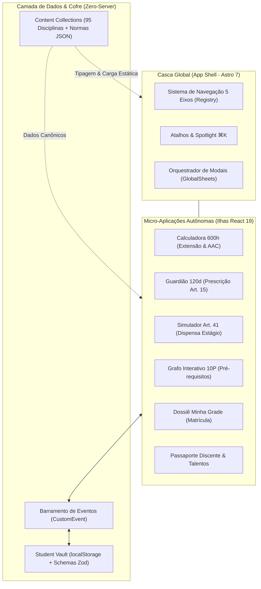
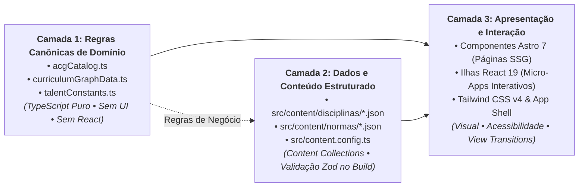
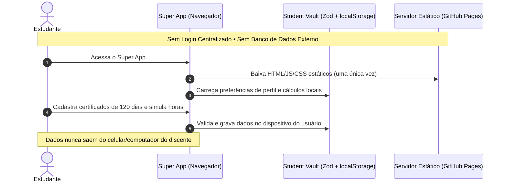

# 00. Visão Geral & Paradigma Modular

> **Capítulo 00** • Documentação de Arquitetura Modular  
> **Sistema:** Super App CAGP UFMG • Bacharelado em Gestão Pública (FAFICH/UFMG)

---

## 1. Por que um Super App Modular?

Portais acadêmicos tradicionais sofrem cronicamente de dois extremos arquiteturais indesejáveis:

1. **O Monólito Centralizado:** Um sistema rígido onde qualquer pequena mudança em uma regra de estágio ou adição de uma disciplina requer refatoração profunda de rotas, layouts e banco de dados.
2. **A Fragmentação Desconexa:** Múltiplos sites, planilhas avulsas, formulários Google e murais no WhatsApp/Instagram, onde o estudante precisa navegar por dezenas de links para planejar sua vida acadêmica.

O **Super App CAGP UFMG** adota uma terceira via: uma **plataforma unificada de micro-aplicações modulares** que compartilham uma casca comum (*App Shell*), um barramento de eventos desacoplado e um cofre de dados local (*Student Vault*), mantendo a autonomia total de cada subsistema.

---

## 2. A Separação em 3 Camadas (*Tri-Layer Architecture*)

Para garantir que o sistema seja de fácil manutenção e modificação, o código é estritamente separado em três camadas com fronteiras claras:

### Camada 1: Regras Canônicas de Domínio (Pure TS)
- **Onde reside:** Arquivos TypeScript utilitários (ex.: [`acgCatalog.ts`](file:///home/gsathler/Nextcloud/Projects/cagp/src/components/calculators/acgCatalog.ts), [`curriculumGraphData.ts`](file:///home/gsathler/Nextcloud/Projects/cagp/src/components/curriculum/curriculumGraphData.ts)).
- **Característica:** Não contém JSX, HTML nem classes de estilização. Define tipos estritos, valores limites, fórmulas matemáticas e textos normativos.
- **Benefício de Manutenção:** Quando o Colegiado do curso altera um teto de horas (ex.: limite de eventos de 30h para 45h), **apenas uma linha de TypeScript puro é modificada**. Nenhuma tela ou componente de interface quebra.

### Camada 2: Dados e Conteúdo Estruturado (Content Collections & Schemas)
- **Onde reside:** [`src/content/`](file:///home/gsathler/Nextcloud/Projects/cagp/src/content/) e [`src/content.config.ts`](file:///home/gsathler/Nextcloud/Projects/cagp/src/content.config.ts).
- **Característica:** Arquivos JSON validados no momento da compilação pelo Zod.
- **Benefício de Manutenção:** Adicionar uma disciplina nova, atualizar uma ementa ou anexar uma nova resolução normativa consiste em adicionar um arquivo JSON na pasta correspondente. O Astro compila e reindexa o catálogo automaticamente.

### Camada 3: Apresentação e Ilhas Interativas (Astro + React)
- **Onde reside:** [`src/pages/`](file:///home/gsathler/Nextcloud/Projects/cagp/src/pages/) e [`src/components/`](file:///home/gsathler/Nextcloud/Projects/cagp/src/components/).
- **Característica:** Utiliza a arquitetura de ilhas (*Islands Architecture*). O Astro pré-renderiza 100% do HTML estático no servidor/build, e apenas os componentes dinâmicos (calculadoras, grafos, modais) carregam hidratação de JavaScript do React no cliente.
- **Benefício de Manutenção:** O visual pode ser reformulado sem tocar nas regras de cálculo ou na base de dados.

---

## 3. O Paradigma Zero-Server & Soberania Discente

Uma das maiores inovações arquiteturais do projeto é o modelo **Zero-Server / Student Vault**:

### Vantagens Estratégicas para Manutenção e Custo
1. **Custo de Infraestrutura Zero:** Como o aplicativo é estático, a hospedagem é gratuita via GitHub Pages ou Netlify, sem custos de bancos Postgres/MySQL ou servidores backend Node/Python.
2. **Conformidade Automática com LGPD:** Dados de perfil discente, foto, certificados de estágio e progresso curricular não saem do navegador do aluno. Não há risco de vazamento de dados em servidores centrais.
3. **Imunidade a Quedas de Servidor:** Se o servidor da UFMG ou a nuvem estiver indisponível, o estudante continua abrindo o Super App offline no campus com todas as calculadoras e ementas funcionais.
