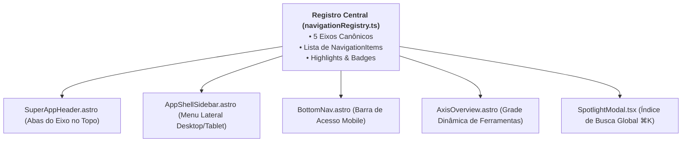

# 01. Arquitetura Orientada a Registros (*Registry-Driven*)

> **Capítulo 01** • Documentação de Arquitetura Modular  
> **Sistema:** Super App CAGP UFMG • Bacharelado em Gestão Pública (FAFICH/UFMG)

---

## 1. O Conceito de Registry-Driven

Em sistemas web tradicionais, a criação de uma nova funcionalidade frequentemente envolve editar múltiplos arquivos de navegação: o cabeçalho (`Header`), o menu lateral (`Sidebar`), o rodapé (`Footer`), a barra móvel inferior (`BottomNav`) e os atalhos de busca (`Spotlight`). Isso gera redundância, inconsistência e risco de quebra de rotas.

No **Super App CAGP UFMG**, a navegação e a descoberta de funcionalidades operam pelo padrão **Registry-Driven (Orientado a Registros)**:
- Toda e qualquer rota, serviço, ferramenta ou manual é **declarado uma única vez** em um catálogo central de metadados.
- Os componentes visuais da casca (*App Shell*) lêem esses registros dinamicamente e geram menus, abas ativas, breadcrumbs e cartões de destaque automaticamente.



---

## 2. O Registro Canônico de Navegação (`navigationRegistry.ts`)

O arquivo [`src/lib/navigationRegistry.ts`](file:///home/gsathler/Nextcloud/Projects/cagp/src/lib/navigationRegistry.ts) é o ponto único da verdade para os eixos de conhecimento e serviços do Super App.

### 2.1 Tipagem das Funcionalidades

```typescript
export type AxisId = 'hoje' | 'curso' | 'curriculo' | 'acervo' | 'cagp';
export type FeatureType = 'hub' | 'overview' | 'page' | 'tool' | 'guide' | 'catalog';

export interface NavigationItem {
  id: string;              // Identificador único (ex: 'curriculo-acg')
  label: string;           // Rótulo completo exibido na sidebar
  shortLabel: string;      // Rótulo compacto para tabs e bottom nav
  href: string;            // URL resolvida com base path via route()
  icon: string;            // Classe do Bootstrap Icons (ex: 'bi-calculator')
  description: string;     // Descrição sucinta do serviço
  type: FeatureType;       // Classificação da feature
  isOverview?: boolean;    // Se é a página principal do eixo
  badge?: string;          // Destaque visual opcional (ex: 'Novo', '120d')
  match: string[];         // Expressões regulares para marcar item ativo na URL
}
```

### 2.2 Estrutura de um Eixo (`AxisConfig`)
Cada um dos 5 eixos canônicos agrupa seus itens e define destaques executivos (*highlights*):

```typescript
export interface AxisOverviewHighlight {
  id: string;
  title: string;
  desc: string;
  icon: string;
  href: string;
  actionLabel: string;
  statKey?: string;        // Chave do Student Vault para exibir progresso dinâmico
}

export interface AxisConfig {
  id: AxisId;
  number: number;          // 1 a 5
  name: string;            // 'Hoje', 'Curso', 'Currículo', 'Acervo', 'O CAGP'
  tagline: string;         // Frase síntese do eixo
  icon: string;            // Ícone mestre
  color: string;           // Cor hexadecimal de identidade da marca
  rootHref: string;        // URL raiz do eixo
  items: NavigationItem[]; // Lista de micro-apps e páginas filhas
  overviewHighlights: AxisOverviewHighlight[];
}
```

### 2.3 Funções de Roteamento e Resolução

| Função | Parâmetros | Retorno | Comportamento e Responsabilidade |
| :--- | :--- | :--- | :--- |
| `normalizePathname()` | `pathname: string` | `string` | Remove o prefixo do GitHub Pages (ex.: `/cagp`) e remove sufixos como `/index.html` para permitir conferência pura de rotas. |
| `getAxisById()` | `id: AxisId` | `AxisConfig \| undefined` | Localiza a configuração de um eixo a partir do seu ID literal. |
| `getAxisByPath()` | `pathname: string` | `AxisConfig \| undefined` | Avalia o pathname da requisição contra os padrões regex de todos os itens cadastrados; se houver correspondência, retorna o eixo pai. |
| `getActiveItemId()` | `axis, pathname, hash` | `string` | Determina qual sub-item ou ferramenta está ativa no momento, considerando âncoras na URL (ex.: `/acg#calculadora`). |
| `getAllAxes()` | *nenhum* | `AxisConfig[]` | Retorna o array completo dos 5 eixos para iteradores de cabeçalho e menus. |

---

## 3. O Catálogo de Atalhos Rápidos (`shortcutsCatalog.ts`)

Além do menu formal em árvore, o Super App disponibiliza ações rápidas por meio do arquivo [`src/lib/shortcutsCatalog.ts`](file:///home/gsathler/Nextcloud/Projects/cagp/src/lib/shortcutsCatalog.ts).

### 3.1 Desacoplamento entre Links de Página e Ações Modais
Um atalho rápido pode ser tanto um link de navegação comum quanto um **disparador de eventos de interface**:

```typescript
export interface ShortcutItem {
  id: string;
  label: string;
  fullLabel: string;
  description: string;
  href: string;
  icon: string;
  color: string;
  category: 'Essencial' | 'Acadêmico' | 'Ferramentas' | 'Institucional';
  isAction?: boolean;      // Se verdadeiro, não navega; dispara evento!
  actionEvent?: string;    // Nome do CustomEvent disparado no window
  match: string[];
}
```

### 3.2 Exemplo de Operação Desacoplada
Quando o discente clica no atalho rápido "Passaporte" ou pressiona sua combinação no Spotlight:
1. O item declara `isAction: true` e `actionEvent: 'cagp:open-passport'`.
2. O componente de botão não precisa conhecer a implementação do modal do Passaporte; ele apenas executa:
   ```javascript
   window.dispatchEvent(new CustomEvent(item.actionEvent));
   ```
3. O orquestrador global [`GlobalSheets.tsx`](file:///home/gsathler/Nextcloud/Projects/cagp/src/components/shell/GlobalSheets.tsx) intercepta o evento e monta o componente sob demanda.

---

## 4. Como Adicionar uma Nova Rota em Segundos

Graças a este padrão orientado a registros, adicionar uma nova funcionalidade (por exemplo, um novo simulador de colação de grau) exige apenas:
1. Adicionar o objeto de configuração na lista `items` do eixo desejado em `navigationRegistry.ts`.
2. Criar o arquivo da página correspondente em `src/pages/`.
3. Todos os menus, cabeçalhos, barras móveis e índices de busca passam a reconhecer a nova rota automaticamente, com breadcrumbs e cores consistentes.
