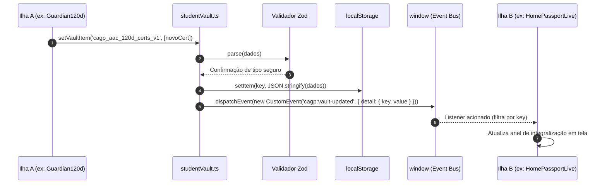

# 02. Barramento de Eventos e Contratos de Dados (*Student Vault*)

> **Capítulo 02** • Documentação de Arquitetura Modular  
> **Sistema:** Super App CAGP UFMG • Bacharelado em Gestão Pública (FAFICH/UFMG)

---

## 1. Por que não usar Gerenciadores Globais Monolíticos?

Em ecossistemas React tradicionais, é comum adotar gerenciadores de estado globais pesados (como Redux, MobX ou Zustand com persistência). Em um **Super App baseado em Astro com arquitetura de ilhas**, essa abordagem traz problemas graves:

1. **Acoplamento Desnecessário:** Uma alteração no store de um módulo forçaria recompilação ou hidratação desnecessária em páginas estáticas que nem utilizam aquele dado.
2. **Hidratação Forçada:** Bibliotecas de estado global exigem provedores de contexto (`<Provider>`) envolvendo toda a aplicação, quebrando a vantagem do Astro de enviar **zero JavaScript** nas partes estáticas.
3. **Fragilidade de Armazenamento:** Dados salvos em `localStorage` sem validação de esquema frequentemente corrompem a aplicação quando a estrutura dos dados evolui entre versões.

O Super App resolve isso combinando **Zod**, **LocalStorage Nativo** e o **Barramento de CustomEvents do Navegador**.



---

## 2. O Contrato de Dados do Cofre (`studentVault.ts`)

O arquivo [`src/lib/storage/studentVault.ts`](file:///home/gsathler/Nextcloud/Projects/cagp/src/lib/storage/studentVault.ts) centraliza a definição de tipos, schemas Zod e valores padrão de todo o estado discente.

### 2.1 Esquemas de Dados Tipados via Zod

```typescript
export const VaultSchemas = {
  // Horas acumuladas por modalidade de extensão e AAC
  cagp_calc_ext_aac_v1: z.record(z.string(), z.number()),

  // Certificados cadastrados no Guardião de 120 dias
  cagp_aac_120d_certs_v1: z.array(CertSchema),

  // Disciplinas de formação livre / eletivas adicionadas na grade
  cagp_custom_curriculum_v1: z.object({
    assignedCourses: z.array(CustomCourseSchema),
  }),

  // Indicador de conclusão da integração inicial do Super App
  cagp_onboarding_completed_v1: z.boolean(),

  // Preferências locais de lembretes e notificações
  cagp_notifications_prefs_v1: z.object({
    ru1815: z.boolean(),
    circular2230: z.boolean(),
    aac120d: z.boolean(),
    lastFired: z.number().optional(),
  }),

  // Tarefas concluídas no checklist de acolhimento do calouro
  cagp_calouro_checklist_v1: z.record(z.string(), z.boolean()),

  // Respostas e diagnóstico vocacional do quiz de percurso
  cagp_percurso_quiz_v1: z.object({
    answers: z.record(z.string(), z.string()),
    resultPath: z.string().optional(),
  }),

  // Disciplinas marcadas no plano de matrícula 'Minha Grade'
  cagp_minha_grade_v1: z.object({
    savedCourses: z.array(z.string()),
  }),

  // Itens comprovados do checklist de dispensa de estágio (Art. 41)
  cagp_art41_checklist_v1: z.record(z.string(), z.boolean()),

  // Preferências completas de acessibilidade e visualização
  cagp_a11y_prefs_v2: z.object({
    font: z.string().default('md'),
    contrast: z.string().default('normal'),
    dyslexia: z.boolean().default(false),
    motion: z.string().default('normal'),
    ruler: z.boolean().optional().default(false),
    showDesktopDock: z.boolean().default(false),
  }),

  // Lista de 1 a 5 IDs de atalhos rápidos ativos
  cagp_discente_shortcuts_v1: z.array(z.string()).min(1).max(5),

  // Papel discente ativo (calouro, veterano, formando, ingressar)
  cagp_user_role_v1: UserRoleSchema,

  // Perfil detalhado para a carteira estudantil (Passaporte)
  cagp_student_profile_v1: z.object({
    name: z.string(),
    period: z.string(),
    avatarPreset: z.string().optional(),
    prideChoice: z.string().optional(),
    // ...demais campos de identificação
  }),
} as const;
```

### 2.2 Tipagem Estrita Automática
Graças ao TypeScript com inferência Zod, cada chave do cofre tem seu tipo estritamente garantido:
```typescript
export type VaultKey = keyof typeof VaultSchemas;
export type VaultData<K extends VaultKey> = z.infer<(typeof VaultSchemas)[K]>;
```

### 2.3 Funções de Manipulação Segura

| Função | Assinatura | Comportamento e Tolerância a Erros |
| :--- | :--- | :--- |
| `getVaultItem<K>()` | `(key: K) => VaultData<K>` | Recupera o item do `localStorage`. Aplica `safeParse()` com Zod. Se os dados estiverem corrompidos ou inexistentes, **retorna automaticamente o valor seguro de `VaultDefaults[key]`** sem lançar exceções. |
| `setVaultItem<K>()` | `(key: K, value: VaultData<K>) => void` | Valida o objeto com Zod. Em caso de sucesso, serializa no `localStorage` e emite o evento `cagp:vault-updated` para que todas as ilhas ativas atualizem sua UI. |
| `getAllVaultData()` | `() => Record<VaultKey, unknown>` | Varre todas as chaves cadastradas e retorna um snapshot completo para geração de backups. |
| `applyA11yPrefsToDOM()`| `(prefs?) => void` | Sincroniza as preferências salvas com os atributos `data-a11y-*` no elemento raiz `<html>`, viabilizando troca instantânea de tema e fontes. |

---

## 3. Portabilidade & Backup Seguro (`backupVault.ts`)

O arquivo [`src/lib/storage/backupVault.ts`](file:///home/gsathler/Nextcloud/Projects/cagp/src/lib/storage/backupVault.ts) provê mecanismos para que o discente transporte seus dados entre celular e computador sem depender de login na nuvem:

1. **Exportação (`exportVaultBackup`):** Consolida todo o cofre em um arquivo `cagp-vault-backup-YYYY-MM-DD.json` contendo timestamp e assinatura de integridade.
2. **Importação Segura (`importVaultBackup`):** Ao carregar um arquivo JSON externo, a função valida **chave por chave** contra os schemas Zod correspondentes. Dados maliciosos ou desatualizados são descartados antes de tocar o `localStorage`, impedindo corrupção do cofre.

---

## 4. O Barramento de Eventos da Casca

As ilhas React e componentes Astro conversam por meio dos seguintes eventos desacoplados:

| Nome do Evento | Emissor | Receptor Típico | Propósito |
| :--- | :--- | :--- | :--- |
| `cagp:vault-updated` | `setVaultItem()` | Ilhas React inscritas | Notifica que uma chave do cofre foi modificada (ex.: horas computadas, novos certificados). |
| `cagp:open-sheet` | Botões de atalho, cabeçalho | `GlobalSheets.tsx` | Solicita abertura de um modal/drawer informando o `sheetId` (`passport`, `campus`, `a11y`, `shortcuts`). |
| `cagp:open-spotlight`| Cabeçalho, `Cmd+K` | `SpotlightModal.tsx` | Abre a busca instantânea global. |
| `cagp:toggle-drawer` | Botão menu hambúrguer | `BaseLayout.astro` | Abre ou fecha o menu lateral de navegação no tablet e mobile. |
