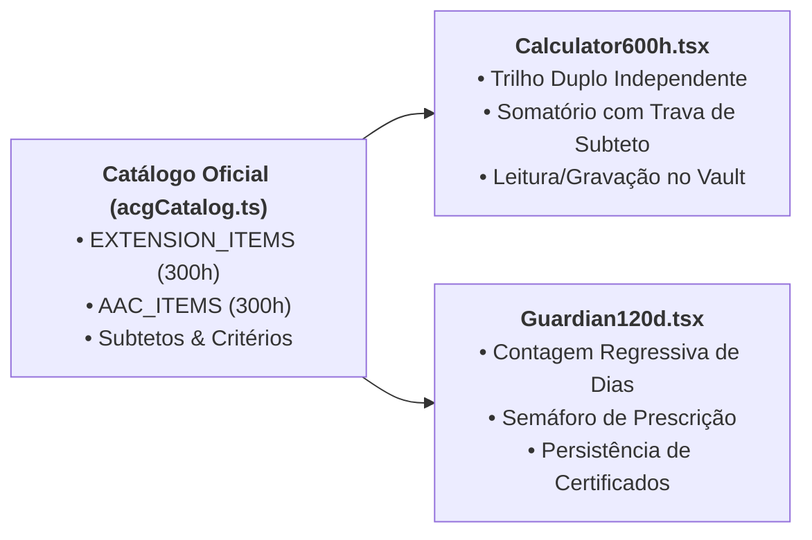
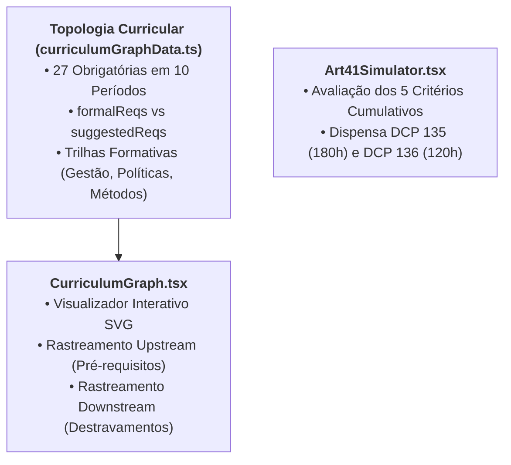

# 03. Funções, Entradas, Saídas e Comportamento dos Módulos

> **Capítulo 03** • Documentação de Arquitetura Modular  
> **Sistema:** Super App CAGP UFMG • Bacharelado em Gestão Pública (FAFICH/UFMG)

---

## 1. Módulo Calculadoras Normativas & 600h

Este módulo gerencia a conformidade com as Atividades Complementares de Graduação (ACG), regulamentadas pelo PPC 2020 e pelo Regulamento N-20229.



### 1.1 Catálogo Canônico de Regras ACG (`acgCatalog.ts`)
Cada atividade passível de aproveitamento é declarada com regras estritas:

```typescript
export interface AcgItemDef {
  key: string;              // Identificador único (ex: 'ext_ensino_inter')
  group: 'ext' | 'aac';     // Grupo normativo (Extensão ou AAC)
  code: string;             // Código no colegiado (ex: 'DCP 176/177')
  label: string;            // Nome formal da atividade
  desc: string;             // Descrição e base regulamentar
  step: number;             // Incremento padrão de horas (ex: 15h, 90h)
  max: number;              // TETO MÁXIMO de aproveitamento permitido
  creditsLabel: string;     // Equivalência de créditos
  icon: string;             // Ícone visual
  has120dDeadline?: boolean;// Se sofre a trava de 120 dias do Art. 15
  accepted: string[];       // Critérios fáticos de aceitação pelo Colegiado
  rejected: string[];       // O que o Colegiado indefere sumariamente
}
```

### 1.2 Calculadora de Trilho Duplo (`Calculator600h.tsx`)
- **Entrada:** Mapa `Record<string, number>` salvo na chave `cagp_calc_ext_aac_v1`.
- **Regra de Negócio Central:**
  - Carga total de Extensão: $\min\left(\sum \min(\text{horas}_i, \text{max}_i), 300\right)$
  - Carga total de AAC: $\min\left(\sum \min(\text{horas}_j, \text{max}_j), 300\right)$
  - **Incomunicabilidade:** Horas excedentes de extensão não compensam carência em AAC e vice-versa.
- **Saída:** Percentuais de progresso nos dois trilhos, saldo restante para colação e alertas de teto atingido.

### 1.3 Guardião de 120 Dias (`Guardian120d.tsx`)
Implementa o cumprimento do **Art. 15, § 4º do Regulamento N-20229**:
- **Função Principal:** `computeDaysLeft(eventDateStr: string): number`
  $$\text{Dias Restantes} = 120 - \left\lfloor \frac{\text{Date.now}() - \text{Date}(\text{eventDateStr})}{86.400.000} \right\rfloor$$
- **Semáforo de Estados:**
  - $\text{Dias} > 30$: `Verde` (Prazo seguro para protocolo na Sala F-2039).
  - $0 \le \text{Dias} \le 30$: `Âmbar/Vermelho Urgente` (Risco iminente de perda de créditos).
  - $\text{Dias} < 0$: `Cinza/Riscado` (Certificado formalmente prescrito pelo Colegiado).
- **Entradas e Saídas:** Adiciona e remove objetos `StudentCert` na chave `cagp_aac_120d_certs_v1`.

---

## 2. Módulo Curricular & Simulação de Estágio



### 2.1 O Grafo de Pré-Requisitos (`curriculumGraphData.ts` & `CurriculumGraph.tsx`)
Cada uma das 27 disciplinas obrigatórias é representada por um nó com atributos pedagógicos e espaciais:

```typescript
export interface CourseNodeData {
  code: string;            // Ex: 'DCP 124'
  name: string;            // Ex: 'Gestão Pública A'
  period: number;          // Período 1 a 10
  dept: 'DCP' | 'ECN' | 'SOA' | 'EST';
  ch: number;              // Carga horária (ex: 60h)
  cr: number;              // Créditos acadêmicos (ex: 4)
  col: number;             // Coluna cartesiana (período no grid)
  y: number;               // Posição vertical no SVG
  track: 'gestao' | 'politicas' | 'sociedade' | 'economia' | 'metodos' | 'pratica';
  formalReqs: string[];    // Bloqueios formais do SIGA
  suggestedReqs: string[]; // Recomendações pedagógicas do Colegiado
  formalUnlocks: string[]; // Disciplinas que este nó libera no SIGA
}
```

- **Comportamento Interativo:**
  - Ao clicar em uma disciplina, o grafo destaca em **vermelho** os pré-requisitos necessários (*upstream*) e em **verde** as disciplinas futuras que serão destravadas (*downstream*).
  - Um painel lateral (*CurriculumDetailDrawer*) exibe ementa oficial e bibliografia.

### 2.2 Simulador do Artigo 41 (`Art41Simulator.tsx`)
Permite ao estudante trabalhador verificar a elegibilidade para dispensa de estágio:
- **Critérios Auditados (`ART41_CRITERIA`):**
  1. `crit_vinculo`: Vínculo formal em órgão público ou terceiro setor;
  2. `crit_matricula`: Matrícula ativa em DCP 135 e/ou DCP 136;
  3. `crit_fase1`: Requerimento com declaração de chefia no início do período;
  4. `crit_horas`: Carga acumulada $\ge 180\text{h}$ (Estágio A) ou $\ge 120\text{h}$ (Estágio B);
  5. `crit_fase2`: Relatório final com atesto de compatibilidade das atribuições.
- **Saída:** Diagnóstico em tempo real. Se os 5 critérios forem atendidos, o simulador emite o selo de elegibilidade e orienta a abertura de processo no SEI-UFMG.

---

## 3. Módulo Passaporte Discente & Carteira Estudantil

Localizado em [`src/components/passport/`](file:///home/gsathler/Nextcloud/Projects/cagp/src/components/passport/):
- **Componentes:** [`PassportCard.tsx`](file:///home/gsathler/Nextcloud/Projects/cagp/src/components/passport/PassportCard.tsx), [`TalentBankEditor.tsx`](file:///home/gsathler/Nextcloud/Projects/cagp/src/components/passport/TalentBankEditor.tsx), [`AvatarRenderer.tsx`](file:///home/gsathler/Nextcloud/Projects/cagp/src/components/passport/AvatarRenderer.tsx).
- **Função:** Renderiza uma identidade visual do discente com foto/avatar vetorial (`candangos`, `estudante`, etc.), tema de identidade (pride / neutro), semestre de ingresso e anel de progresso que consolida:
  - Percentual das 27 obrigatórias concluídas;
  - Percentual das 600 horas de ACG validadas no cofre local;
  - Status do Estágio e TCC.
- **Privacidade:** Todos os dados do passaporte ficam exclusivamente no navegador do aluno.
