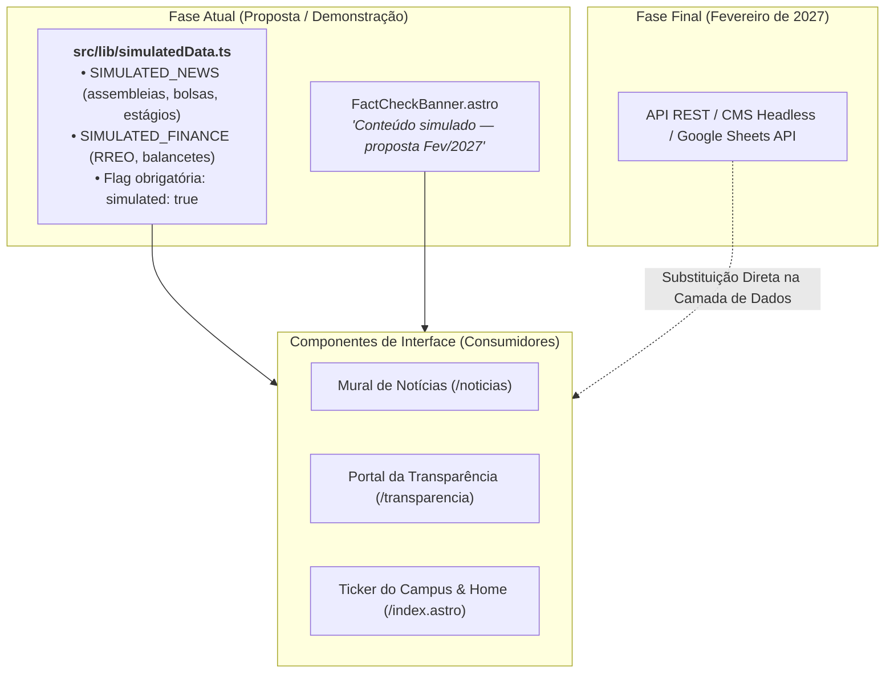

# 04. Camada de Dados Pluggable (*Content Collections*)

> **Capítulo 04** • Documentação de Arquitetura Modular  
> **Sistema:** Super App CAGP UFMG • Bacharelado em Gestão Pública (FAFICH/UFMG)

---

## 1. O Motor de Dados Estáticos do Astro 7

Para armazenar e disponibilizar informações canônicas do curso (matriz curricular, ementas, atos regulamentares e resoluções do CEPE), o Super App utiliza a API de **Content Collections do Astro 7**, configurada em [`src/content.config.ts`](file:///home/gsathler/Nextcloud/Projects/cagp/src/content.config.ts).

```mermaid
flowchart LR
    subgraph Files["Arquivos Fonte (JSON e Markdown)"]
        D["src/content/disciplinas/*.json (95 matérias)"]
        N["src/content/normas/*.json (Resoluções & Atos)"]
        M["_referencias/documentos-oficiais/*.md"]
    end

    subgraph Config["src/content.config.ts (Build Time)"]
        LoaderD["glob(**/*.json) + Zod Schema"]
        LoaderN["glob(**/*.json) + Zod Schema"]
        LoaderM["glob([!R]*.md) + Zod Schema"]
    end

    subgraph AstroStore["Astro Content Store (Type-Safe)"]
        Store["getCollection('disciplinas')<br/>getCollection('normas')"]
    end

    subgraph Pages["Páginas Consumidoras (SSG)"]
        P1["/percurso (Grade 10P)"]
        P2["/optativas (Busca e Filtros)"]
        P3["/documentos (Atos e Normas)"]
    end

    Files --> Config
    Config --> AstroStore
    AstroStore --> Pages
```



---

## 2. Esquemas Zod das Coleções

### 2.1 Coleção `disciplinas`
Armazena a totalidade das 27 obrigatórias e 68 optativas do PPC 2020:

```typescript
const disciplinas = defineCollection({
  loader: glob({ pattern: '**/*.json', base: './src/content/disciplinas' }),
  schema: z.object({
    codigo: z.string(),                                  // Ex: 'DCP 124'
    nome: z.string(),                                    // Ex: 'Gestão Pública A'
    natureza: z.enum(['obrigatoria', 'optativa']),       // Classificação
    periodo: z.number().optional(),                      // 1 a 10 se obrigatória
    ch: z.number(),                                      // Carga horária (60, 90, 180)
    ementa: z.string(),                                  // Texto oficial da ementa
    preRequisitos: z.array(z.string()).default([]),      // Lista de códigos
    modulo: z.string().optional(),                       // Trilha temática
  }),
});
```

### 2.2 Coleção `normas`
Catálogo de atos normativos com vinculação aos documentos canônicos em PDF:

```typescript
const normas = defineCollection({
  loader: glob({ pattern: '**/*.json', base: './src/content/normas' }),
  schema: z.object({
    titulo: z.string(),        // Ex: 'Regulamento N-20229'
    orgao: z.string(),         // 'Colegiado DCP', 'CEPE UFMG', etc.
    ano: z.number(),           // Ano de publicação
    resumo: z.string(),        // Síntese normativa
    arquivo: z.string().optional(), // Nome do PDF correspondente em public/documentos/
  }),
});
```

---

## 3. Isolamento de Mocks & Transição para APIs Reais (Fev/2027)

Conforme estabelecido no `PRODUCT.md`, os módulos de notícias dinâmicas e o Portal da Transparência ainda não possuem backend nem APIs em produção. O sistema adota um padrão de **isolamento estrito de conteúdo simulado**:



### Contratos Preparados para Troca Direta
Os componentes de interface consomem tipos TypeScript padronizados (`SimulatedNewsItem`, `SimulatedFinanceRecord`). Quando a integração definitiva for desenvolvida:
1. Nenhuma linha de JSX, CSS ou layout precisará ser modificada.
2. Apenas a função de carregamento em `src/lib/` passará a buscar os dados da API real em vez do array estático.
3. O componente `FactCheckBanner.astro` será removido ou desativado via configuração.
