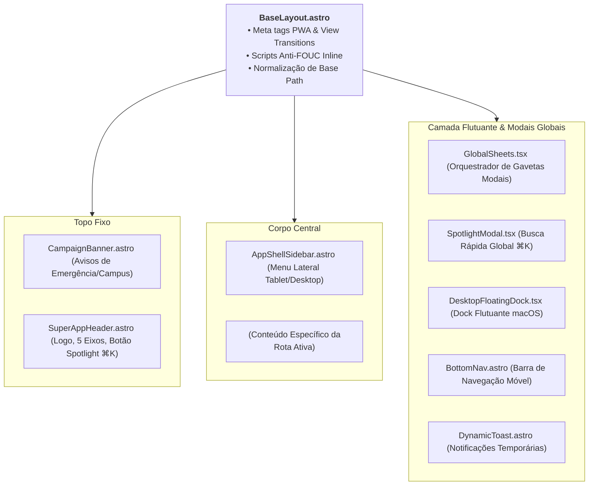
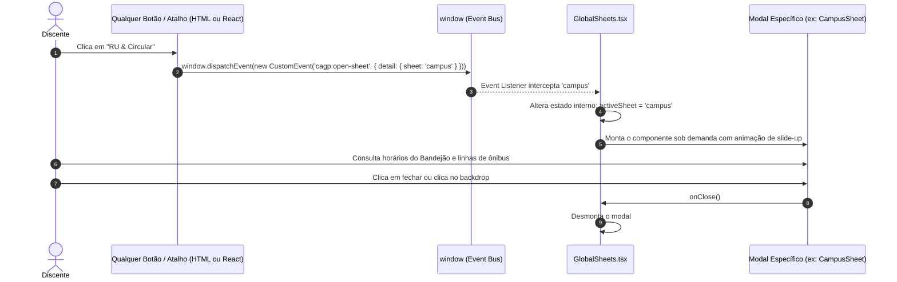

# 05. Casca Global (*App Shell*) e Orquestração de Telas

> **Capítulo 05** • Documentação de Arquitetura Modular  
> **Sistema:** Super App CAGP UFMG • Bacharelado em Gestão Pública (FAFICH/UFMG)

---

## 1. A Casca Unificada (`BaseLayout.astro`)

O padrão **App Shell** garante que toda a estrutura visual de navegação (cabeçalho, barra inferior, menus laterais e orquestradores de diálogo) seja compartilhada por todas as páginas com renderização instantânea via **Astro View Transitions** (`<ClientRouter />`).



---

## 2. Resolução de Caminhos Base (`paths.ts`)

Para garantir que o Super App funcione de forma idêntica tanto em desenvolvimento local (`http://localhost:4321/`) quanto publicado no GitHub Pages sob um subcaminho (`https://gsathler-vi.github.io/cagp/`), o módulo [`src/lib/paths.ts`](file:///home/gsathler/Nextcloud/Projects/cagp/src/lib/paths.ts) fornece duas funções fundamentais:

```typescript
// Retorna a URL interna prefixada com o base path
export function route(path: string): string {
  const rawBase = import.meta.env.BASE_URL || '/';
  const cleanBase = rawBase.replace(/\/$/, '');
  const cleanPath = path.startsWith('/') ? path : `/${path}`;
  if (cleanPath === '/') return cleanBase ? `${cleanBase}/` : '/';
  return `${cleanBase}${cleanPath}`;
}

// Retorna o caminho de imagens, PDFs e ícones estáticos
export function asset(path: string): string {
  const rawBase = import.meta.env.BASE_URL || '/';
  const cleanBase = rawBase.replace(/\/$/, '');
  const cleanPath = path.startsWith('/') ? path : `/${path}`;
  return `${cleanBase}${cleanPath}`;
}
```

---

## 3. Orquestração Central de Telas Modais (`GlobalSheets.tsx`)

Em vez de cada página instanciar seus próprios modais (o que aumentaria o tamanho do bundle e geraria código duplicado), o Super App adota um **hospedeiro central de gavetas (*Bottom Sheets*)** montado no rodapé do `BaseLayout`:



### Gavetas Hospedadas pelo `GlobalSheets`:
1. `PassportSheet.tsx`: Carteira e identidade acadêmica discente;
2. `CampusSheet.tsx`: Horários do RU II Setorial e linhas do Circular Noturno;
3. `A11ySheet.tsx`: Painel de preferências de acessibilidade e leitura;
4. `ShortcutsSheet.tsx`: Gerenciador de personalização de atalhos rápidos.

---

## 4. O Buscador Global Spotlight (`SpotlightModal.tsx`)

Inspirado no Spotlight do macOS e no Raycast:
- **Atalho de Teclado:** Acionado globalmente por `Cmd + K` (Mac) ou `Ctrl + K` (Windows/Linux).
- **Indexação em Memória:** Ao ser aberto, indexa em tempo real:
  - Os 5 eixos de navegação;
  - As 95 disciplinas (obrigatórias e optativas) com seus respectivos códigos;
  - Documentos e resoluções do acervo;
  - Ações diretas (abrir passaporte, abrir configurações).
- **Navegação por Teclado:** Suporta navegação por setas (`↑` e `↓`) e seleção por `Enter`.

---

## 5. Responsividade Multi-Dispositivo (Proposta A)

A interface adapta sua ergonomia conforme a largura da viewport, respeitando os padrões da Apple Human Interface Guidelines:

| Formato | Resolução | Comportamento da Casca |
| :--- | :--- | :--- |
| **Mobile** | `< 768px` | Cabeçalho compacto, menu hambúrguer com gaveta deslizante, barra inferior de navegação rápida ([`BottomNav.astro`](file:///home/gsathler/Nextcloud/Projects/cagp/src/components/shell/BottomNav.astro)) e modais que sobem como gavetas de baixo para cima (*Bottom Sheets*). |
| **Tablet** | `768px – 1279px` | Menu lateral colapsado em formato de trilho vertical de ícones (*rail*), expandindo sobre o conteúdo ao toque sem empurrar a tela. |
| **Desktop** | `≥ 1280px` | Sidebar lateral fixa completa com títulos e descrições, cabeçalho de atalhos e suporte a Dock Flutuante opcional no rodapé ([`DesktopFloatingDock.tsx`](file:///home/gsathler/Nextcloud/Projects/cagp/src/components/shell/DesktopFloatingDock.tsx)). |
