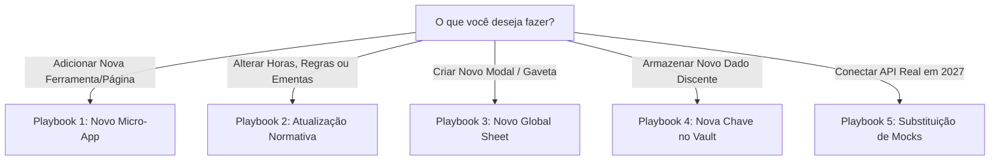

# 06. Playbooks de Extensibilidade & Manutenção

> **Capítulo 06** • Documentação de Arquitetura Modular  
> **Sistema:** Super App CAGP UFMG • Bacharelado em Gestão Pública (FAFICH/UFMG)

---

## 1. Visão Geral dos Playbooks

Esta seção contém receitas práticas, passo a passo, projetadas para permitir que qualquer desenvolvedor ou agente de IA realize modificações e extensões no Super App sem risco de regressão ou quebra de outros subsistemas.



---

## Playbook 1: Como Criar e Plugar um Novo Micro-App

Suponha que o CAGP deseje lançar uma nova ferramenta: o **"Simulador de Formação Livre"**.

### Passo 1: Criar o Componente da Ferramenta
Crie a ilha interativa em `src/components/percurso/SimuladorFormacaoLivre.tsx`:
```tsx
import React, { useState } from 'react';
import { getVaultItem, setVaultItem } from '../../lib/storage/studentVault';

export const SimuladorFormacaoLivre: React.FC = () => {
  // Lógica autocontida da ferramenta
  return <div className="p-4 bg-white rounded-lg">Meu Novo Simulador</div>;
};
```

### Passo 2: Criar a Página de Rota em `src/pages/`
Crie `src/pages/formacao-livre.astro` utilizando o layout padrão:
```astro
---
import BaseLayout from '../layouts/BaseLayout.astro';
import { SimuladorFormacaoLivre } from '../components/percurso/SimuladorFormacaoLivre';
---
<BaseLayout title="Simulador de Formação Livre">
  <main class="max-w-4xl mx-auto px-4 py-8">
    <SimuladorFormacaoLivre client:load />
  </main>
</BaseLayout>
```

### Passo 3: Registrar a Ferramenta no `navigationRegistry.ts`
Abra [`src/lib/navigationRegistry.ts`](file:///home/gsathler/Nextcloud/Projects/cagp/src/lib/navigationRegistry.ts) e adicione o item na lista `items` do Eixo 3 (Currículo):
```typescript
{
  id: 'curriculo-formacao-livre',
  label: 'Simulador Formação Livre',
  shortLabel: 'Formação Livre',
  href: route('/formacao-livre'),
  icon: 'bi-mortarboard',
  description: 'Planejamento de até 240h em matérias de outros cursos da UFMG.',
  type: 'tool',
  match: ['^/formacao-livre'],
}
```

*Pronto! Automaticamente, a nova ferramenta aparece na barra de navegação, nos menus laterais, nos cards de visão geral e no indexador do Spotlight (⌘K).*

---

## Playbook 2: Como Atualizar Normas do Curso sem Tocar na UI

### Cenário A: O Colegiado aprovou uma nova disciplina optativa
1. Crie um novo arquivo JSON em `src/content/disciplinas/opt-dcp-999-nova-materia.json`:
   ```json
   {
     "codigo": "DCP 999",
     "nome": "Governança Digital no Setor Público",
     "natureza": "optativa",
     "ch": 60,
     "ementa": "Princípios de governo digital, interoperabilidade e transparência pública.",
     "preRequisitos": ["DCP 124"],
     "modulo": "Políticas Públicas"
   }
   ```
2. O Astro valida o schema no próximo build e a disciplina passa a ser pesquisável na página de optativas e no Spotlight.

### Cenário B: O Colegiado alterou o limite de horas de uma modalidade ACG
1. Abra [`src/components/calculators/acgCatalog.ts`](file:///home/gsathler/Nextcloud/Projects/cagp/src/components/calculators/acgCatalog.ts).
2. Localize o item correspondente pelo código ou chave (ex.: `ext_eventos_ii`).
3. Altere o valor de `max` (ex.: de `30` para `45`).
4. **Nenhum arquivo JSX ou CSS precisa ser alterado.** A Calculadora de 600h absorverá o novo teto automaticamente.

---

## Playbook 3: Como Plugar uma Nova Gaveta no `GlobalSheets.tsx`

Para adicionar um novo modal global (por exemplo, um painel rápido com o mapa das salas da FAFICH):

1. Crie o componente do modal em `src/components/shell/MapaSalasSheet.tsx`.
2. Abra [`src/components/shell/GlobalSheets.tsx`](file:///home/gsathler/Nextcloud/Projects/cagp/src/components/shell/GlobalSheets.tsx):
   - Adicione `'mapa-salas'` à tipagem `ActiveSheet`:
     ```typescript
     type ActiveSheet = 'passport' | 'campus' | 'a11y' | 'shortcuts' | 'mapa-salas' | null;
     ```
   - No `switch (activeSheet)`, adicione a renderização:
     ```tsx
     {activeSheet === 'mapa-salas' && <MapaSalasSheet onClose={closeSheet} />}
     ```
3. Para abrir a gaveta a partir de qualquer link, botão ou atalho do aplicativo, basta disparar:
   ```javascript
   window.dispatchEvent(new CustomEvent('cagp:open-sheet', { detail: { sheet: 'mapa-salas' } }));
   ```

---

## Playbook 4: Como Adicionar uma Nova Chave no Student Vault

Para persistir novos dados discentes localmente de forma segura e tipada:

1. Abra [`src/lib/storage/studentVault.ts`](file:///home/gsathler/Nextcloud/Projects/cagp/src/lib/storage/studentVault.ts).
2. Adicione o novo schema em `VaultSchemas`:
   ```typescript
   export const VaultSchemas = {
     // ...chaves existentes
     cagp_meu_novo_dado_v1: z.object({
       favoritos: z.array(z.string()),
       dataUltimoUso: z.string(),
     }),
   };
   ```
3. Forneça o valor padrão em `VaultDefaults`:
   ```typescript
   export const VaultDefaults = {
     // ...valores existentes
     cagp_meu_novo_dado_v1: {
       favoritos: [],
       dataUltimoUso: new Date().toISOString(),
     },
   };
   ```
4. Consuma a chave em qualquer componente com tipagem completa:
   ```typescript
   const dados = getVaultItem('cagp_meu_novo_dado_v1'); // Tipagem inferida automaticamente!
   setVaultItem('cagp_meu_novo_dado_v1', { ...dados, favoritos: ['DCP 124'] });
   ```

---

## Playbook 5: Como Plugar APIs Reais em Fevereiro de 2027

Quando o CAGP disponibilizar a API oficial ou serviço de transparência:

1. Abra [`src/lib/simulatedData.ts`](file:///home/gsathler/Nextcloud/Projects/cagp/src/lib/simulatedData.ts).
2. Substitua o array estático `SIMULATED_NEWS` por uma função assíncrona ou de busca via endpoint:
   ```typescript
   export async function fetchOfficialNews(): Promise<SimulatedNewsItem[]> {
     const res = await fetch('https://api.cagp-ufmg.org/v1/noticias');
     return res.json();
   }
   ```
3. Como os componentes de tela (`src/pages/noticias/index.astro`, `HomeHeroHub.tsx`) consomem exatamente a mesma tipagem `SimulatedNewsItem`, a transição é **100% transparente**.
4. Remova o aviso `<FactCheckBanner />` das páginas correspondentes.
