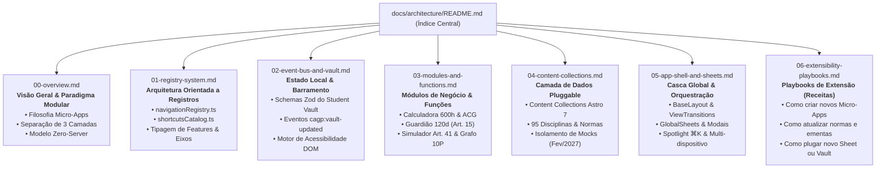

# Documentação de Arquitetura Modular — Super App CAGP UFMG

> **Guia Técnico de Escalabilidade, Modularidade e Manutenção**  
> **Versão do Sistema:** 3.0.0 (`cagp-ufmg-superapp`)  
> **Framework:** Astro 7 (SSG) • React 19 (Islands) • Tailwind CSS v4 • Zod • TypeScript  
> **Filosofia:** *Modular Super App • Zero-Server • Registry-Driven • Offline-First*

---

## 1. Mapa de Navegação da Documentação

Esta documentação foi decomposta em capítulos modulares para permitir consulta rápida e manutenção independente de cada subsistema:

---

## 2. Índice dos Capítulos

| Capítulo | Arquivo | Foco Principal |
| :--- | :--- | :--- |
| **00. Visão Geral & Modularidade** | [`00-overview.md`](file:///home/gsathler/Nextcloud/Projects/cagp/docs/architecture/00-overview.md) | Princípios de concepção do Super App, separação de camadas (*Core Rules*, *Data*, *UI*), benefícios do modelo sem servidor. |
| **01. Sistema de Registros** | [`01-registry-system.md`](file:///home/gsathler/Nextcloud/Projects/cagp/docs/architecture/01-registry-system.md) | Como o sistema registra e descobre eixos, rotas, ferramentas e atalhos de forma desacoplada (*Registry-Driven*). |
| **02. Estado Local & Eventos** | [`02-event-bus-and-vault.md`](file:///home/gsathler/Nextcloud/Projects/cagp/docs/architecture/02-event-bus-and-vault.md) | O Student Vault, contratos Zod, sincronização reativa inter-ilhas via `CustomEvent` e acessibilidade. |
| **03. Funções & Motores de Negócio** | [`03-modules-and-functions.md`](file:///home/gsathler/Nextcloud/Projects/cagp/docs/architecture/03-modules-and-functions.md) | Algoritmos, parâmetros de entrada/saída das calculadoras de 600h, contagem de prazos, simulador de estágio e grafo 10P. |
| **04. Dados & Content Collections** | [`04-content-collections.md`](file:///home/gsathler/Nextcloud/Projects/cagp/docs/architecture/04-content-collections.md) | Esquemas de disciplinas e normas, integridade em tempo de build e estratégia de transição para feeds reais. |
| **05. Casca Global & Shell** | [`05-app-shell-and-sheets.md`](file:///home/gsathler/Nextcloud/Projects/cagp/docs/architecture/05-app-shell-and-sheets.md) | Orquestração do `BaseLayout`, View Transitions, gavetas contextuais (`GlobalSheets`) e Spotlight. |
| **06. Playbooks de Extensibilidade** | [`06-extensibility-playbooks.md`](file:///home/gsathler/Nextcloud/Projects/cagp/docs/architecture/06-extensibility-playbooks.md) | Passo a passo prático para manter, estender, plugar novas ferramentas e atualizar regras sem quebras. |

---

## 3. Filosofia Central da Arquitetura

O sistema é construído sobre três pilares mandatórios:
1. **Desacoplamento Estrito:** Mudanças normativas no curso (ex.: alteração de horas de extensão pelo Colegiado) exigem apenas edição em arquivos de configuração pura (`.ts` ou `.json`), sem necessidade de refatorar componentes de interface (`.astro` ou `.tsx`).
2. **Arquitetura Orientada a Registros (*Registry-Driven*):** Novas funcionalidades não são "espalhadas" hardcoded pelo código; elas se registram no catálogo central de navegação e atalhos, sendo renderizadas automaticamente pelo Shell.
3. **Soberania do Discente (Zero-Server):** O aplicativo opera com 100% de autonomia e privacidade, persistindo dados com schemas Zod no `localStorage` e executando offline no campus Pampulha via Service Worker.
