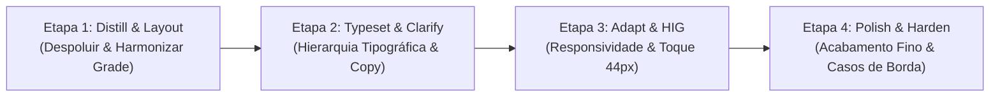

# Playbook Mestre de Orquestração: Impeccable + Apple Design

> **Guia Definitivo de Comandos e Refinamento Passo a Passo para o Super App CAGP UFMG**  
> **Destinatários:** Desenvolvedores, Mantenedores e Agentes de Inteligência Artificial (Antigravity)  
> **Localização:** [`docs/playbooks/00-MASTER-ORCHESTRATION-PLAYBOOK.md`](file:///home/gsathler/Nextcloud/Projects/cagp/docs/playbooks/00-MASTER-ORCHESTRATION-PLAYBOOK.md)

---

## 1. Como Funciona a Orquestração

Para obter um refinamento de qualidade profissional, **o segredo é nunca pedir tudo de uma vez**. Quando um modelo de IA tenta refinar tudo simultaneamente (layout, tipografia, cores, responsividade, acessibilidade e micro-interações), ele tende a diluir o foco, introduzir regressões e perder detalhes cruciais.

A estratégia adotada neste projeto combina duas ferramentas complementares de alto nível:
1. **Skill `/impeccable`:** Fornece um vocabulário de **24 comandos de refino atômico**, cada um especializado em uma faceta da interface (desde auditoria técnica até micro-interações).
2. **Skill `/apple-design`:** Fornece o rigor formal das **Diretrizes de Interface Humana da Apple (HIG)** (alvos de toque $\ge 44\text{pt}$, superfícies sólidas e opacas sem *Liquid Glass*, foco estrito no tema claro acadêmico sem Modo Escuro, hierarquia de fontes, curvatura *squircle*, navegação por folhas deslizantes e áreas seguras).

---

## 2. Dicionário dos Comandos do Impeccable

Use esta tabela de referência para escolher exatamente o verbo necessário para cada tarefa:

| Comando | Categoria | O que faz no código | Quando usar no Super App |
| :--- | :--- | :--- | :--- |
| `init` | Build | Cria o arquivo [`PRODUCT.md`](file:///home/gsathler/Nextcloud/Projects/cagp/PRODUCT.md) com a visão do produto. | Já configurado na raiz. |
| `document` | Build | Gera o [`DESIGN.md`](file:///home/gsathler/Nextcloud/Projects/cagp/DESIGN.md) documentando tokens do sistema. | Já configurado na raiz. |
| `extract [target]` | Build | Identifica padrões repetitivos e extrai para componentes reutilizáveis. | Quando uma página tem cards ou banners duplicados. |
| `critique [target]` | Evaluate | Análise heurística de UX e usabilidade sem alterar código. | Para diagnosticar problemas antes de refatorar uma página. |
| `audit [target]` | Evaluate | Checagem técnica estrita (A11y WCAG AAA, performance, contraste). | Para verificar conformidade antes de fechar um módulo. |
| `distill [target]` | Refine | **Remove excessos e redundâncias.** Elimina texto desnecessário, bordas pesadas e elementos visuais duplicados. | **Essencial:** para limpar páginas sobrecarregadas. |
| `layout [target]` | Enhance | **Ajusta o ritmo vertical, espaçamentos, grid e alinhamentos.** Corrige margens inconsistentes e agrupamentos. | **Essencial:** para dar elegância e harmonia espacial. |
| `typeset [target]` | Enhance | **Ajusta a hierarquia tipográfica.** Calibra tamanhos de fonte, pesos (Oswald vs Inter vs Mono) e entrelinhas. | Para páginas com textos desiguais ou de difícil leitura. |
| `adapt [target]` | Fix | **Garante responsividade total.** Trata mobile, tablet, desktop, áreas seguras (`safe-area-inset`) e teclado. | **Essencial:** para garantir uso perfeito no celular. |
| `polish [target]` | Refine | **Passe de acabamento fino.** Micro-detalhes, sombras sutis, raios de canto (*squircle*), estados hover/active. | A última etapa antes de considerar a tela pronta. |
| `harden [target]` | Refine | **Resiliência e casos de borda.** Trata estados vazios (*empty states*), offline, erros de digitação e dados nulos. | Em formulários, calculadoras e simuladores. |
| `clarify [target]` | Fix | **Melhora a redação de UX (microcopy).** Torna rótulos, títulos e mensagens explicativas mais diretos. | Para descomplicar burocracias acadêmicas e normas. |
| `animate [target]` | Enhance | Adiciona transições e movimentos sutis com propósito funcional. | Em abas, expansão de detalhes e abertura de modais. |
| `bolder [target]` | Refine | Amplifica designs mornos ou sem personalidade. | Para páginas institucionais que precisam de mais presença. |
| `quieter [target]` | Refine | Suaviza telas visualmente agressivas ou poluídas. | Para formulários ou painéis com estímulo excessivo. |

---

## 3. O Pipeline Recomendado de 4 Etapas por Página

Para refinar qualquer página do Super App, aplique a seguinte sequência ordenada:



1. **Etapa 1: `distill` + `layout`**
   - Remova blocos redundantes ou repetitivos.
   - Reorganize elementos em cartões modulares e semânticos.
   - Aplique a grade de espaçamento do sistema (`gap-3`, `gap-6`, `p-4`, `p-6`).
2. **Etapa 2: `typeset` + `clarify`**
   - Garanta que títulos usem `Oswald` em caixa alta e subtítulos usem `Inter`.
   - Limite o texto de leitura contínua a `max-w-[70ch]`.
   - Simplifique termos excessivamente jurídicos ou técnicos sem perder precisão.
3. **Etapa 3: `adapt` + Apple HIG**
   - Assegure alvos de toque mínimos de `44px` (`min-h-[44px]`).
   - Verifique o comportamento no iPhone (largura ~390px) e no Desktop.
   - Garanta que modais abram como *Bottom Sheet* em telas móveis e janela centralizada no desktop.
4. **Etapa 4: `polish` + `harden`**
   - Ajuste bordas sutis (`border-[#DFDBD2]`), fundos suaves (`bg-[#FBF8F3]` ou `bg-white`).
   - Adicione estados vazios (*empty states*) para buscas sem resultado.
   - Valide que nada quebre caso o usuário esteja offline ou sem dados no *Student Vault*.

---

## 4. Template Mestre de Prompt para o Agente

Quando for solicitar a um agente que refine uma página, copie e preencha este template no chat:

````markdown
Execute um refinamento focado na página: `src/pages/<NOME_DA_PAGINA>.astro`
utilizando as skills `/impeccable` e `/apple-design`.

Contexto Obrigatório:
- Consulte PRODUCT.md e DESIGN.md para tokens de cor, tipografia e diretrizes de interface.
- Consulte docs/playbooks/02-APPLE-DESIGN-HIG-RULES.md para regras de alvos de toque e sheets.

Comandos Impeccable a aplicar nesta rodada:
- `<VERBO_1>`: <O que deve ser feito>
- `<VERBO_2>`: <O que deve ser feito>

Diretrizes Apple HIG & Arquitetura:
1. Alvos de toque com no mínimo 44px de altura em todos os botões e links.
2. Responsividade fluida (mobile viewport com dvh, layout adaptativo).
3. Eliminar redundâncias visuais e modularizar elementos em componentes reutilizáveis se necessário.
4. Preservar o consumo de dados através de `/conteudo/` ou das coleções Astro.

Ao finalizar:
1. Rode `npm run typecheck` e confirme que não há erros de tipos.
2. Rode `npm run build` e confirme que a compilação SSG passou com 100% de sucesso.
3. Resuma brevemente as melhorias implementadas.
````

---

## 5. Protocolo de Verificação & Proteção contra Regressões

Sempre que uma alteração for feita:
1. **Auditoria de Tipos:** Execute `npm run typecheck` (`tsc -b`).
2. **Auditoria de Compilação Estática:** Execute `npm run build`. O Astro deve gerar todas as 30+ páginas estáticas em `dist/`.
3. **Inspeção Visual:** Teste a página no navegador nas larguras móvel (390px), tablet (768px) e desktop (1280px).
