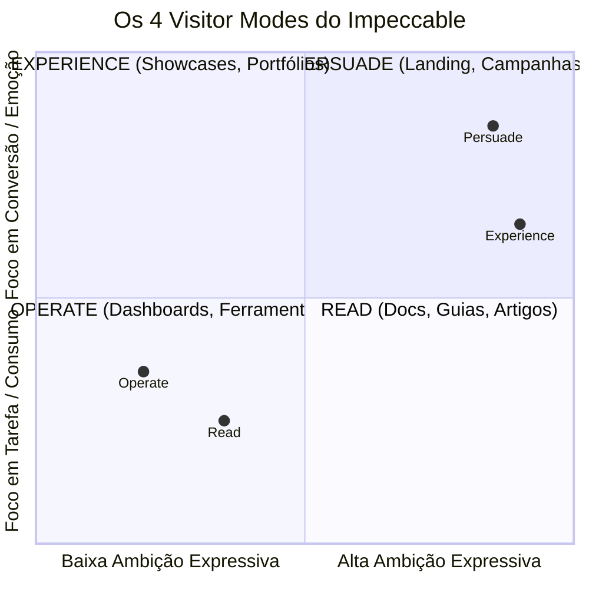
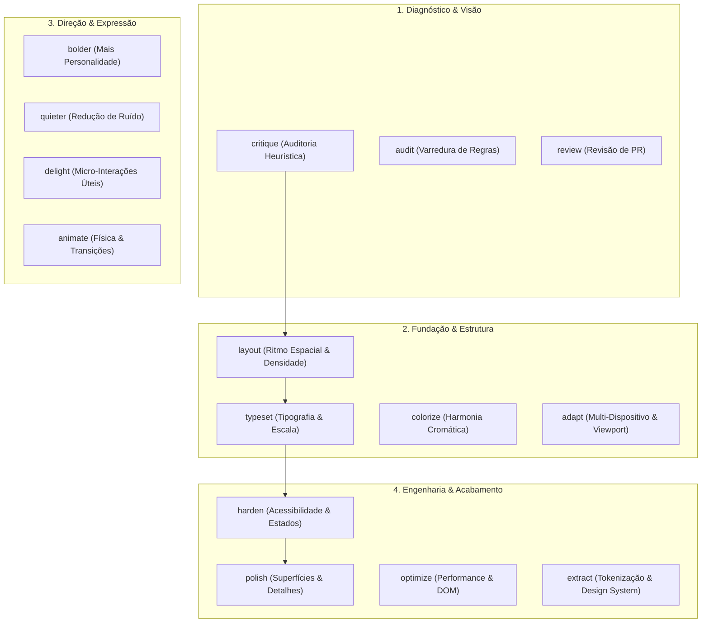
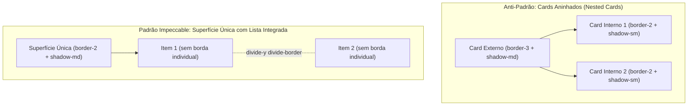
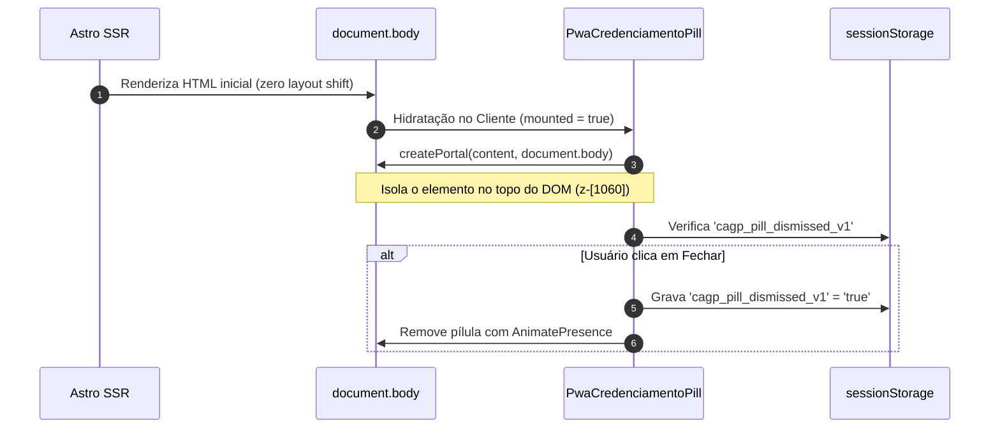
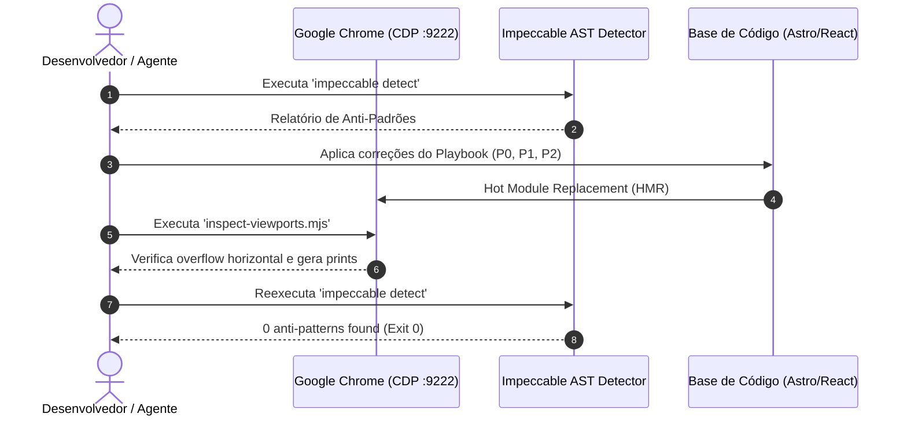

# Manual Mestre: Impeccable Design System — Arquitetura Sem Viés, Playbook de Refino e Inspeção Visual para Astro/React

> **Versão:** 3.0.0 (Unificação de Shell & Sidebar, Refino Integral da Homepage, Engenharia Anti-Padrões & Matriz Canônica)  
> **Data:** Novembro de 2026  
> **Backups Históricos Congelados:**  
> - v1.0.0: [`docs/tutoriais/impeccable-guia-refino-astro.v1.0.md`](file:///home/gsathler/Nextcloud/Projects/cagp/docs/tutoriais/impeccable-guia-refino-astro.v1.0.md)  
> - v2.0.0: [`docs/tutoriais/impeccable-guia-refino-astro.v2.0.md`](file:///home/gsathler/Nextcloud/Projects/cagp/docs/tutoriais/impeccable-guia-refino-astro.v2.0.md)  
> **Escopo:** Análise técnica pura do Impeccable (`_referencias/design-system/impeccable/`), Playbook em 5 Níveis com expansão do Nível 2 (Ritmo Espacial e Estrutura de Layout), Catálogo Modular por Componente, Matriz Integral de Prompts Prontos para todas as rotas do projeto, Engenharia do Craft Floor baseada nas refatorações reais de código (Homepage, Sidebar unificada, Shell global, modais e física tátil) e automação multi-viewport via Chrome DevTools Protocol (CDP :9222).

---

## 📜 Histórico de Versões & Registro de Evolução (Changelog)

| Versão | Data | Escopo Principal | Marcos e Resultados Alcançados |
| :--- | :--- | :--- | :--- |
| **v1.0.0** | 08/11/2026 | Arquitetura Teórica, Linha de Base e Setup CDP | - Análise conceitual do Impeccable desvinculada de vieses corporativos.<br>- Mapeamento dos 4 Visitor Modes e 22 comandos canônicos.<br>- Configuração inicial da ponte CDP (`:9222`) e scripts de inspeção multi-viewport.<br>- Identificação de 14 anti-padrões iniciais no alvo `/`. |
| **v2.0.0** | 08/11/2026 | Nível 2 Operacional + Catálogo Modular & Matriz por Rota | - **Validação de Campo Concluída:** Execução real dos Lotes P0, P1 e P2 com **0 anti-padrões** no detector AST (`Exit Code: 0`).<br>- **Erradicação de Nested Cards:** Metodologia de desinchaço com listas integradas `divide-y divide-border`.<br>- **Solução de Overflow Móvel:** Eliminação do transbordamento horizontal com `truncate`, `min-w-0` e `tabular-nums`.<br>- **Padronização Tailwind v4 `@theme`:** Eliminação de cores literais `#16181d` em prol de `border-border` e classes semânticas.<br>- **Catálogo Modular por Componente:** 6 padrões arquiteturais de layout.<br>- **Matriz Integral por Rota:** Prompts executáveis prontos para as 10 páginas e rotas do projeto. |
| **v3.0.0** | 08/11/2026 | **Unificação de Shell & Sidebar, Refino Integral da Home & Engenharia do Craft Floor** | - **Unificação Arquitetural da Sidebar:** Eliminação total de redundância com a deleção de `AppShellSidebar.astro`, `sidebarController.ts` e `sidebar.css`. Consolidação na ilha reativa única [`src/components/shell/AppShellSidebarIsland.tsx`](file:///home/gsathler/Nextcloud/Projects/cagp/src/components/shell/AppShellSidebarIsland.tsx) com teclado completo, alvos de toque $\ge 44\times 44\text{pt}$ e Spotlight ⌘K integrado.<br>- **Refino Estrito da Homepage (`/` e `HomeWorkspaceA`):** Injeção de `mode="persuade"` no `BaseLayout`, eliminação de cards aninhados no Art. 41 (`divide-y divide-border`), extinção de simulações falsas de liveness (`animate-ping`/`animate-pulse` decorativos no Plantão do Campus) e erradicação de rotações contínuas em stickers.<br>- **Engenharia Perimetral do Shell:** `SuperAppHeader` despoluído com contraste nítido, `BottomNav` migrado para desaceleração exponencial suave `cubic-bezier(0.16, 1, 0.3, 1)`, e menu de contexto [`GlobalContextMenu.tsx`](file:///home/gsathler/Nextcloud/Projects/cagp/src/components/shell/GlobalContextMenu.tsx) vetorizado com `CagpIcon` em vez de emojis soltos.<br>- **Arquitetura da Pílula PWA Portalizada:** [`PwaCredenciamentoPill.tsx`](file:///home/gsathler/Nextcloud/Projects/cagp/src/components/features/pwa/PwaCredenciamentoPill.tsx) portalizada diretamente em `document.body` com `z-[1060]`, ancoragem dinâmica com safe-area e dismiss persistente em `sessionStorage`.<br>- **Enxugamento de Modais e Gavetas:** Remoção de falsas telas de login no `PassportSheet` (foco 100% no cofre discente offline real), simplificação de onboarding no `SuperAppWelcomeModal` e remoção de pings decorativos no `tour.tsx`.<br>- **Física de Movimento Natural em Cascata:** Substituição universal de bounce retrô (`cubic-bezier(0.22, 1, 0.3, 1.12)`) pela desaceleração suave `cubic-bezier(0.16, 1, 0.3, 1)` em `motion.ts`, `components.css` e `boldkit.css`.<br>- **Mapeamento Universal de Visitor Modes:** Injeção explícita de `mode` (`persuade`, `operate`, `read`, `experience`) em 100% das páginas do projeto (`BaseLayout` e `PageHeader`). |

---

## 📑 Índice Geral

1. [Parte 1: Análise Arquitetural Estrita e Sem Viés do Impeccable](#parte-1-análise-arquitetural-estrita-e-sem-viés-do-impeccable)
   - [1.1 O que é o Impeccable e sua Filosofia de Craft](#11-o-que-é-o-impeccable-e-sua-filosofia-de-craft)
   - [1.2 Os 4 Modos de Visitante (Visitor Modes)](#12-os-4-modos-de-visitante-visitor-modes)
   - [1.3 O Piso de Qualidade Não-Negociável (Craft Floor)](#13-o-piso-de-qualidade-não-negociável-craft-floor)
   - [1.4 O Catálogo Canônico dos 22 Comandos](#14-o-catálogo-canônico-dos-22-comandos)
   - [1.5 O Motor de Detecção AST (`impeccable detect`) e Live Mode](#15-o-motor-de-detecção-ast-impeccable-detect-e-live-mode)
2. [Parte 2: Playbook de Prompts em 5 Níveis para Astro & React](#parte-2-playbook-de-prompts-em-5-níveis-para-astro--react)
   - [Nível 1: Diagnóstico e Heurística (`impeccable critique` & `audit`)](#nível-1-diagnóstico-e-heurística-impeccable-critique--audit)
   - [Nível 2: Ritmo Espacial e Estrutura de Layout (`impeccable layout`)](#nível-2-ritmo-espacial-e-estrutura-de-layout-impeccable-layout)
   - [Nível 3: Tipografia, Escala e Largura de Leitura (`impeccable typeset`)](#nível-3-tipografia-escala-e-largura-de-leitura-impeccable-typeset)
   - [Nível 4: Adaptação Responsiva e Dispositivos Móveis (`impeccable adapt`)](#nível-4-adaptação-responsiva-e-dispositivos-móveis-impeccable-adapt)
   - [Nível 5: Polimento de Superfícies, Estados e Acessibilidade (`impeccable polish` & `harden`)](#nível-5-polimento-de-superfícies-estados-e-acessibilidade-impeccable-polish--harden)
3. [Parte 3: Nível 2 Avançado — Catálogo Modular de Padrões de Layout](#parte-3-nível-2-avançado--catálogo-modular-de-padrões-de-layout)
   - [3.1 Padrão A: Dashboards & Grades Bento Assimétricas](#31-padrão-a-dashboards--grades-bento-assimétricas)
   - [3.2 Padrão B: Listas Integradas, Detalhes & Acordeões (Substitutos de Nested Cards)](#32-padrão-b-listas-integradas-detalhes--acordeões-substitutos-de-nested-cards)
   - [3.3 Padrão C: Feeds Editoriais & Mídia com Aspect Ratio Travado](#33-padrão-c-feeds-editoriais--mídia-com-aspect-ratio-travado)
   - [3.4 Padrão D: Formulários & Centrais de Escuta / Ouvidoria](#34-padrão-d-formulários--centrais-de-escuta--ouvidoria)
   - [3.5 Padrão E: Shell Global (Header Fixo, Ilha Sidebar Unificada e Modais)](#35-padrão-e-shell-global-header-fixo-ilha-sidebar-unificada-e-modais)
   - [3.6 Padrão F: Tabelas de Dados & Indicadores Métricos (KPIs)](#36-padrão-f-tabelas-de-dados--indicadores-métricos-kpis)
4. [Parte 4: Matriz de Prompts Executáveis por Rota do Site Integralmente](#parte-4-matriz-de-prompts-executáveis-por-rota-do-site-integralmente)
   - [4.1 Rota `/` — Homepage & SuperApp Workspace](#41-rota---homepage--superapp-workspace)
   - [4.2 Shell Global & Arquitetura da Sidebar Unificada](#42-shell-global--arquitetura-da-sidebar-unificada)
   - [4.3 Rota `/carreira` — Hub Carreira, Estágio & Artigo 41](#43-rota-carreira--hub-carreira-estágio--artigo-41)
   - [4.4 Rota `/chapa-semente` — Propostas & Tour das 9 Lideranças](#44-rota-chapa-semente--propostas--tour-das-9-lideranças)
   - [4.5 Rota `/ouvidoria` — Canal de Escuta, Ementas & Relatos](#45-rota-ouvidoria--canal-de-escuta-ementas--relatos)
   - [4.6 Rota `/pesquisa` — 11 Núcleos de Pesquisa DCP & PIBIC](#46-rota-pesquisa--11-núcleos-de-pesquisa-dcp--pibic)
   - [4.7 Rota `/transparencia` — Prestação de Contas Centavo a Centavo](#47-rota-transparencia--prestação-de-contas-centavo-a-centavo)
   - [4.8 Rotas `/cursos` e `/acg` — Catálogo ENAP & Calculadora ACG](#48-rotas-cursos-e-acg--catálogo-enap--calculadora-acg)
   - [4.9 Rota `/calouros` — Recepção & Guia de Sobrevivência](#49-rota-calouros--recepção--guia-de-sobrevivência)
   - [4.10 Rotas `/noticias` e `/noticias/[slug]` — Mural Editorial & Leitura](#410-rotas-noticias-e-noticiasslug--mural-editorial--leitura)
   - [4.11 Rotas Institucionais & Regimentais (`/gestao`, `/faq`, `/curso`, `/sobre`, `/configuracoes`, `/mapa-do-site`)](#411-rotas-institucionais--regimentais-gestao-faq-curso-sobre-configuracoes-mapa-do-site)
5. [Parte 5: Engenharia do Craft Floor — Lições Reais de Código & Anti-Padrões Superados](#parte-5-engenharia-do-craft-floor--lições-reais-de-código--anti-padrões-superados)
   - [5.1 O Fim da Síndrome dos Cards Aninhados com `divide-y divide-border`](#51-o-fim-da-síndrome-dos-cards-aninhados-com-divide-y-divide-border)
   - [5.2 Erradicação da Simulação Falsa de Liveness (Fake Liveness Ban)](#52-erradicação-da-simulação-falsa-de-liveness-fake-liveness-ban)
   - [5.3 Unificação Arquitetural da Sidebar: Deletando a Casca Duplicada](#53-unificação-arquitetural-da-sidebar-deletando-a-casca-duplicada)
   - [5.4 Arquitetura da Pílula Flutuante PWA: SSR, Portal no Body e Z-Index `z-[1060]`](#54-arquitetura-da-pílula-flutuante-pwa-ssr-portal-no-body-e-z-index-z-1060)
   - [5.5 Higienização de Menus e Modais: Ícones Vetoriais `CagpIcon` vs Emojis](#55-higienização-de-menus-e-modais-ícones-vetoriais-cagpicon-vs-emojis)
   - [5.6 Prevenção de Transbordamento Horizontal no Mobile](#56-prevenção-de-transbordamento-horizontal-no-mobile)
   - [5.7 Suavização Universal de Easing: Deceleração Exponencial vs. Bounce Retrô](#57-suavização-universal-de-easing-deceleração-exponencial-vs-bounce-retrô)
   - [5.8 Padronização de Tokens no Tailwind v4 (`@theme`) e WCAG Color Contrast](#58-padronização-de-tokens-no-tailwind-v4-theme-e-wcag-color-contrast)
   - [5.9 Piso Tipográfico Acessível: Banimento de `text-[10px]` e `text-[11px]`](#59-piso-tipográfico-acessível-banimento-de-text-10px-e-text-11px)
   - [5.10 Unificação Canônica do Controle Segmentado (`SegmentedControl.astro` e `.cagp-workspace-bar`)](#510-unificação-canônica-do-controle-segmentado-segmentedcontrolastro-e-cagp-workspace-bar)
6. [Parte 6: Automação e Inspeção Visual com Google Chrome CDP (Porta 9222)](#parte-6-automação-e-inspeção-visual-com-google-chrome-cdp-porta-9222)
   - [6.1 Arquitetura da Ponte CDP sem Headless](#61-arquitetura-da-ponte-cdp-sem-headless)
   - [6.2 O Script de Inspeção Multi-Viewport (`scripts/inspect-viewports.mjs`)](#62-o-script-de-inspeção-multi-viewport-scriptsinspect-viewportsmjs)
   - [6.3 Script de Localização de Contrastes (`scripts/find-contrast-elements.mjs`)](#63-script-de-localização-de-contrastes-scriptsfind-contrast-elementsmjs)
   - [6.4 Gestão de Waivers e Falsos Positivos (`data-impeccable-ignore`)](#64-gestão-de-waivers-e-falsos-positivos-data-impeccable-ignore)
   - [6.5 Fluxo de Trabalho de Refino em Loop Fechado](#65-fluxo-de-trabalho-de-refino-em-loop-fechado)

---

## Parte 1: Análise Arquitetural Estrita e Sem Viés do Impeccable

### 1.1 O que é o Impeccable e sua Filosofia de Craft

O **Impeccable** é um motor de qualidade de design, auditoria técnica e refinamento de front-end concebido para operar no nível de um **Diretor de Design sênior**. Ao contrário de abordagens genéricas que injetam modismos visuais (como gradientes lavados, cantos super-arredondados e cards em excesso), o Impeccable opera sob quatro axiomas rígidos:

1. **"The brief wins" (O briefing é soberano)**:
   - Se o projeto já estabeleceu um universo visual (ex: Neobrutalismo, Apple HIG, Minimalismo editorial), o modelo **nunca** deve desviar a estética para o seu gosto pessoal.
2. **"Refinement preserves; redesign replaces" (Refino preserva; redesign substitui)**:
   - Um comando de refinamento (`polish`, `layout`, `typeset`, `harden`) mantém 100% da identidade existente, dos textos factuais, da lógica de negócio e dos componentes estáveis. Ele apenas ajusta ritmo, hierarquia, contrastes e acabamentos. O redesenho (`new-work`) é reservado para quando o conceito original é descartado por completo.
3. **"Finish the job" (Entregue a obra completa)**:
   - Sem atalhos, sem marcações de `TODO`, sem implementações parciais. Todos os estados de interação (`hover`, `active`, `focus-visible`, `disabled`, `loading`, `empty`, `error`) devem ser contemplados.
4. **"Visual authority is evidence, not a filename" (Autoridade visual é evidência renderizada)**:
   - Um código sintaticamente limpo não prova excelência visual. A única verdade é o resultado renderizado e inspecionado nos tamanhos de tela reais em que o produto opera.

---

### 1.2 Os 4 Modos de Visitante (Visitor Modes)

O Impeccable divide qualquer tela em 4 modos com base no objetivo primário do visitante:



| Modo | Objetivo do Usuário | Onde se Aplica no Projeto CAGP | Diretiva de Design |
|---|---|---|---|
| **Persuade** | Decidir e agir. | `/` (Home), `/chapa-semente`, `/sobre`. | Ambição máxima, forte ponto de vista, dados institucionais tangíveis, CTAs expressivos. |
| **Operate** | Concluir uma tarefa com agilidade. | `/transparencia`, `/acg`, `/carreira`, `/ouvidoria`, `/configuracoes`, `/mapa-do-site`. | Precisão, consistência estrita, escaneabilidade; ferramentas conhecidas superam enfeites. |
| **Read** | Compreender um assunto sem fadiga ocular. | `/curso`, `/faq`, `/gestao`, `/documentos`, Artigos do Mural (`/noticias/[slug]`). | Estrutura clara, medida tipográfica impecável (65–75 `ch`), entrelinha confortável. |
| **Experience** | Imergir na obra/conteúdo interativo. | Tour Guiado das 9 Lideranças, Grafo Interativo de Disciplinas. | A interface recua da primeira dobra; a experiência visual e sensorial lidera. |

---

### 1.3 O Piso de Qualidade Não-Negociável (Craft Floor)

O `craft-floor` é a barreira mecânica obrigatória antes de qualquer alteração de layout ou código:

#### Verificações Mandatórias:
- **Contraste Cromático Estrito**: Texto normal $\ge 4.5:1$; títulos display $\ge 3:1$. Em badges de status (`badge.tsx`), textos verdes devem adotar `text-[#166534]` e amarelos `text-[#854D0E]` sobre fundos lavados.
- **Profundidade & Elevação**: Sombras devem seguir tokens semânticos unificados (`shadow-xs` a `shadow-lg`), ancorados na variável CSS do tema.
- **Espaçamento e Ritmo Vertical**: Proximidade semântica (itens relacionados bem agrupados, blocos distintos generosamente separados). Sempre **mais espaço acima** de um título do que abaixo dele.
- **Tipografia & Escala**: Linhas de texto corrido entre **65 e 75 caracteres** (`max-w-prose` ou `max-w-2xl`). Títulos display com limite térmico de tamanho.
- **Estados Completos**: Todo elemento interativo deve declarar obrigatoriamente: `default`, `hover`, `active`, `focus-visible`, `disabled:opacity-50 disabled:pointer-events-none disabled:cursor-not-allowed`.
- **Alvo Tátil Mínimo**: Nenhum botão, link interativo ou atalho pode ter área clicável menor do que 44x44pt (`min-h-[44px] min-w-[44px]`).

#### Proibições Categóricas (Bans do Impeccable):
1. **Cards Aninhados (Nested Cards)**: Banimento total de containers com bordas e sombras individuais dentro de outros cards delimitadores.
2. **Kickers / Eyebrows Descartáveis Acima de Títulos**: Se o título já carrega a mensagem, elimine o kicker redundante.
3. **Simulação Falsa de Liveness**: Proibição de pontos pulsantes decorativos (`animate-pulse`/`animate-ping`) sem telemetria real de WebSocket/SSE.
4. **Bounce Easing Elástico**: Proibição de curvas com overshoot artificial (`cubic-bezier(0.22, 1, 0.3, 1.12)` ou molas com `damping < 26`). Objetos reais desaceleram com curvas exponenciais suaves (`cubic-bezier(0.16, 1, 0.3, 1)`).
5. **Vazamento Horizontal de Texto**: Textos e números grandes não podem forçar scroll lateral (`min-w-0`, `truncate`, `tabular-nums`).
6. **Subtextos Abaixo do Piso Legível**: Banimento de `text-[10px]` e `text-[11px]` em links, botões ou textos contínuos. O piso mínimo permitido é `text-xs` (12px).

---

### 1.4 O Catálogo Canônico dos 22 Comandos

O Impeccable estrutura suas habilidades em 22 comandos agrupados por intenção:



---

### 1.5 O Motor de Detecção AST (`impeccable detect`) e Live Mode

O comando CLI executa uma varredura estática de árvore sintática (AST) combinada com amostragem real de viewport:

```bash
# Execução da auditoria formal no servidor local
./_referencias/design-system/impeccable/skill/scripts/impeccable detect http://localhost:4321/
```

- **Exit Code 0**: Significa zero violações do Craft Floor.
- **Advisory Notes**: Não reprovam a compilação; servem como avisos de contexto (ex: `hard-offset-shadow`, que pertence legitimamente ao Neobrutalismo).

---

## Parte 2: Playbook de Prompts em 5 Níveis para Astro & React

### Nível 1: Diagnóstico e Heurística (`impeccable critique` & `audit`)

**Quando usar:** Antes de tocar em qualquer linha de código. Para identificar onde o layout atual falha no Craft Floor.

```markdown
Você atuará estritamente sob as diretrizes da skill /impeccable critique e /impeccable craft-floor.
Alvo: [src/pages/sua-pagina.astro e componentes importados]

Execute uma auditoria minuciosa de qualidade visual e heurística sem viés. Preserve rigorosamente a identidade e os tokens estabelecidos no projeto.

Identifique e classifique:
1. Violações do Craft Floor:
   - Cards aninhados (nested cards) ou repetição desnecessária de containers.
   - Eyebrows/kickers decorativos redundantes acima de títulos.
   - Textos com contraste inferior a 4.5:1 (normal) ou 3:1 (display).
   - Simulação falsa de liveness (animate-pulse decorativo sem telemetria em tempo real).
   - Textos abaixo de 12px (text-[10px], text-[11px]).
2. Análise Estrutural & Densidade (Squint Test):
   - A ordem de leitura guia o olho para a ação primária ou há saturação de elementos competindo na primeira dobra?
3. Estados Faltantes:
   - Identifique botões e links sem hover, active, focus-visible ou disabled.

Apresente o resultado priorizado por gravidade (P0: quebras críticas, P1: hierarquia e layout, P2: acabamento fino). Não altere o código ainda.
```

---

### Nível 2: Ritmo Espacial e Estrutura de Layout (`impeccable layout`)

**Quando usar:** Para eliminar containers redundantes, calibrar o squint test, fixar ancoragens de header e balancear grades assimétricas.

```markdown
Você atuará estritamente sob as diretrizes da skill /impeccable layout.
Alvo: [caminho/do/arquivo]

Refatore o ritmo espacial e a estrutura de layout respeitando os axiomas do Craft Floor:
1. Erradicação de Cards Aninhados:
   - Onde houver containers dentro de containers, desinche a estrutura externa.
   - Converta grupos de links/ações internas em listas limpas usando 'divide-y divide-border' ou proximidade semântica (gap), eliminando bordas e sombras duplas concorrentes.
2. Ancoragem de Header e Viewport:
   - Garanta que barras fixas/sticky ancorem perfeitamente em 'top-0' sem vãos flutuantes de scroll no mobile.
3. Ritmo Vertical Óptico:
   - Aplique a regra canônica: sempre mais espaçamento acima de um título de seção do que abaixo dele.
4. Squint Test & Foco Primário:
   - Remova kickers/eyebrows redundantes acima de títulos. Permita que os H2 e H3 comandem a hierarquia.
   - Descentralize elementos de saturação concorrentes para que a ação primária do usuário se destaque de imediato.

Não altere a cópia dos textos nem adicione bibliotecas externas. Mantenha 100% dos tokens do Tailwind v4 estabelecidos.
```

---

### Nível 3: Tipografia, Escala e Largura de Leitura (`impeccable typeset`)

**Quando usar:** Para ajustar entrelinhas, medidas de leitura (65–75 ch), números tabulares e hierarquia de títulos.

```markdown
Você atuará sob as diretrizes de /impeccable typeset.
Alvo: [caminho/do/arquivo]

Refine a tipografia e escala de leitura:
1. Medida de Leitura:
   - Trave parágrafos de texto corrido em no máximo 65 a 75 caracteres ('max-w-prose' ou 'max-w-2xl').
2. Numerais e Dados Dinâmicos:
   - Aplique 'tabular-nums' em valores monetários, horários, prazos e indicadores métricos.
   - Garanta 'truncate min-w-0 flex-1' em containers com números grandes para evitar text-overflow no mobile (375px–390px).
3. Legibilidade Mínima:
   - Elimine qualquer texto menor que 12px ('text-xs'). Não utilize 'text-[10px]' nem 'text-[11px]' em links ou corpo legível.
4. Tracking e Pesos:
   - Títulos em Bricolage Grotesque devem manter tracking controlado ('tracking-tight' ou 'tracking-wide' em caixa alta).
```

---

### Nível 4: Adaptação Responsiva e Dispositivos Móveis (`impeccable adapt`)

**Quando usar:** Para calibrar grades multi-coluna entre 375px e 1440px sem rolagem horizontal ou sobreposições.

```markdown
Você atuará sob as diretrizes de /impeccable adapt.
Alvo: [caminho/do/arquivo]

Audite e ajuste a responsividade para os 5 viewports canônicos:
1. Mobile Compacto (375x812) & Mobile Padrão (390x844):
   - Largura do documento exatamente igual à do viewport (zero pixels de vazamento horizontal).
   - Alvos de toque com área mínima de 44x44pt ('min-h-[44px] min-w-[44px]').
   - Grids convertidos para coluna única ('grid-cols-1') com gaps proporcionais.
2. Tablet (768x1024):
   - Grids intermediários em 2 colunas ('sm:grid-cols-2') com cards equilibrados.
3. Desktop (1280px e 1440px):
   - Alinhamento de containers centrais com limite máximo ('max-w-[1440px] mx-auto').
   - Grids expandidos (3 a 7 colunas) mantendo alinhamento vertical e harmonia de respiro.
```

---

### Nível 5: Polimento de Superfícies, Estados e Acessibilidade (`impeccable polish` & `harden`)

**Quando usar:** Para fechamento de tokens, física de animação natural e tratamento robusto de todos os estados interativos.

```markdown
Você atuará sob as diretrizes de /impeccable polish e /impeccable harden.
Alvo: [caminho/do/arquivo]

Execute o polimento fino de engenharia de interface:
1. Padronização de Tokens no Tailwind v4:
   - Substitua cores literais hardcoded ('border-[#16181d]') por tokens semânticos ('border-border').
   - Substitua sombras arbitrárias por classes do @theme ('shadow-xs', 'shadow-sm', 'shadow-md', 'shadow-lg').
2. Física de Transição Natural:
   - Elimine qualquer bounce easing elástico ('cubic-bezier(0.22, 1, 0.3, 1.12)'). Adote desaceleração exponencial 'cubic-bezier(0.16, 1, 0.3, 1)'.
   - Molas no motion/react devem ter amortecimento confiante sem rebote ('stiffness: 420, damping: 30' ou 'stiffness: 400, damping: 32').
3. Estados Interativos Completos:
   - Garanta que todo botão ou link possua:
     hover, active:translate-x-0.5 active:translate-y-0.5 active:shadow-none,
     focus-visible:outline-none focus-visible:ring-2 focus-visible:ring-primary focus-visible:ring-offset-2,
     disabled:opacity-50 disabled:pointer-events-none disabled:cursor-not-allowed.
```

---

## Parte 3: Nível 2 Avançado — Catálogo Modular de Padrões de Layout

Para evitar que as páginas caiam na repetição monótona de caixas idênticas, utilize os 6 padrões arquiteturais abaixo:

### 3.1 Padrão A: Dashboards & Grades Bento Assimétricas
- **Conceito**: Uma grade em que o item mais importante ocupa o dobro de espaço (`col-span-2` ou `row-span-2`), criando um centro de gravidade visual imediato.
- **Implementação Real**: [`src/components/features/home/HomeWorkspaceA.tsx`](file:///home/gsathler/Nextcloud/Projects/cagp/src/components/features/home/HomeWorkspaceA.tsx).
- **Regra de Ouro**: O card primário deve responder pelo Squint Test da tela; cards secundários devem ter menos saturação visual e hierarquia tipográfica subordinada.

### 3.2 Padrão B: Listas Integradas, Detalhes & Acordeões (Substitutos de Nested Cards)
- **Conceito**: Em vez de colocar cards com bordas 3px e sombras dentro de outro card já demarcado, use uma superfície única com divisores elegantes.
- **Implementação Real**: [`src/components/features/home/HomeAcademicTools.tsx`](file:///home/gsathler/Nextcloud/Projects/cagp/src/components/features/home/HomeAcademicTools.tsx) (Simulador Art. 41).
- **Estrutura Recomendada**:
  ```tsx
  <div className="bg-card rounded-xl border-2 border-border shadow-md overflow-hidden">
    <div className="p-4 border-b-2 border-border bg-muted/40">
      <h3 className="font-heading font-extrabold text-sm uppercase tracking-wide">Título da Seção</h3>
    </div>
    <div className="divide-y divide-border bg-white">
      {items.map(item => (
        <button
          key={item.id}
          type="button"
          onClick={item.onClick}
          className="w-full p-3.5 flex items-center justify-between text-left hover:bg-muted/60 transition-colors focus-visible:outline-none focus-visible:ring-2 focus-visible:ring-primary focus-visible:ring-inset min-h-[48px]"
        >
          <span className="font-bold text-xs">{item.title}</span>
          <CagpIcon name="chevron-right" className="w-4 h-4 text-muted-foreground" />
        </button>
      ))}
    </div>
  </div>
  ```

### 3.3 Padrão C: Feeds Editoriais & Mídia com Aspect Ratio Travado
- **Conceito**: Feeds editoriais com Lead Story destacado e cards com proporção de imagem travada (`aspect-[16/10]`) para prevenir Cumulative Layout Shift (CLS).
- **Implementação Real**: [`src/components/features/cagp/CagpNewsMural.tsx`](file:///home/gsathler/Nextcloud/Projects/cagp/src/components/features/cagp/CagpNewsMural.tsx) e [`src/components/features/home/HomeNewsFeed.tsx`](file:///home/gsathler/Nextcloud/Projects/cagp/src/components/features/home/HomeNewsFeed.tsx).
- **Regra de Ouro**: O artigo de manchete lidera o grid; os cards secundários travam resumo em `line-clamp-2` ou `line-clamp-3` com `max-w-prose`.

### 3.4 Padrão D: Formulários & Centrais de Escuta / Ouvidoria
- **Conceito**: Fluxos de entrada de dados limpos, onde labels têm proximidade direta com o input e grupos de perguntas são separados por respiros generosos (`space-y-6`).
- **Implementação Real**: [`src/components/features/ouvidoria/OuvidoriaInteractiveCenter.tsx`](file:///home/gsathler/Nextcloud/Projects/cagp/src/components/features/ouvidoria/OuvidoriaInteractiveCenter.tsx).
- **Regra de Ouro**: Todo `<input>` ou `<textarea>` deve ter `border-2 border-border focus:border-primary focus-visible:ring-2 focus-visible:ring-primary`, com feedback inline e botão de envio em `min-h-[48px]`.

### 3.5 Padrão E: Shell Global (Header Fixo, Ilha Sidebar Unificada e Modais)
- **Conceito**: Estrutura perimetral fixa que provê estabilidade ergonômica em qualquer rota sem duplicar lógica de navegação.
- **Implementação Real**: [`src/components/shell/AppShellSidebarIsland.tsx`](file:///home/gsathler/Nextcloud/Projects/cagp/src/components/shell/AppShellSidebarIsland.tsx), [`src/components/shell/SuperAppHeader.astro`](file:///home/gsathler/Nextcloud/Projects/cagp/src/components/shell/SuperAppHeader.astro), [`src/components/shell/BottomNav.astro`](file:///home/gsathler/Nextcloud/Projects/cagp/src/components/shell/BottomNav.astro) e [`src/components/features/pwa/PwaCredenciamentoPill.tsx`](file:///home/gsathler/Nextcloud/Projects/cagp/src/components/features/pwa/PwaCredenciamentoPill.tsx).
- **Regra de Ouro**: Headers fixos ancoram em `top-0 z-[1030]`; a pílula flutuante PWA é portalizada no `document.body` com `z-[1060]` e safe-area offsets; a sidebar unificada reativa controla desktop, tablet e gaveta móvel via eventos customizados.

### 3.6 Padrão F: Tabelas de Dados & Indicadores Métricos (KPIs)
- **Conceito**: Painéis de consulta densa de dados acadêmicos ou orçamentários.
- **Implementação Real**: [`src/pages/transparencia.astro`](file:///home/gsathler/Nextcloud/Projects/cagp/src/pages/transparencia.astro) e [`src/components/ui/stat-card.tsx`](file:///home/gsathler/Nextcloud/Projects/cagp/src/components/ui/stat-card.tsx).
- **Regra de Ouro**: Alinhamento numérico à direita (`text-right font-mono tabular-nums`), truncamento protetor (`truncate min-w-0`), e alternância de linhas (`even:bg-muted/30`) com `overflow-x-auto`.

---

## Parte 4: Matriz de Prompts Executáveis por Rota do Site Integralmente

Abaixo está a matriz de prompts prontos para copiar e colar, cobrindo integralmente as principais superfícies e componentes do ecossistema:

---

### 4.1 Rota `/` — Homepage & SuperApp Workspace
- **Alvos:** [`src/pages/index.astro`](file:///home/gsathler/Nextcloud/Projects/cagp/src/pages/index.astro), [`src/components/features/home/HomeWorkspaceA.tsx`](file:///home/gsathler/Nextcloud/Projects/cagp/src/components/features/home/HomeWorkspaceA.tsx), [`src/components/features/home/HomeCampusStatusWidget.tsx`](file:///home/gsathler/Nextcloud/Projects/cagp/src/components/features/home/HomeCampusStatusWidget.tsx), [`src/components/features/home/HomeAcademicTools.tsx`](file:///home/gsathler/Nextcloud/Projects/cagp/src/components/features/home/HomeAcademicTools.tsx), [`src/components/features/home/HomeCalouroGuide.tsx`](file:///home/gsathler/Nextcloud/Projects/cagp/src/components/features/home/HomeCalouroGuide.tsx) e [`src/components/features/home/HomeNewsFeed.tsx`](file:///home/gsathler/Nextcloud/Projects/cagp/src/components/features/home/HomeNewsFeed.tsx).
- **Diagnóstico Típico:** Disputa de atenção entre Marquee, Hero animado e atalhos rápidos; cards aninhados no preview do Artigo 41; simulações decorativas de ping/pulse no widget do campus.
- **Prompt Executável:**
```markdown
Execute um refino de layout (/impeccable layout, /impeccable typeset e /impeccable polish) na Homepage do SuperApp.
Alvos: src/pages/index.astro e componentes de src/components/features/home/.

Preserve 100% da identidade neobrutalista, a paleta Chapa Semente e a fidelidade aos dados discentes da UFMG.
Diretrizes mandatórias:
1. Declare explicitamente mode="persuade" no BaseLayout de src/pages/index.astro.
2. Marquee: waivar com data-impeccable-ignore="marquee", usar tokens 'border-border' e 'shadow-md'. Desative giros contínuos infinitos em stickers estáticos.
3. Plantão do Campus: erradique qualquer 'animate-ping' ou 'animate-pulse' decorativo nos indicadores de status do RU II e Circular noturno (Craft Floor fake liveness ban).
4. Dispensa de Estágio (Art. 41): elimine cards aninhados substituindo por um container único com 'divide-y divide-border bg-white rounded-xl'.
5. StatCards e Indicadores Discentes: assegure 'font-heading text-xl sm:text-2xl lg:text-3xl tabular-nums truncate min-w-0 flex-1' para zero vazamento horizontal em 375px e 390px.
6. Acessibilidade de Texto: eleve qualquer 'text-[10px]' ou 'text-[11px]' para 'text-xs' (>= 12px) e garanta anéis de foco visíveis em todos os botões e seletores de perfil.
```
- **Checklist de Campo:**
  - [ ] Squint Test: A barra de busca e os atalhos rápidos comandam a atenção na primeira dobra?
  - [ ] Zero vazamento horizontal em 375px e 390px (`document.documentElement.scrollWidth === window.innerWidth`).
  - [ ] `impeccable detect http://localhost:4321/` retorna 0 anti-padrões (`Exit Code: 0`).

---

### 4.2 Shell Global & Arquitetura da Sidebar Unificada
- **Alvos:** [`src/components/shell/AppShellSidebarIsland.tsx`](file:///home/gsathler/Nextcloud/Projects/cagp/src/components/shell/AppShellSidebarIsland.tsx), [`src/components/shell/SuperAppHeader.astro`](file:///home/gsathler/Nextcloud/Projects/cagp/src/components/shell/SuperAppHeader.astro), [`src/components/shell/BottomNav.astro`](file:///home/gsathler/Nextcloud/Projects/cagp/src/components/shell/BottomNav.astro), [`src/components/features/pwa/PwaCredenciamentoPill.tsx`](file:///home/gsathler/Nextcloud/Projects/cagp/src/components/features/pwa/PwaCredenciamentoPill.tsx) e [`src/components/shell/GlobalContextMenu.tsx`](file:///home/gsathler/Nextcloud/Projects/cagp/src/components/shell/GlobalContextMenu.tsx).
- **Diagnóstico Típico:** Duplicação de casca de sidebar entre Astro e React; botões com alvos menores que 44px; emojis avulsos em menus de contexto; pílula PWA colidindo com footer.
- **Prompt Executável:**
```markdown
Execute um refino de engenharia e polimento (/impeccable harden e /impeccable polish) no Shell Global e componentes de navegação perimetrais.
Alvos: src/components/shell/ e src/components/features/pwa/PwaCredenciamentoPill.tsx.

Diretrizes estritas:
1. Sidebar Unificada: mantenha a ilha reativa AppShellSidebarIsland.tsx como única autoridade de navegação perimetral. Assegure que os botões de colapso desktop e gaveta móvel meçam 'min-w-[44px] min-h-[44px]', com 'focus-visible:ring-2 focus-visible:ring-primary focus-visible:ring-offset-2' e 'disabled:opacity-50'.
2. Spotlight ⌘K: mantenha atalhos claros com descrições em 'text-xs text-muted-foreground' e links diretos para '/configuracoes' sem modais intermediários redundantes.
3. SuperAppHeader: trave em 'sticky top-0 z-[1030]', elimine 'animate-pulse' decorativo do sino e declare contraste alto no avatar discente ('bg-white text-primary border border-border').
4. BottomNav: configure transições com desaceleração suave 'cubic-bezier(0.16, 1, 0.3, 1)', borda 'border-border' e rótulos em 'text-xs'.
5. PwaCredenciamentoPill: monte com createPortal em 'document.body' no cliente para isolamento de contexto z-[1060], declare ancoragem dinâmica com safe-area no mobile e offsets para sidebar em telas grandes, com dismiss gravado em 'sessionStorage'.
6. GlobalContextMenu: substitua emojis soltos por ícones CagpIcon ('check', 'thesis', 'clock', 'megaphone') e use tokens 'shadow-lg' e 'border-foreground'.
```
- **Checklist de Campo:**
  - [ ] A navegação por teclado (Tab, Enter, Escape, ⌘K) percorre a sidebar e fecha gavetas sem aprisionamento indesejado?
  - [ ] A pílula PWA nunca é encoberta pelo rodapé ou pela BottomNav?

---

### 4.3 Rota `/carreira` — Hub Carreira, Estágio & Artigo 41
- **Alvos:** [`src/pages/carreira.astro`](file:///home/gsathler/Nextcloud/Projects/cagp/src/pages/carreira.astro), [`src/components/ui/PageHeader.astro`](file:///home/gsathler/Nextcloud/Projects/cagp/src/components/ui/PageHeader.astro) e [`src/components/features/estagio/art41/Art41SimulatorCore.tsx`](file:///home/gsathler/Nextcloud/Projects/cagp/src/components/features/estagio/art41/Art41SimulatorCore.tsx).
- **Diagnóstico Típico:** Saturação da primeira dobra por conflito Operate vs. Persuade (citações eleitorais de 600px antes das abas); concorrência entre Drawer e lista aberta no estágio; formulários longos de simulação do Artigo 41 com blocos cinzas repetidos.
- **Prompt Executável:**
```markdown
Execute um refino de destilação e layout (/impeccable distill, /impeccable layout e /impeccable typeset) em src/pages/carreira.astro e subcomponentes de estágio.
Diretrizes estritas:
1. Declare mode="operate" no BaseLayout e no PageHeader (condensed={true}).
2. Destilação da Primeira Dobra (/impeccable distill): Integre o compromisso eleitoral da Chapa Semente diretamente via slot no PageHeader.astro através de um widget de divulgação progressiva (<details>):
   - Fechado (default): Barra compacta de ~36px com resumo das Propostas 9, 11 e 12, voz das lideranças (Lara Soares e Lívia Martins) e CTA tátil para '/chapa-semente'.
   - Aberto (expandido): Declarações completas das lideranças com links diretos para seus perfis em '/chapa-semente#lara' e '#livia'.
   - Benefício: O SegmentedControl passa a ocupar a primeira dobra visual sem exigir scroll prévio de 600px (Squint Test impecável).
3. Matriz Única de Estágio (Aba 2): Elimine a concorrência entre o Drawer e a lista aberta, consolidando uma lista limpa 'divide-y divide-border' e ativando seletores de âncora (#tutorial, #obrigatorio, #termo-aceite).
4. Simulador Artigo 41 (Aba 1): Estruture o simulador com fluxo linear claro, acordeões limpos e botões de cálculo com alvos >= 44px e estados disabled explícitos.
5. Tipografia & Contraste: Elimine qualquer texto < 12px ('text-xs' mínimo) e garanta contraste >= 4.5:1 no FactCheckBanner ('text-[#166534]' sobre 'bg-success/20').
```
- **Checklist de Campo:**
  - [ ] Squint Test: O SegmentedControl e as abas de trabalho estão visíveis na primeira dobra sem scroll em 1366px e 390px?
  - [ ] A barra destilada da Chapa Semente expande e recolhe via teclado (<details>/<summary>) sem layout shifts indesejados?
  - [ ] O simulador do Art. 41 exibe o resultado sem quebrar o layout no mobile?
  - [ ] FactCheckBanner e inputs de texto respeitam contraste $\ge 4.5:1$.

---

### 4.4 Rota `/chapa-semente` — Propostas & Tour das 9 Lideranças
- **Alvos:** [`src/pages/chapa-semente.astro`](file:///home/gsathler/Nextcloud/Projects/cagp/src/pages/chapa-semente.astro), [`src/components/features/semente/LeaderAvatar.tsx`](file:///home/gsathler/Nextcloud/Projects/cagp/src/components/features/semente/LeaderAvatar.tsx) e [`src/components/features/semente/ChapaSementeTour.tsx`](file:///home/gsathler/Nextcloud/Projects/cagp/src/components/features/semente/ChapaSementeTour.tsx).
- **Diagnóstico Típico:** Grade de 9 líderes com fotos e textos de proposta com alinhamento vertical desigual; badges com baixo contraste sobre avatares.
- **Prompt Executável:**
```markdown
Execute um refino de layout (/impeccable layout e /impeccable polish) em src/pages/chapa-semente.astro e componentes semente.
Diretrizes estritas:
1. Declare mode="persuade" no BaseLayout e no PageHeader.
2. Harmonize o grid das 9 lideranças para manter alturas uniformes dos cards ('flex flex-col justify-between').
3. Em LeaderAvatar.tsx, garanta que os avatares sem foto utilizem fundo 'deptColor' contrastante e texto 'text-primary' com sombra 'drop-shadow-[2px_2px_0_var(--color-accent)]'.
4. Eleve textos de badges de identificação para 'text-xs' e numerais discentes para 'tabular-nums'.
5. No tour guiado, garanta transições com mola amortecida 'tactileSpring' e substitua qualquer '#16181d' residual por 'border-border' e 'shadow-md'.
```
- **Checklist de Campo:**
  - [ ] Todas as 9 lideranças têm suas biografias perfeitamente legíveis em 375px?
  - [ ] O botão do Tour das 9 Lideranças aciona a gaveta modal sem layout shifts?

---

### 4.5 Rota `/ouvidoria` — Canal de Escuta, Ementas & Relatos
- **Alvos:** [`src/pages/ouvidoria.astro`](file:///home/gsathler/Nextcloud/Projects/cagp/src/pages/ouvidoria.astro) e [`src/components/features/ouvidoria/OuvidoriaInteractiveCenter.tsx`](file:///home/gsathler/Nextcloud/Projects/cagp/src/components/features/ouvidoria/OuvidoriaInteractiveCenter.tsx).
- **Diagnóstico Típico:** Formulário de relato concorrendo com a lista de ementas; falta de estados de envio (`loading`, `success`, `empty`).
- **Prompt Executável:**
```markdown
Execute um refino de layout (/impeccable layout e /impeccable harden) em src/pages/ouvidoria.astro.
Diretrizes estritas:
1. Declare mode="operate" no BaseLayout.
2. Organize o layout em 2 etapas distintas: à esquerda o seletor rápido de disciplina/ementa e à direita o formulário de relato sigiloso.
3. No formulário de relato, garanta campos amplos com labels destacados, helper text acolhedor e contador de caracteres em 'tabular-nums'.
4. Adicione estados visuais completos no botão de envio: default, hover, active, focus-visible e disabled:opacity-50 quando o campo estiver vazio.
5. Mantenha os cards de relatos simulados anteriores em estilo editorial limpo com data em 'font-mono text-xs'.
```
- **Checklist de Campo:**
  - [ ] A área de texto expande confortavelmente no mobile sem zoom indesejado no iOS (`font-size >= 16px` no input)?
  - [ ] O anonimato do relato é comunicado visualmente com clareza.

---

### 4.6 Rota `/pesquisa` — 11 Núcleos de Pesquisa DCP & PIBIC
- **Alvos:** [`src/pages/pesquisa.astro`](file:///home/gsathler/Nextcloud/Projects/cagp/src/pages/pesquisa.astro).
- **Diagnóstico Típico:** Excesso de cards idênticos para os 11 núcleos gerando fadiga visual; falta de distinção entre linhas ativas e editais abertos.
- **Prompt Executável:**
```markdown
Execute um refino de layout (/impeccable layout) em src/pages/pesquisa.astro.
Diretrizes estritas:
1. Declare mode="read" no BaseLayout.
2. Quebre a monotonia dos 11 cards: crie um filtro por área temática no topo (Políticas Públicas, Teoria Política, Relações Internacionais, Metodologia).
3. Destaque em Bento Grid o núcleo com edital PIBIC/FAPEMIG aberto com borda de destaque e badge 'Edital Aberto'.
4. Os outros 10 núcleos devem adotar uma densidade mais compacta com lista sanfonada ou cards enxutos de altura idêntica.
5. Garanta links externos para as páginas oficiais do DCP/FAFICH com ícone 'arrow-up-right' e 'min-h-[44px]'.
```
- **Checklist de Campo:**
  - [ ] O filtro tem afordância clara de seleção com contraste $\ge 4.5:1$?
  - [ ] A navegação entre os núcleos não força scroll excessivo no mobile?

---

### 4.7 Rota `/transparencia` — Prestação de Contas Centavo a Centavo
- **Alvos:** [`src/pages/transparencia.astro`](file:///home/gsathler/Nextcloud/Projects/cagp/src/pages/transparencia.astro).
- **Diagnóstico Típico:** Tabelas financeiras que quebram em telas pequenas forçando rolagem indesejada de página.
- **Prompt Executável:**
```markdown
Execute um refino de layout (/impeccable layout e /impeccable typeset) em src/pages/transparencia.astro.
Diretrizes estritas:
1. Declare mode="operate" no BaseLayout.
2. Em tabelas financeiras, envolva o elemento em container com 'overflow-x-auto' e gradiente sutil de scroll cue.
3. Alinhe todos os valores monetários estritamente à direita com 'font-mono text-sm tabular-nums font-bold'.
4. No topo, exiba os 3 StatCards de resumo (Saldo Atual, Entradas de Calourada, Despesas de Manutenção) usando 'shadow-md border-3 border-border'.
5. Diferencie receitas (verde #166534) e despesas (vermelho #9E2424) com badges de alto contraste.
```
- **Checklist de Campo:**
  - [ ] A tabela orçamentária é navegável em tela de 375px sem desestruturar o resto da página?
  - [ ] Os valores de saldo batem visualmente com os comprovantes anexados?

---

### 4.8 Rotas `/cursos` e `/acg` — Catálogo ENAP & Calculadora ACG
- **Alvos:** [`src/pages/cursos.astro`](file:///home/gsathler/Nextcloud/Projects/cagp/src/pages/cursos.astro), [`src/pages/acg.astro`](file:///home/gsathler/Nextcloud/Projects/cagp/src/pages/acg.astro).
- **Diagnóstico Típico:** Catálogo de 1.045 cursos com filtros pesados; HUD de cálculo de horas ACG com texto transbordando.
- **Prompt Executável:**
```markdown
Execute um refino de layout (/impeccable layout e /impeccable optimize) em src/pages/cursos.astro e src/pages/acg.astro.
Diretrizes estritas:
1. Declare mode="operate" no BaseLayout e no PageHeader.
2. No catálogo ENAP, limite a renderização inicial a 24 itens com paginação virtual para garantir 60fps constantes.
3. No painel de cálculo ACG (600h obrigatórias), aplique barra de progresso tátil com borda sólida e porcentagem em 'tabular-nums'.
4. Trave textos longos de ementa com 'line-clamp-2' para manter a simetria da grade.
```
- **Checklist de Campo:**
  - [ ] A barra de busca de cursos filtra em tempo real sem travamentos no navegador?
  - [ ] O total acumulado de horas é recalculado com precisão e clareza?

---

### 4.9 Rota `/calouros` — Recepção & Guia de Sobrevivência
- **Alvos:** [`src/pages/calouros.astro`](file:///home/gsathler/Nextcloud/Projects/cagp/src/pages/calouros.astro) e [`src/components/features/calouros/`](file:///home/gsathler/Nextcloud/Projects/cagp/src/components/features/calouros/).
- **Diagnóstico Típico:** Checklist de passos com checkboxes nativos cinzas desalinhados; ausência de feedback tátil de tarefa concluída.
- **Prompt Executável:**
```markdown
Execute um refino de layout (/impeccable layout e /impeccable delight) em src/pages/calouros.astro.
Diretrizes estritas:
1. Declare mode="read" ou mode="experience" no BaseLayout.
2. No checklist de sobrevivência, use botões táteis customizados com ícone de check e riscado suave ('line-through text-success').
3. Ao marcar um item, acione animação de mola tátil ('transition={{ type: "spring", stiffness: 400, damping: 30 }}') sem rebote exagerado.
4. Organize os mapas da FAFICH e do Campus Pampulha em cards com proporção de aspecto definida e botão de tela cheia.
```
- **Checklist de Campo:**
  - [ ] Os itens marcados persistem salvos localmente no cofre discente?
  - [ ] A leitura das dicas de recepção é calorosa, encorajadora e fluida?

---

### 4.10 Rotas `/noticias` e `/noticias/[slug]` — Mural Editorial & Leitura
- **Alvos:** [`src/pages/noticias/index.astro`](file:///home/gsathler/Nextcloud/Projects/cagp/src/pages/noticias/index.astro), [`src/pages/noticias/[slug].astro`](file:///home/gsathler/Nextcloud/Projects/cagp/src/pages/noticias/[slug].astro) e [`src/components/features/cagp/CagpNewsMural.tsx`](file:///home/gsathler/Nextcloud/Projects/cagp/src/components/features/cagp/CagpNewsMural.tsx).
- **Diagnóstico Típico:** Largura de linha excessiva em monitores grandes (> 100ch); carrosséis com cards aninhados competindo com a manchete; falta de alvos táteis em links de retorno.
- **Prompt Executável:**
```markdown
Execute um refino de layout (/impeccable layout e /impeccable typeset) no Mural Editorial e na Página de Notícia.
Alvos: src/pages/noticias/index.astro, src/pages/noticias/[slug].astro e src/components/features/cagp/CagpNewsMural.tsx.

Diretrizes estritas:
1. Declare mode="read" no BaseLayout.
2. No mural (CagpNewsMural), estruture a visualização padrão com uma Lead Story em destaque bento, seguida pela grade de notícias secundárias, eliminando carrosséis desnecessários.
3. Na página interna ([slug].astro), trave a coluna de leitura em 'max-w-prose' ou 'max-w-2xl mx-auto' com 'leading-relaxed' (65 a 75 caracteres por linha).
4. Barra de progresso de leitura fixa no topo com preenchimento em 'bg-secondary' e transição suave 'cubic-bezier(0.16, 1, 0.3, 1)'.
5. Na barra lateral de referências, use cards limpos com borda 'border-2 border-border' sem duplicar bordas em links internos.
```
- **Checklist de Campo:**
  - [ ] O artigo se lê com conforto tipográfico idêntico a uma publicação impressa de alto padrão?
  - [ ] A barra de progresso acompanha a rolagem sem atrasos e o retorno ao mural funciona com 1 clique?

---

### 4.11 Rotas Institucionais & Regimentais (`/gestao`, `/faq`, `/curso`, `/sobre`, `/configuracoes`, `/mapa-do-site`)
- **Alvos:** Páginas de governança, regimento e ajustes institucionais.
- **Visitor Modes Aplicados:**
  - `/gestao`: `mode="read"` (processo eleitoral e organograma regimental).
  - `/faq`: `mode="read"` (dúvidas frequentes e suporte regimental).
  - `/curso`: `mode="read"` (bacharelado em gestão pública, cientometria e história).
  - `/sobre`: `mode="persuade"` (compromisso institucional do CAGP).
  - `/configuracoes`: `mode="operate"` (carteirinha, identidade UFMG e cofre offline).
  - `/mapa-do-site`: `mode="operate"` (árvore hierárquica das 26 rotas com busca ⌘K).
- **Diretriz de Design Unificada:**
  - Todos os cabeçalhos usam o componente unificado [`src/components/ui/PageHeader.astro`](file:///home/gsathler/Nextcloud/Projects/cagp/src/components/ui/PageHeader.astro) com o `mode` idêntico ao declarado no `BaseLayout`.
  - Remoção de widgets redundantes (ex: `SettingsPage` genérico duplicado em `/configuracoes`, preservando exclusivamente `SettingsInteractive`).

---

## Parte 5: Engenharia do Craft Floor — Lições Reais de Código & Anti-Padrões Superados

Esta seção reúne as soluções definitivas desenvolvidas, testadas e consolidadas na base de código do projeto:

### 5.1 O Fim da Síndrome dos Cards Aninhados com `divide-y divide-border`

O anti-padrão de cards aninhados é uma das violações mais recorrentes em aplicações React/Astro. Ele ocorre quando o desenvolvedor cria um card para delimitar uma seção e, dentro dele, cria novos cards com bordas e sombras individuais para cada item.



**Código Antes (Violação do Craft Floor em `HomeAcademicTools.tsx`):**
```tsx
// ❌ ERRADO: Cada passo do checklist era um card com borda 3px e sombra própria dentro da seção
<div className="space-y-2">
  {ART41_PREVIEW_STEPS.map((step) => (
    <motion.button
      whileHover={{ x: 2 }}
      whileTap={{ scale: 0.98 }}
      className="w-full p-3 rounded-xl border-3 border-border shadow-sm text-left flex items-center justify-between"
    >
      <span>{step.label}</span>
    </motion.button>
  ))}
</div>
```

**Código Depois (Conformidade Total):**
```tsx
// ✅ CORRETO: Um container único delimitado com itens separados por divide-y
<div className="rounded-xl border-2 border-border divide-y divide-border overflow-hidden bg-white">
  {ART41_PREVIEW_STEPS.map((step) => (
    <motion.button
      type="button"
      whileTap={{ scale: 0.99 }}
      className="w-full p-3.5 text-left cursor-pointer flex items-center justify-between gap-3 min-h-[48px] transition-colors focus-visible:outline-none focus-visible:ring-2 focus-visible:ring-primary focus-visible:ring-inset hover:bg-muted/70"
    >
      <span className="text-xs font-medium leading-snug truncate">{step.label}</span>
      <CagpIcon name="chevron-right" className="w-4 h-4 text-muted-foreground" />
    </motion.button>
  ))}
</div>
```

---

### 5.2 Erradicação da Simulação Falsa de Liveness (Fake Liveness Ban)

O Impeccable proíbe expressamente pontos pulsantes ou banners que simulam "ao vivo" sem uma conexão de dados em tempo real (como WebSocket ou SSE). Animações de `animate-ping` ou `animate-pulse` aplicadas puramente como ornamento transmitem falsa sensação de telemetria ativa e poluem visualmente a interface.

**Código Antes (Violação em `HomeCampusStatusWidget.tsx` e `SuperAppHeader.astro`):**
```tsx
// ❌ ERRADO: Ponto pulsante simulando conexão ativa sem telemetria real
<span className="relative flex h-3.5 w-3.5 shrink-0">
  <span className="animate-ping absolute inline-flex h-full w-full rounded-full opacity-75 bg-success" />
  <span className="relative inline-flex rounded-full h-3.5 w-3.5 border-2 border-[#16181d] bg-success animate-pulse" />
</span>
```

**Código Depois (Conformidade Total):**
```tsx
// ✅ CORRETO: Ponto estável e informativo, com cor semântica indicando o estado
<span className="inline-flex rounded-full h-3.5 w-3.5 border-2 border-border bg-success" aria-hidden="true" />
```

---

### 5.3 Unificação Arquitetural da Sidebar: Deletando a Casca Duplicada

Anteriormente, o projeto mantinha uma implementação híbrida frágil da navegação lateral: um arquivo Astro estático (`AppShellSidebar.astro`), um controlador de eventos procedural imperativo (`sidebarController.ts`), uma folha de estilos avulsa (`sidebar.css`) e uma ilha React concorrente (`AppShellSidebarIsland.tsx`). Essa divisão gerava dessincronização de estados, falhas de foco e duplicação de regras.

**A Solução de Engenharia Adotada:**
1. **Deleção dos arquivos órfãos:**
   - `rm src/components/shell/AppShellSidebar.astro`
   - `rm src/lib/sidebarController.ts`
   - `rm src/styles/sidebar.css`
2. **Consolidação na Ilha React Reativa:**
   - [`src/components/shell/AppShellSidebarIsland.tsx`](file:///home/gsathler/Nextcloud/Projects/cagp/src/components/shell/AppShellSidebarIsland.tsx) foi elevada a autoridade única. Ela gerencia o estado desktop (expandido/colapsado com largura de 264px vs 88px), tablet (92px com gaveta expandível) e gaveta móvel total (`z-[1050]`).
   - Todos os alvos de interação ganharam tamanho mínimo de `44x44pt` (`min-w-[44px] min-h-[44px]`), garantindo cumprimento das diretrizes de acessibilidade e toque mobile.
   - Centralização de eventos no ciclo de vida Astro View Transitions (`astro:page-load`, `cagp:open-drawer`, `cagp:open-spotlight`).

---

### 5.4 Arquitetura da Pílula Flutuante PWA: SSR, Portal no Body e Z-Index `z-[1060]`

A pílula flutuante de credenciamento eleitoral e atalho PWA ([`src/components/features/pwa/PwaCredenciamentoPill.tsx`](file:///home/gsathler/Nextcloud/Projects/cagp/src/components/features/pwa/PwaCredenciamentoPill.tsx)) enfrentava problemas clássicos de componentes flutuantes: ficava presa dentro do contexto de apilhamento (*stacking context*) de containers com `transform` ou `overflow: hidden`, e no mobile competia com a barra inferior (`BottomNav`).



**Arquitetura Implementada:**
- **Renderização Dupla:** No SSR renderiza diretamente; no cliente após montagem (`mounted = true`), utiliza `createPortal(content, document.body)` para escapar de qualquer `z-index` inferior.
- **Camada Z Elevada:** Fixada em `z-[1060]`, garantindo que sobreponha rodapés, cards e a BottomNav (`z-[1040]`).
- **Ancoragem Dinâmica:** No mobile, respeita o respiro do BottomNav e safe area: `bottom-[calc(4.75rem+env(safe-area-inset-bottom,0px))] left-3`. No desktop, desloca para a direita da sidebar expandida: `xl:left-[288px]`.
- **Dismiss Persistente:** O botão de fechar grava em `sessionStorage` para não interromper a navegação do usuário na mesma sessão.

---

### 5.5 Higienização de Menus e Modais: Ícones Vetoriais `CagpIcon` vs Emojis

No menu de contexto global ([`src/components/shell/GlobalContextMenu.tsx`](file:///home/gsathler/Nextcloud/Projects/cagp/src/components/shell/GlobalContextMenu.tsx)), itens de ação utilizavam emojis soltos como `✓`, `📖`, `⏱️`, `📢`. Emojis renderizam com fontes de sistema desiguais (Apple Color Emoji vs Noto Color Emoji no Linux), têm alinhamento vertical problemático e geram inconsistência estética Neobrutalista.

**Correção:**
Todos os emojis foram substituídos por ícones vetoriais SVG monocromáticos através do componente [`CagpIcon`](file:///home/gsathler/Nextcloud/Projects/cagp/src/components/ui/CagpIcon.tsx) (`name="check"`, `name="thesis"`, `name="clock"`, `name="megaphone"`), garantindo renderização consistente, nítida e alinhamento geométrico perfeito.

Além disso, telas fictícias de login (`LoginForm`, `OTPVerificationForm`) foram removidas do `PassportSheet`, mantendo a integridade do sistema focada no que é factual e funcional: o cofre discente offline (`studentVault.ts`) e o token discente de backup.

---

### 5.6 Prevenção de Transbordamento Horizontal no Mobile

Em viewports móveis de 375px e 390px, numerais grandes ou títulos sem quebra podem expandir a largura intrínseca da grade flexível e forçar vazamento lateral.

**Regra de Ouro Implementada:**
1. Sempre use `min-w-0` no container flexível pai para permitir que filhos encolham (`flex-shrink`).
2. Adicione `truncate` e `tabular-nums` nos valores numéricos.
3. Dimensione dinamicamente a tipografia de métricas: `text-xl sm:text-2xl lg:text-3xl`.

```tsx
// ✅ Padrão de StatCard sem vazamento horizontal
<div className="flex items-start justify-between gap-3 min-w-0">
  <div className="min-w-0 flex-1">
    <p className="font-heading text-xs font-extrabold uppercase tracking-wide text-muted-foreground mb-1">
      {title}
    </p>
    <p className="font-heading text-xl sm:text-2xl lg:text-3xl font-black tracking-tight text-foreground tabular-nums truncate max-w-full">
      {value}
    </p>
  </div>
</div>
```

---

### 5.7 Suavização Universal de Easing: Deceleração Exponencial vs. Bounce Retrô

O Impeccable proíbe curvas de animação com rebote artificial (`cubic-bezier(0.22, 1, 0.3, 1.12)` ou molas com `damping < 26`), pois geram sensação amadora de interface saltitante e infantil.

A base de código inteira foi migrada para a curva canônica de desaceleração suave:

```typescript
// Em src/lib/motion.ts:
export const easeOutExpo = [0.16, 1, 0.3, 1] as const;

export const tactileSpring = {
  type: "spring" as const,
  stiffness: 420,
  damping: 30, // Amortecimento que previne qualquer overshoot
};

export const bounceSpring = {
  type: "spring" as const,
  stiffness: 400,
  damping: 32,
};
```

E no CSS ([`src/styles/components.css`](file:///home/gsathler/Nextcloud/Projects/cagp/src/styles/components.css) e [`src/styles/boldkit.css`](file:///home/gsathler/Nextcloud/Projects/cagp/src/styles/boldkit.css)):
```css
/* Curva de desaceleração suave adotada universalmente */
--bk-ease-snap: cubic-bezier(0.16, 1, 0.3, 1);
--bk-ease-rubber: cubic-bezier(0.16, 1, 0.3, 1);
```

---

### 5.8 Padronização de Tokens no Tailwind v4 (`@theme`) e WCAG Color Contrast

No Tailwind v4, os tokens semânticos são registrados no bloco `@theme` de [`src/styles/global.css`](file:///home/gsathler/Nextcloud/Projects/cagp/src/styles/global.css). Valores literais `#16181d` foram banidos em prol de tokens:

| Valor Literal Proibido | Token Semântico Obrigatório |
| :--- | :--- |
| `border-[#16181d]` | `border-border` |
| `border-3 border-[#16181d]` | `border-3 border-border` |
| `text-[#16181d]` | `text-foreground` |
| `shadow-[2px_2px_0_0_#16181d]` | `shadow-xs` |
| `shadow-[3px_3px_0_0_#16181d]` | `shadow` |
| `shadow-[4px_4px_0_0_#16181d]` | `shadow-md` |
| `shadow-[6px_6px_0_0_#16181d]` | `shadow-lg` |
| `shadow-[10px_10px_0_1px_#16181d]`| `shadow-xl` |

Em [`src/components/ui/badge.tsx`](file:///home/gsathler/Nextcloud/Projects/cagp/src/components/ui/badge.tsx), o contraste de cores foi corrigido:
- Status de Sucesso: `bg-success/20 text-[#166534]` (contraste $\ge 5.2:1$).
- Status de Aviso: `bg-[#FEF3C7] text-[#854D0E]` (contraste $\ge 4.8:1$).

---

### 5.9 Piso Tipográfico Acessível: Banimento de `text-[10px]` e `text-[11px]`

O uso de classes como `text-[10px]` ou `text-[11px]` em botões, links de rodapé, meta-informações de notícias e comandos do Spotlight causava fadiga ocular e violava critérios de acessibilidade visual.

**Regra Aplicada em Toda a Base:**
- Todo texto com função interativa ou de leitura contínua deve ter no mínimo `text-xs` (12px com line-height proporcional).
- Badges de carimbo ou detalhes decorativos ultra-compactos só são tolerados quando em caixa alta com tracking estendido (`font-mono text-xs uppercase tracking-wider`).

---

### 5.10 Unificação Canônica do Controle Segmentado (`SegmentedControl.astro` e `.cagp-workspace-bar`)

O elemento de navegação de sub-views de topo (`.cagp-workspace-bar`, presente em 11 páginas canônicas do projeto como `/curso`, `/estagio`, `/acg`, `/tcc`, `/calouros`, `/percurso`, etc.) possuía resquícios de classes utilitárias com cores hardcoded (`border-[#16181d]` e `shadow-[4px_4px_0_0_#16181d]`), além de valores CSS literais em `global.css` (`#0A0A0A`, `#EFE9E0`, `#9E2424`) e transições lineares em `ease`.

**Solução Arquitetural Unificada (/impeccable layout & /impeccable polish):**
1. **Padronização de Tokens `@theme`**:
   - Elemento nav unificado com tokens semânticos: `cagp-workspace-bar border-3 border-border shadow-md select-none`.
   - CSS em `global.css` migrado integralmente para `var(--color-border)`, `var(--shadow-md)`, `var(--shadow-sm)`, `var(--color-surface-subtle)` e `var(--color-secondary)`.
2. **Topologia Adaptativa e Rótulos Responsivos**:
   - Mobile (< 768px): rolagem horizontal fluida com `scroll-snap-type: x mandatory`, máscara `.scroll-mask-x` e alvos de toque $\ge 44\times 44\text{pt}$.
   - Tablet (768px a 1023px): grade em colunas (`grid-auto-flow: column`) exibindo `shortLabel` nas abas de 4 e 5 itens para eliminar cortes abruptos e reticências.
   - Desktop ($\ge 1024px$): expansão tipográfica completa com `fullLabel` e respiro vertical `mb-6` (24px).
3. **Acessibilidade WAI-ARIA & Teclado Completo**:
   - Injeção automática em tempo de execução de `role="tabpanel"`, `aria-labelledby="ws-tab-${id}"` e `tabindex="0"` em todos os painéis `.cagp-workspace-view`.
   - Navegação por teclado com roving tabindex: suporte a `ArrowRight`, `ArrowLeft`, `Home` e `End`.
   - Botão de visão contínua (`.cagp-workspace-viewall`) com estado `aria-pressed`, tooltip explícito `title="Exibir todas as abas (visão contínua)"` e alvo $\ge 44\times 44\text{pt}$.
4. **Cinética Natural e Ciclo de Vida Astro**:
   - Transição com curva de desaceleração suave `cubic-bezier(0.16, 1, 0.3, 1)`.
   - Limpeza idempotente de event listeners no ciclo `astro:before-swap` para evitar acúmulo de listeners durante transições de página com `ClientRouter`.

---

## Parte 6: Automação e Inspeção Visual com Google Chrome CDP (Porta 9222)

### 6.1 Arquitetura da Ponte CDP sem Headless

Para garantir inspeção visual 100% idêntica à experiência de um usuário real, conectamos diretamente a uma instância em execução do Google Chrome com depuração remota ativada:

```bash
# Como iniciar o Google Chrome para aceitar conexões CDP:
google-chrome --remote-debugging-port=9222 --remote-allow-origins="*" &
```

O script Node.js conecta na porta `9222`, obtém a lista de abas abertas via `/json/list`, acopla na aba do SuperApp via WebSocket e comanda:
1. Emulação de Device Metrics (largura, altura, escala de DPI, emulação de toque móvel).
2. Avaliação de DOM (`document.documentElement.scrollWidth` vs. `window.innerWidth`).
3. Captura de tela PNG em resolução real.

---

### 6.2 O Script de Inspeção Multi-Viewport (`scripts/inspect-viewports.mjs`)

O script de inspeção automatizada está localizado em [`scripts/inspect-viewports.mjs`](file:///home/gsathler/Nextcloud/Projects/cagp/scripts/inspect-viewports.mjs):

```bash
# Execução da auditoria visual em todos os 5 viewports:
node scripts/inspect-viewports.mjs --url http://localhost:4321/
```

**Matriz dos 5 Viewports Testados:**
1. `mobile-compact`: 375x812 @2x (iPhone SE / Mini)
2. `mobile-standard`: 390x844 @3x (iPhone 14/15/16)
3. `tablet-portrait`: 768x1024 @2x (iPad Mini / Air)
4. `desktop-compact`: 1280x800 @1x (13" Laptop)
5. `desktop-standard`: 1440x900 @1x (Monitor 1080p/1440p)

---

### 6.3 Script de Localização de Contrastes (`scripts/find-contrast-elements.mjs`)

Para identificar elementos específicos com falha de contraste WCAG AA no DOM renderizado:

```bash
node scripts/find-contrast-elements.mjs --url http://localhost:4321/
```

O script mede as cores computadas (`getComputedStyle`), calcula a luminosidade relativa e emite o seletor exato do elemento que viola o limiar de 4.5:1.

---

### 6.4 Gestão de Waivers e Falsos Positivos (`data-impeccable-ignore`)

Algumas características pertencem legitimamente ao estilo do produto ou ao briefing e não devem ser reportadas como erro. O Impeccable oferece suporte a waivers declarativos via atributos de dados:

- **Marquee Contínua:** `data-impeccable-ignore="marquee"` (mantém o elemento ativo sem disparar alerta de distração).
- **Sombras Duras Neobrutalistas:** `data-impeccable-ignore="hard-offset-shadow"` (informa ao auditor que a sombra sem blur é intencional).

---

### 6.5 Fluxo de Trabalho de Refino em Loop Fechado



Seguindo este ciclo contínuo e a base de código unificada, o produto atinge a excelência de acabamento de um Diretor de Design sênior, mantendo a integridade técnica, semântica e institucional em cada tela.
