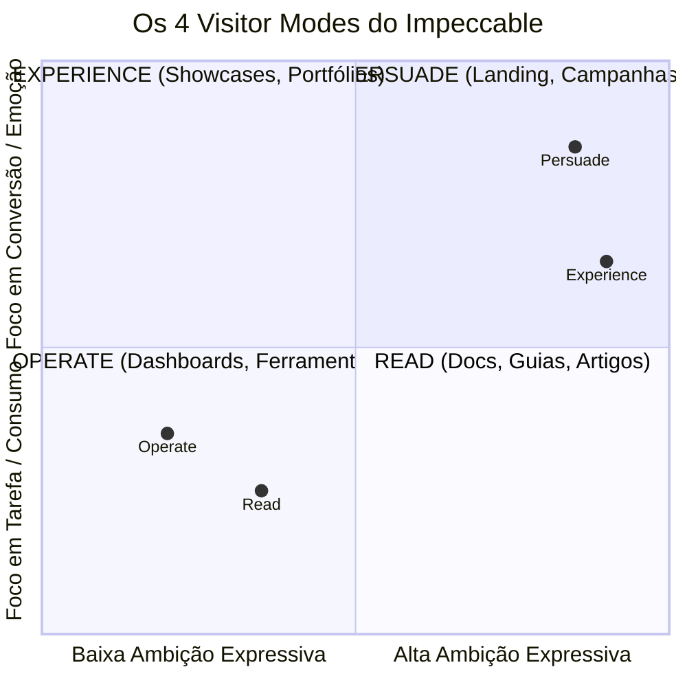
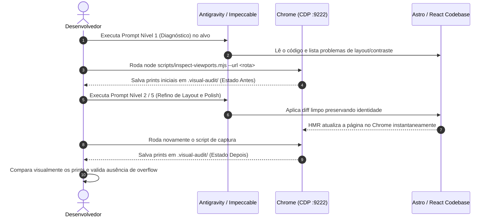

# Manual Mestre: Impeccable Design System — Arquitetura Sem Viés, Playbook de Refino e Inspeção Visual para Astro/React

> **Versão:** 1.0.0  
> **Escopo:** Análise técnica pura do Impeccable (`_referencias/design-system/impeccable/`), Playbook de prompts para refino de sites Astro/React, eliminação de anti-padrões de layout e inspeção visual multi-viewport via Chrome DevTools Protocol (CDP :9222).

---

## Índice

1. [Parte 1: Análise Arquitetural Estrita e Sem Viés do Impeccable](#parte-1-análise-arquitetural-estrita-e-sem-viés-do-impeccable)
   - [1.1 O que é o Impeccable e sua Filosofia de Craft](#11-o-que-é-o-impeccable-e-sua-filosofia-de-craft)
   - [1.2 Os 4 Modos de Visitante (Visitor Modes)](#12-os-4-modos-de-visitante-visitor-modes)
   - [1.3 O Piso de Qualidade Não-Negociável (Craft Floor)](#13-o-piso-de-qualidade-não-negociável-craft-floor)
   - [1.4 O Catálogo Canônico dos 22 Comandos](#14-o-catálogo-canônico-dos-22-comandos)
   - [1.5 O Motor de Detecção AST (`impeccable detect`) e Live Mode](#15-o-motor-de-detecção-ast-impeccable-detect-e-live-mode)
2. [Parte 2: Playbook de Prompts em 5 Níveis para Astro & React](#parte-2-playbook-de-prompts-em-5-níveis-para-astro--react)
   - [Nível 1: Diagnóstico e Heurística](#nível-1-diagnóstico-e-heurística-impeccable-critique--audit)
   - [Nível 2: Ritmo Espacial e Estrutura de Layout](#nível-2-ritmo-espacial-e-estrutura-de-layout-impeccable-layout)
   - [Nível 3: Tipografia, Escala e Largura de Leitura](#nível-3-tipografia-escala-e-largura-de-leitura-impeccable-typeset)
   - [Nível 4: Adaptação Responsiva e Dispositivos Móveis](#nível-4-adaptação-responsiva-e-dispositivos-móveis-impeccable-adapt)
   - [Nível 5: Polimento de Superfícies, Estados e Acessibilidade](#nível-5-polimento-de-superfícies-estados-e-acessibilidade-impeccable-polish)
3. [Parte 3: Guia de Foco Exclusivo — Layout, Polimento e Craft Floor](#parte-3-guia-de-foco-exclusivo--layout-polimento-e-craft-floor)
   - [3.1 O Fim da Síndrome dos Cards Aninhados (Nested Cards)](#31-o-fim-da-síndrome-dos-cards-aninhados-nested-cards)
   - [3.2 Ritmo Espacial Óptico vs. Matemático](#32-ritmo-espacial-óptico-vs-matemático)
   - [3.3 Estados de Superfície e Acabamento de Navegador](#33-estados-de-superfície-e-acabamento-de-navegador)
   - [3.4 Matriz Comparativa: Código Ingênuo vs. Código com Craft Floor](#34-matriz-comparativa-código-ingênuo-vs-código-com-craft-floor)
4. [Parte 4: Estudos de Caso Práticos no Projeto CAGP](#parte-4-estudos-de-caso-práticos-no-projeto-cagp)
   - [4.1 Caso 1: Shell e Navegação (`SuperAppHeader` e `BottomNav`)](#41-caso-1-shell-e-navegação-superappheader-e-bottomnav)
   - [4.2 Caso 2: Homepage e Workspace (`src/pages/index.astro`)](#42-caso-2-homepage-e-workspace-srcpagesindexastro)
   - [4.3 Caso 3: Modais e Gavetas Globais (`GlobalSheets.tsx`)](#43-caso-3-modais-e-gavetas-globais-globalsheetstsx)
5. [Parte 5: Automação e Inspeção Visual com Google Chrome CDP (Porta 9222)](#parte-5-automação-e-inspeção-visual-com-google-chrome-cdp-porta-9222)
   - [5.1 Como Funciona a Depuração Remota (CDP)](#51-como-funciona-a-depuração-remota-cdp)
   - [5.2 O Script de Inspeção Multi-Viewport (`scripts/inspect-viewports.mjs`)](#52-o-script-de-inspeção-multi-viewport-scriptsinspect-viewportsmjs)
   - [5.3 Fluxo de Trabalho de Refino em Loop Contínuo](#53-fluxo-de-trabalho-de-refino-em-loop-contínuo)

---

## Parte 1: Análise Arquitetural Estrita e Sem Viés do Impeccable

### 1.1 O que é o Impeccable e sua Filosofia de Craft

O **Impeccable** é um motor de qualidade de design, auditoria técnica e refinamento de front-end concebido para operar no nível de um **Diretor de Design premiado**. Ao contrário de ferramentas ou prompts genéricos que inserem estilos repetitivos de frameworks (como gradientes sem contraste, cantos arredondados excessivos e modais para qualquer ação), o Impeccable opera sob axiomas rígidos:

1. **"The brief wins" (O briefing é soberano)**:
   - Se o projeto já estabeleceu um universo visual (ex: Neobrutalismo, Apple HIG, Minimalismo editorial), o modelo **nunca** deve desviar a estética para seu gosto pessoal.
2. **"Refinement preserves; redesign replaces" (Refino preserva; redesign substitui)**:
   - Um comando de refinamento (`polish`, `layout`, `typeset`) mantém 100% da identidade existente, dos textos factuais, da lógica de negócio e dos componentes estáveis. Ele apenas ajusta ritmo, hierarquia, contrastes e acabamentos. O redesenho (`new-work`) é reservado para quando o conceito original é descartado por completo.
3. **"Finish the job" (Entregue a obra completa)**:
   - Sem atalhos, sem marcações de `TODO`, sem implementações parciais. Todos os estados de interação (hover, active, disabled, loading, empty, error) devem ser definidos.
4. **"Visual authority is evidence, not a filename" (Autoridade visual é evidência renderizada)**:
   - Um código sintaticamente limpo não prova excelência visual. A única verdade é o resultado renderizado e inspecionado nos tamanhos de tela reais em que o produto opera.

---

### 1.2 Os 4 Modos de Visitante (Visitor Modes)

O Impeccable divide qualquer tela em 4 modos com base no objetivo primário do visitante na superfície:



| Modo | Objetivo do Usuário | Onde se Aplica | Diretiva de Design |
|---|---|---|---|
| **Persuade** | Decidir e agir. | Landing pages, páginas institucionais, vendas, campanhas. | Ambição máxima, forte ponto de vista, imagens reais, forte apelo emocional. |
| **Operate** | Concluir uma tarefa com agilidade. | Dashboards, editores, painéis administrativos, configurações, fluxos de preenchimento. | Precisão, consistência estrita, escaneabilidade, padrões conhecidos outrank expressão decorativa. |
| **Read** | Compreender um assunto sem fadiga. | Documentação, tutoriais, artigos, FAQ, normativas. | Estrutura clara, medida tipográfica impecável (65–75 caracteres), entrelinha confortável, ausência de ruído. |
| **Experience** | Imergir na obra/conteúdo. | Portfólios, galerias, experimentos interativos. | A interface recua da primeira dobra; o artefato visual lidera. |

> [!IMPORTANT]
> O modo é definido **por superfície**, e não pelo produto como um todo. Por exemplo: a página inicial de um SuperApp pode operar em modo `Persuade` ou `Operate`, enquanto sua página de documentação ou FAQ opera estritamente em `Read`.

---

### 1.3 O Piso de Qualidade Não-Negociável (Craft Floor)

O `craft-floor.md` é a barreira mecânica que deve ser consultada antes de **qualquer** edição de interface. Ele se divide em **Verificações Mandatórias** e **Proibições Categóricas (Bans)**.

#### Verificações Mandatórias:
- **Contraste**: Texto de corpo e placeholders $\ge 4.5:1$; títulos grandes $\ge 3:1$. Em superfícies coloridas, o texto secundário deve ser uma tonalidade derivada da matiz de fundo ou do texto primário, nunca cinza neutro desconexo.
- **Profundidade**: Sombras devem possuir deslocamento e desfoque suave. Halos coloridos com deslocamento zero são meros artefatos decorativos.
- **Espaçamento e Ritmo**: Proximidade semântica (itens relacionados bem agrupados, grupos distintos generosamente separados). Sempre **mais espaço acima** de um título do que abaixo dele.
- **Tipografia**: Largura de linha de leitura entre **65 e 75 caracteres** (`ch`). Títulos display com no máximo `6rem`. Tracking negativo controlado (piso em `-0.04em`; usualmente `-0.02em` a `-0.03em`).
- **Estados Completos**: Todo elemento clicável ou com foco deve declarar explicitamente: `default`, `hover`, `focus-visible`, `active`, `disabled`, além de estados de `loading` e `empty`.
- **Superfícies do Navegador**: O tema deve customizar as partes que os frameworks esquecem: seleção de texto (`::selection`), cor do cursor (`caret-color`), scrollbars personalizadas e anel de foco (`focus-visible`).

#### Proibições Categóricas (Anti-Padrões Banidos):
1. **Cards como Scaffold Preguiçoso e Cards Aninhados**: É proibido transformar a tela em uma repetição idêntica de retângulos com ícone + título + texto. **Cards aninhados (card dentro de card) são terminantemente proibidos.**
2. **Hero-Metric Padronizado**: O clichê de número gigante centralizado com legenda minúscula e gráfico de linha decorativo.
3. **Eyebrow / Kicker em Todas as Seções**: O rótulo em caixa-alta minúsculo acima do título principal. O título deve sustentar seu próprio peso; elimine o kicker desnecessário.
4. **Números Decorativos de Seção (01 / 02 / 03)**: A menos que a ordem sequencial cronológica seja estritamente indispensável para a tarefa.
5. **Texto em Degradê**: Ênfase visual deve ser obtida via peso, tamanho ou cor sólida expressiva, não por texto em gradiente genérico.
6. **Sombras Duras (`box-shadow: 4px 4px 0`) Fora de Contexto Neobrutalista**: A sombra em bloco sem desfoque é uma escolha estilística do neobrutalismo; aplicá-la em um sistema minimalista clássico ou moderno quebra a integridade do sistema.
7. **Modais para Ações Triviais**: Nunca interromper o fluxo com um diálogo modal se a tarefa não exigir bloqueio estrito de contexto ou proteção contra perda de dados.
8. **Emojis Substituindo Ícones**: Toda iconografia deve usar biblioteca SVG real com traçado e peso unificados.

---

### 1.4 O Catálogo Canônico dos 22 Comandos

O Impeccable organiza suas habilidades em 6 categorias funcionais:

| Categoria | Comando | Descrição Operacional | Referência Técnica |
|---|---|---|---|
| **Build** | `shape [feature]` | Planeja UX/UI e estrutura espacial antes de codificar. | `reference/shape.md` |
| | `init` | Captura o contexto durável do produto em `PRODUCT.md`. | `reference/init.md` |
| | `document` | Faz a engenharia reversa do código para gerar `DESIGN.md`. | `reference/document.md` |
| | `extract [target]` | Extrai tokens e componentes reutilizáveis para o design system. | `reference/extract.md` |
| **Evaluate** | `critique [target]` | Revisão heurística de UX em 6 eixos com subagentes isolados. | `reference/critique.md` |
| | `audit [target]` | Verificação técnica automatizada (acessibilidade, performance, DOM). | `reference/audit.md` |
| **Refine** | `polish [target]` | Passe final de qualidade antes de entregar (acabamento e alinhamento). | `reference/polish.md` |
| | `bolder [target]` | Amplifica interfaces excessivamente tímidas ou genéricas. | `reference/bolder.md` |
| | `quieter [target]` | Suaviza interfaces superestimulantes ou barulhentas. | `reference/quieter.md` |
| | `distill [target]` | Remove complexidade supérflua, deixando apenas o essencial. | `reference/distill.md` |
| | `harden [target]` | Prepara para produção: tratamento de erros, textos longos e i18n. | `reference/harden.md` |
| | `onboard [target]` | Desenha fluxos de primeiro acesso, estados vazios e ativação. | `reference/onboard.md` |
| **Enhance** | `layout [target]` | Corrige agrupamento, ritmo espacial e hierarquia visual. | `reference/layout.md` |
| | `typeset [target]` | Calibra escala tipográfica, tracking, entrelinha e largura. | `reference/typeset.md` |
| | `colorize [target]` | Adiciona intenção cromática estratégica a interfaces monocromáticas. | `reference/colorize.md` |
| | `animate [target]` | Insere micro-movimento com física natural (mola e desaceleração). | `reference/animate.md` |
| | `delight [target]` | Adiciona detalhes táteis memoráveis sem comprometer a usabilidade. | `reference/delight.md` |
| | `overdrive [target]` | Empurra o design para limites expressivos de vanguarda. | `reference/overdrive.md` |
| **Fix** | `clarify [target]` | Aprimora microcopy, rótulos de botões e mensagens de erro. | `reference/clarify.md` |
| | `adapt [target]` | Adapta a interface para diferentes tamanhos de tela e touch. | `reference/adapt.md` |
| | `optimize [target]` | Diagnostica e elimina gargalos de performance e repaint de layout. | `reference/optimize.md` |
| **Iterate** | `live` | Modo de variantes em tempo real via HMR no navegador. | `reference/live.md` |
| | `generate` | Gera múltiplas alternativas de um elemento diretamente na página. | `reference/generate.md` |

---

### 1.5 O Motor de Detecção AST (`impeccable detect`) e Live Mode

- **`impeccable detect`**: Executa uma análise estática rápida por AST nos arquivos do projeto (HTML, JSX, TSX, CSS, Astro), apontando violações mecânicas das regras do `craft-floor` (ex: contrastes insuficientes, classes de tracking ilegal, cards aninhados).
- **Modo `live`**: Inicializa um servidor de apoio local acoplado ao servidor de desenvolvimento (Astro, Vite, Next.js). Ele injeta um script leve (`live-browser.js`) no DOM do navegador, permitindo clicar em qualquer elemento e iterar instantaneamente sobre variantes com substituição atômica via HMR.

---

## Parte 2: Playbook de Prompts em 5 Níveis para Astro & React

Este playbook fornece receitas de prompts prontos para copiar e colar no seu agente ou LLM, ajustados com rigor às convenções de componentes Astro (`.astro`) e React (`.tsx`) com Tailwind CSS.

---

### Nível 1: Diagnóstico e Heurística (`impeccable critique` + `audit`)

> **Quando usar:** Antes de tocar no código, para listar todos os defeitos de hierarquia visual, anti-padrões e quebras de contraste em uma página ou componente.

```markdown
Você atuará estritamente sob as diretrizes da skill Impeccable (comando: `critique` e `craft-floor`).
Alvo: [INSERIR CAMINHO DO ARQUIVO, ex: src/pages/index.astro ou src/components/shell/SuperAppHeader.astro]

Execute uma auditoria minuciosa de qualidade visual e heurística sem viés. Não proponha redesign do mundo visual existente; preserve rigorosamente a identidade e os tokens estabelecidos no projeto.

Identifique e classifique os seguintes itens:
1. Violações do Craft Floor:
   - Presença de cards aninhados (nested cards) ou repetição preguiçosa de containers.
   - Eyebrows/kickers decorativos descartáveis acima de títulos.
   - Textos com contraste inferior a 4.5:1 (normal) ou 3:1 (display).
   - Uso indevido de sombras ou gradientes decorativos desmotivados.
2. Análise Estrutural & Densidade:
   - A ordem de leitura visual (squint test) guia o olho corretamente para a ação primária?
   - Os grupos de conteúdo estão semanticamente aproximados e os blocos distintos suficientemente separados?
3. Estados Faltantes:
   - Identifique botões, links e campos que não possuem classes para hover, active, focus-visible ou disabled.

Apresente o resultado em uma lista priorizada por gravidade (P0: quebra de acessibilidade/layout, P1: ritmo e hierarquia falhos, P2: polimento e acabamento fino). Não faça alterações no código ainda; aguarde minha autorização.
```

---

### Nível 2: Ritmo Espacial e Estrutura de Layout (`impeccable layout`)

> **Quando usar:** Quando a página parece "pesada", com caixas demais, espaçamentos aleatórios ou falta de respiração entre seções.

```markdown
Você atuará sob a diretriz da skill Impeccable (comando: `layout` e referência `reference/layout.md`).
Alvo: [INSERIR ARQUIVO ASTRO/REACT]

O objetivo é refinar a estrutura espacial, o agrupamento e o ritmo visual deste componente, sem alterar sua identidade ou funcionalidade.

Diretrizes obrigatórias:
1. Elimine Containers Preguiçosos:
   - Remova bordas e fundos de cards intermediários se a simples proximidade visual (`gap` e `padding`) já delimitar o conteúdo com clareza.
   - Elimine qualquer ocorrência de cards aninhados.
2. Calibre a Cadência Espacial:
   - Substitua valores arbitrários de margem/padding por uma escala consistente baseada em múltiplos de 4px (ex: gap-2, gap-4, gap-6, p-4, p-6).
   - Garanta que haja significativamente mais espaço acima de cada cabeçalho/título do que abaixo dele (relação de pelo menos 2:1 ou 1.5:1).
3. Hierarquia Óptica:
   - Ajuste o alinhamento óptico (ex: alinhamento de ícones com textos maiúsculos ou labels menores).
   - Use `flex` e `grid` com `gap` direto entre irmãos em vez de margens em nós filhos.

Forneça o diff do código mantendo todos os imports, props TypeScript e lógica de negócio intactos.
```

---

### Nível 3: Tipografia, Escala e Largura de Leitura (`impeccable typeset`)

> **Quando usar:** Quando textos longos ficam desconfortáveis de ler, títulos estão desproporcionais ou o kerning/tracking parece amador.

```markdown
Você atuará sob a diretriz da skill Impeccable (comando: `typeset` e referência `reference/typeset.md`).
Alvo: [INSERIR ARQUIVO, ex: src/pages/documentos.astro ou componente de texto]

Refine a tipografia e legibilidade deste arquivo conforme o padrão de excelência editorial do Impeccable:

Diretrizes obrigatórias:
1. Medida de Linha (Measure):
   - Restrinja parágrafos de texto corrido a uma largura máxima entre 65ch e 75ch (use `max-w-prose` ou `max-w-[65ch]`), evitando linhas excessivamente longas em telas desktop.
2. Escala e Contraste Tipográfico:
   - Garanta degraus nítidos entre H1, H2, H3 e texto de corpo. Evite subtítulos com tamanho quase idêntico ao corpo.
   - Assegure entrelinhas proporcionais: títulos display compactos (`leading-tight` ou `leading-[1.1]`), texto de corpo confortável (`leading-relaxed` ou `leading-[1.6]`).
3. Kerning e Tracking:
   - Aplique tracking negativo sutil em títulos grandes em caixa-alta ou display (`tracking-tight` ou `tracking-[-0.02em]`).
   - NUNCA ultrapasse o piso de tracking de `-0.04em`.
   - Mantenha texto de corpo em tracking normal (`tracking-normal`).
4. Balanceamento de Quebra:
   - Em títulos principais, utilize `text-balance` ou `text-wrap: balance` para prevenir viúvas e orfãs.

Apresente o código atualizado preservando as fontes do projeto (@fontsource já configurado).
```

---

### Nível 4: Adaptação Responsiva e Dispositivos Móveis (`impeccable adapt`)

> **Quando usar:** Para corrigir quebras em mobile (375px), touch targets pequenos demais, ou menus laterais invadindo o conteúdo.

```markdown
Você atuará sob a diretriz da skill Impeccable (comando: `adapt` e referência `reference/adapt.md`).
Alvo: [INSERIR COMPONENTE RESPONSIVO, ex: src/components/shell/SuperAppHeader.astro ou BottomNav.astro]

Adapte a experiência deste componente para garantir ergonomia impecável tanto em telas compactas (375px a 430px) quanto em desktop (1280px+):

Diretrizes obrigatórias:
1. Alvos de Toque Táteis (Touch Targets):
   - Todo botão, link ou gatilho em mobile deve possuir dimensão tátil mínima de 44x44px (ou `min-w-[44px] min-h-[44px]`).
2. Eliminação de Vazamento Horizontal:
   - Inspecione grids e flex containers. Nenhum elemento deve ter largura fixa (`w-[500px]`) que force rolagem horizontal em viewports estreitos.
   - Utilize classes responsivas do Tailwind (`w-full sm:w-auto`, `grid-cols-1 sm:grid-cols-2 md:grid-cols-3`).
3. Safe Area Insets:
   - Para headers fixos/sticky no topo ou barras inferiores fixas na base, preserve suporte às áreas seguras do dispositivo móvel (`env(safe-area-inset-top)` e `env(safe-area-inset-bottom)`).
4. Ergonomia do Polegar:
   - Em mobile, priorize navegação inferior (bottom navigation) e gavetas deslizantes (bottom sheets) em vez de modais flutuantes centralizados que exigem toque no topo da tela.

Apresente a alteração com foco estrito em robustez responsiva.
```

---

### Nível 5: Polimento de Superfícies, Estados e Acessibilidade (`impeccable polish`)

> **Quando usar:** Na reta final de acabamento do componente, garantindo elegância nas interações, anéis de foco acessíveis e micro-detalhes.

```markdown
Você atuará sob a diretriz da skill Impeccable (comando: `polish` e referência `reference/polish.md` + `craft-floor.md`).
Alvo: [INSERIR ARQUIVO]

Realize o acabamento final de superfícies e estados interativos deste componente:

Diretrizes obrigatórias:
1. Estados Interativos Completos:
   - Botões e cards clicáveis devem ter:
     * Hover: sutil elevação ou escurecimento de fundo.
     * Active: micro-compressão tátil (`active:scale-[0.98]` ou deslocamento físico no neobrutalismo).
     * Focus-visible: anel de foco bem delineado (`focus-visible:outline-none focus-visible:ring-2 focus-visible:ring-primary focus-visible:ring-offset-2`).
     * Disabled: `disabled:opacity-50 disabled:pointer-events-none`.
2. Superfícies do Navegador:
   - Assegure que seleções de texto tenham a cor da paleta semântica (`selection:bg-primary selection:text-white`).
3. Refinamento de Bordas e Cantos:
   - Verifique se os raios de curvatura (`rounded-*`) são consistentes entre o container pai e os filhos internos para evitar o defeito de cantos concêntricos desalinhados.
4. Micro-animação:
   - Transições de cor e opacidade devem usar curva suave e duração rápida (`transition-all duration-150 ease-out`).

Retorne as alterações completas prontas para produção.
```

---

## Parte 3: Guia de Foco Exclusivo — Layout, Polimento e Craft Floor

### 3.1 O Fim da Síndrome dos Cards Aninhados (Nested Cards)

O erro mais comum em front-ends modernos construídos com bibliotecas como Tailwind e Shadcn/UI é colocar tudo dentro de `<Card>`:

```
[Card Pai (Borda + Sombra + Fundo)]
   └── [Card Filho (Borda + Sombra + Fundo)]
          └── [Card Neto com Ícone (Borda + Sombra)]
```

**Por que o Impeccable bane essa prática?**  
1. Cria ruído visual extremo: o cérebro do usuário gasta energia interpretando 3 camadas de contornos em vez de consumir a informação.  
2. Rouba espaço útil (paddings e margens acumuladas).  
3. Denota preguiça composicional.

#### Como resolver com Craft Floor:
- O container principal provê a superfície.
- Os itens internos são organizados por **espaçamento relativo (`gap`)**, **separadores sutis de linha (`divide-y` ou `border-t`)** ou **alinhamento tabular**.
- Apenas elementos de destaque primário ou cards interativos individuais merecem elevação e borda própria.

---

### 3.2 Ritmo Espacial Óptico vs. Matemático

Espaçamento geométrico puro frequentemente parece visualmente torto. O Impeccable exige compensação óptica:

1. **Assimetria de Cabeçalho**:
   - ❌ *Erro matemático*: `py-6` em torno de uma seção. O título fica tão perto do conteúdo acima quanto do conteúdo abaixo.
   - ✅ *Correção óptica*: `pt-10 pb-4` ou `mt-8 mb-2`. O título "gruda" visualmente naquilo que ele descreve e se afasta do bloco anterior.
2. **Ícones em Botões e Pills**:
   - Um ícone ao lado de um texto em caixa-alta frequentemente parece mais alto que as letras devido à sua caixa delimitadora invisível. Compense com um leve ajuste óptico (`-translate-y-[0.5px]` ou `items-center`).
3. **Escala de Espaçamento Conectada**:
   - Use uma proporção harmônica:
     - Micro-intervalos (entre ícone e rótulo): `gap-1.5` ou `gap-2` (6px a 8px).
     - Componentes irmãos no mesmo grupo: `gap-3` ou `gap-4` (12px a 16px).
     - Separação entre grupos distintos: `gap-6` ou `gap-8` (24px a 32px).
     - Separação entre seções principais: `my-12` a `my-16` (48px a 64px).

---

### 3.3 Estados de Superfície e Acabamento de Navegador

Um site "praticamente pronto" que parece amador quase sempre falha nos detalhes do navegador. Para atingir o padrão Impeccable:

```css
/* Exemplo de refinamento global em styles/global.css */

/* 1. Seleção com a identidade semântica */
::selection {
  background-color: var(--color-primary, #16181d);
  color: #ffffff;
}

/* 2. Cursor com cor intencional */
input, textarea {
  caret-color: var(--color-primary, #16181d);
}

/* 3. Scrollbar refinada e proporcional */
@media (pointer: fine) {
  ::-webkit-scrollbar {
    width: 8px;
    height: 8px;
  }
  ::-webkit-scrollbar-track {
    background: transparent;
  }
  ::-webkit-scrollbar-thumb {
    background-color: rgba(22, 24, 29, 0.2);
    border-radius: 9999px;
  }
  ::-webkit-scrollbar-thumb:hover {
    background-color: rgba(22, 24, 29, 0.4);
  }
}
```

---

### 3.4 Matriz Comparativa: Código Ingênuo vs. Código com Craft Floor

Para ilustrar o impacto prático em Astro/React com Tailwind:

```astro
<!-- ❌ CÓDIGO INGÊNUO (Anti-padrões: card aninhado, kicker desnecessário, gradiente genérico, tracking nulo) -->
<div class="p-6 bg-white rounded-xl shadow-lg border border-gray-200">
  <span class="text-xs uppercase text-indigo-500 font-bold tracking-wider">Avisos do Campus</span>
  <h2 class="text-2xl font-bold bg-gradient-to-r from-blue-600 to-indigo-600 bg-clip-text text-transparent mt-1 mb-4">
    Atualizações de Hoje
  </h2>

  <div class="space-y-4">
    <!-- Card dentro de card -->
    <div class="p-4 bg-gray-50 rounded-lg border border-gray-200 shadow-sm flex items-center justify-between">
      <div class="flex items-center gap-3">
        <span class="text-2xl">📢</span> <!-- Emoji como ícone -->
        <div>
          <h4 class="font-bold text-gray-900">RU Aberto</h4>
          <p class="text-sm text-gray-500">Cardápio do almoço disponível</p>
        </div>
      </div>
      <button class="bg-blue-600 text-white px-3 py-1.5 rounded-lg text-sm">Ver</button>
    </div>
  </div>
</div>
```

```astro
<!-- ✅ CÓDIGO COM CRAFT FLOOR (Proximidade semântica, ícone SVG, tipografia balanceada, estados táteis) -->
<section class="p-6 bg-card rounded-2xl border-2 border-border shadow-xs">
  <!-- Título com hierarquia própria, sem kicker desnecessário -->
  <header class="mb-5">
    <h2 class="text-xl font-heading font-extrabold text-foreground tracking-tight text-balance">
      Avisos do Campus
    </h2>
    <p class="text-xs text-muted-foreground mt-0.5">
      Atualizações em tempo real para os estudantes da FAFICH
    </p>
  </header>

  <!-- Lista sem cartões aninhados redundantes: proximidade e linhas sutis -->
  <ul class="divide-y divide-border/60" role="list">
    <li class="py-3.5 first:pt-0 last:pb-0 flex items-center justify-between gap-3 group">
      <div class="flex items-center gap-3 min-w-0">
        <!-- Ícone SVG padronizado em contêiner proporcional -->
        <div class="w-9 h-9 rounded-lg bg-primary/10 text-primary flex items-center justify-center shrink-0">
          <svg class="w-5 h-5 stroke-[2]" fill="none" viewBox="0 0 24 24" stroke="currentColor">
            <path stroke-linecap="round" stroke-linejoin="round" d="M11 5.882V19.24a1.76 1.76 0 01-3.417.592l-2.147-6.15M18 13a3 3 0 100-6M5.436 13.683A4.001 4.001 0 017 6h1.832c4.1 0 7.625-1.234 9.168-3v14c-1.543-1.766-5.067-3-9.168-3H7a3.988 3.988 0 01-1.564-.317z" />
          </svg>
        </div>
        <div class="min-w-0">
          <p class="text-sm font-bold text-foreground truncate">Restaurante Universitário</p>
          <p class="text-xs text-muted-foreground truncate">Cardápio do almoço disponível</p>
        </div>
      </div>

      <!-- Botão com touch target >= 44px e estados completos -->
      <a
        href="/campus"
        class="min-h-[44px] min-w-[44px] px-3.5 py-1.5 inline-flex items-center justify-center rounded-xl text-xs font-bold bg-primary text-primary-foreground border-2 border-border shadow-xs hover:bg-primary/90 active:scale-[0.98] focus-visible:outline-none focus-visible:ring-2 focus-visible:ring-primary focus-visible:ring-offset-2 transition-all cursor-pointer"
      >
        Acessar
      </a>
    </li>
  </ul>
</section>
```

---

## Parte 4: Estudos de Caso Práticos no Projeto CAGP

### 4.1 Caso 1: Shell e Navegação (`SuperAppHeader` e `BottomNav`)

No arquivo `src/components/shell/SuperAppHeader.astro` e `BottomNav.astro`:

1. **Pontos de Excelência Já Presentes**:
   - Alvos de toque táteis mínimos de 44x44px (`min-w-[44px] min-h-[44px]`).
   - Uso de `env(safe-area-inset-top)` e `env(safe-area-inset-bottom)`.
2. **Oportunidades de Refino Impeccable**:
   - **Contraste de Labels**: Em `BottomNav.astro`, rótulos inativos usam `text-[10px]`. Certifique-se de que a cor inativa atinja contraste $\ge 4.5:1$ contra o fundo branco.
   - **Optical Pill Alignment**: No estado ativo da barra inferior (`cagp-bottom-axis-pill`), a pílula sobe com `-translate-y-0.5`. Verifique se em dispositivos com densidade 3x (iPhone OLED) essa elevação não corta o traço superior de 3px contra o topo da barra.
   - **Z-Index Unificado**: `SuperAppHeader` está em `z-[1030]` e `BottomNav` em `z-[1040]`. Padronize a escala de sobreposição para evitar conflito com drawers (`z-[1050]`) e toasts (`z-[1060]`).

---

### 4.2 Caso 2: Homepage e Workspace (`src/pages/index.astro`)

Na Homepage (`src/pages/index.astro` que carrega `HomeWorkspaceA.tsx`):

1. **Squint Test (Teste do Borrão)**:
   - Em telas móveis (375px), o topo deve apresentar imediatamente o estado do aluno ou atalhos primários.
   - Se widgets secundários (como feed de notícias ou tours) empurrarem o conteúdo prioritário para baixo de 800px de rolagem, use `HomeWorkspaceA` com abas dinâmicas ou agrupamento compacto em acordeão.
2. **Ritmo de Seções**:
   - Evite empilhar 5 componentes seguidos que possuam a mesma borda de 3px e o mesmo padding de 16px. Intercale seções em cartão com seções de lista aberta sobre o fundo, gerando respiro e cadência.

---

### 4.3 Caso 3: Modais e Gavetas Globais (`GlobalSheets.tsx`)

Em `src/components/shell/GlobalSheets.tsx`:

1. **Transição Bottom-Sheet em Mobile vs. Modal em Desktop**:
   - Telas $\le 768px$ devem abrir gavetas puxadas da base (`drawer` / `bottom-sheet`) com arraste tátil.
   - Telas $\ge 1024px$ devem centrar o diálogo com `max-w-xl` e `backdrop-blur-xs`.
2. **Bloqueio de Rolagem de Fundo (Scroll Lock)**:
   - Quando um sheet abrir, adicione `overflow-hidden` à tag `<body>` para evitar rolagem dupla no iOS Safari.

---

## Parte 5: Automação e Inspeção Visual com Google Chrome CDP (Porta 9222)

### 5.1 Como Funciona a Depuração Remota (CDP)

Ao iniciar o Google Chrome com:
```bash
google-chrome-stable --remote-debugging-port=9222 --user-data-dir=$HOME/.config/chrome-debug
```
O navegador abre uma interface de automação direta via **Chrome DevTools Protocol (CDP)** em `http://127.0.0.1:9222`. Isso permite que scripts externos inspecionem páginas ativas, simulem qualquer largura de tela sem distorção e tirem capturas de tela reais pixel-a-pixel.

---

### 5.2 O Script de Inspeção Multi-Viewport (`scripts/inspect-viewports.mjs`)

Criamos no repositório o script utilitário `scripts/inspect-viewports.mjs`.

#### Como Usar:

1. **Verificar se o navegador está escutando**:
   ```bash
   node scripts/inspect-viewports.mjs --check
   ```
2. **Capturar viewports e auditar overflow da página atual do Astro**:
   ```bash
   # Com o servidor Astro rodando (padrão porta 4321):
   node scripts/inspect-viewports.mjs --url http://localhost:4321/
   ```
3. **Auditar uma rota específica (ex: página de cursos ou sobre)**:
   ```bash
   node scripts/inspect-viewports.mjs --url http://localhost:4321/curso --out .visual-audit/curso
   ```

#### Breakpoints Auditados Automaticamente:
- **375 x 812 px** (Mobile compacto - iPhone/Pixel) — testa alvos de toque e overflow horizontal.
- **768 x 1024 px** (Tablet vertical - iPad) — testa colapso de sidebars e grids de 2 colunas.
- **1280 x 800 px** (Laptop padrão) — testa menus expandidos e densidade desktop.
- **1440 x 900 px** (Desktop amplo) — testa limites de leitura (`max-w-prose` e centralização).

---

### 5.3 Fluxo de Trabalho de Refino em Loop Contínuo

Recomendamos o seguinte ciclo ágil para cada tela a ser refinada:



Esse ciclo fecha o loop com evidência visual comprovada, garantindo que o seu projeto Astro/React atinja o nível máximo de craft sem adivinhação.
