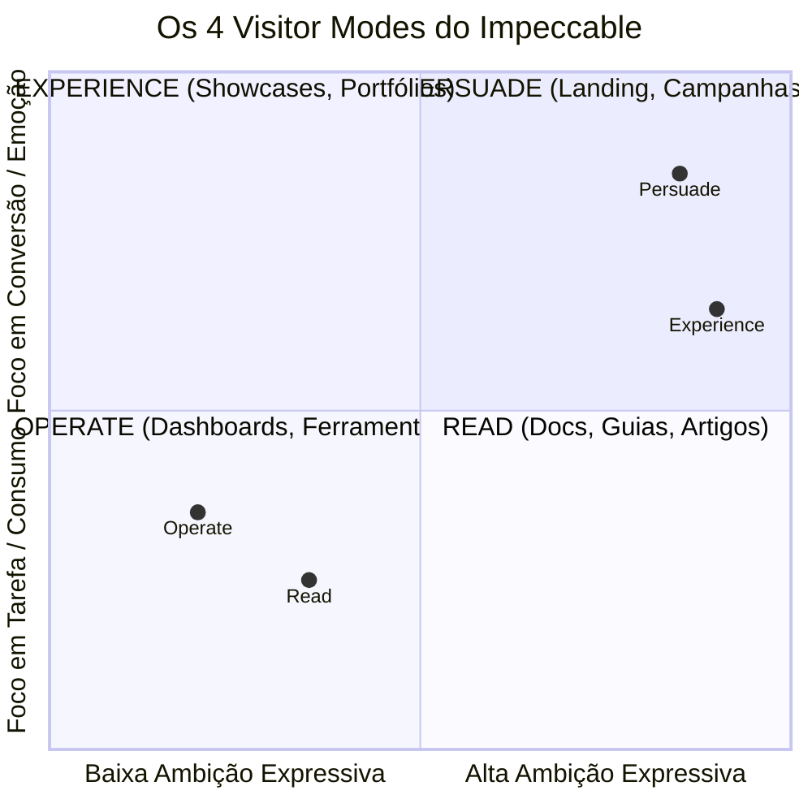
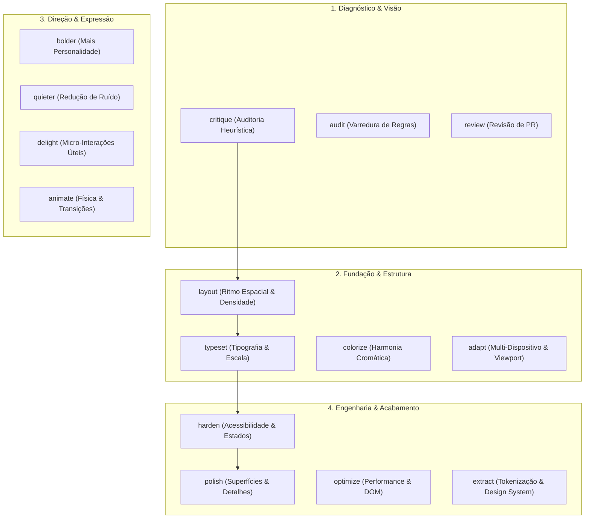
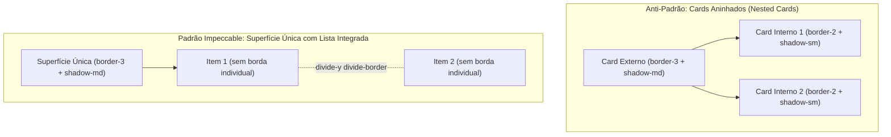
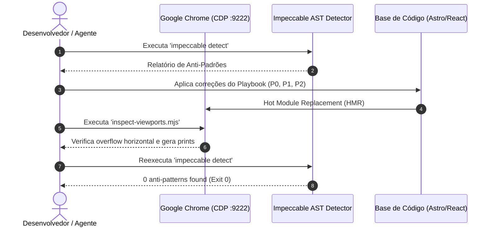

# Manual Mestre: Impeccable Design System — Arquitetura Sem Viés, Playbook de Refino e Inspeção Visual para Astro/React

> **Versão:** 2.0.0 (Nível 2 Operacional + Catálogo Modular & Matriz Integral de Rotas)  
> **Data:** Novembro de 2026  
> **Backup Histórico Congelado (v1.0.0):** [`docs/tutoriais/impeccable-guia-refino-astro.v1.0.md`](file:///home/gsathler/Nextcloud/Projects/cagp/docs/tutoriais/impeccable-guia-refino-astro.v1.0.md)  
> **Escopo:** Análise técnica pura do Impeccable (`_referencias/design-system/impeccable/`), Playbook em 5 Níveis com expansão completa do Nível 2 (Ritmo Espacial e Estrutura de Layout), Catálogo Modular por Componente, Matriz Pronta para Copiar e Colar de todas as rotas do projeto, e automação multi-viewport via Chrome DevTools Protocol (CDP :9222).

---

## 📜 Histórico de Versões & Registro de Evolução (Changelog)

| Versão | Data | Escopo Principal | Marcos e Resultados Alcançados |
| :--- | :--- | :--- | :--- |
| **v1.0.0** | 08/11/2026 | Arquitetura Teórica, Linha de Base e Setup CDP | - Análise conceitual do Impeccable desvinculada de vieses.<br>- Mapeamento dos 4 Visitor Modes e 22 comandos canônicos.<br>- Configuração inicial da ponte CDP (`:9222`) e scripts de inspeção multi-viewport.<br>- Identificação de 14 anti-padrões iniciais no alvo `/`. |
| **v2.0.0** | 08/11/2026 | **Nível 2 Operacional + Catálogo Modular & Matriz por Rota** | - **Validação de Campo Concluída:** Execução real dos Lotes P0, P1 e P2 com **0 anti-padrões** no detector AST (`Exit Code: 0`).<br>- **Erradicação de Nested Cards:** Metodologia de desinchaço com listas integradas `divide-y divide-border`.<br>- **Solução de Overflow Móvel:** Eliminação do transbordamento horizontal de 42px com `truncate`, `min-w-0` e `tabular-nums`.<br>- **Padronização Tailwind v4 `@theme`:** Eliminação de dezenas de cores literais `#16181d` em prol de `border-border` e classes utilitárias de elevação (`shadow-xs` a `shadow-lg`).<br>- **Física Tátil Refinada:** Extinção de bounce easing artificial (`cubic-bezier(0.22, 1, 0.3, 1.12)`) substituído pela curva exponencial de desaceleração natural `cubic-bezier(0.16, 1, 0.3, 1)` e `bounceSpring` amortecida.<br>- **Catálogo Modular por Componente:** 6 padrões arquiteturais de layout.<br>- **Matriz Integral por Rota:** Prompts executáveis prontos para as 10 páginas e rotas do projeto. |

---

## 📑 Índice Geral

1. [Parte 1: Análise Arquitetural Estrita e Sem Viés do Impeccable](#parte-1-análise-arquitetural-estrita-e-sem-viés-do-impeccable)
   - [1.1 O que é o Impeccable e sua Filosofia de Craft](#11-o-que-é-o-impeccable-e-sua-filosofia-de-craft)
   - [1.2 Os 4 Modos de Visitante (Visitor Modes)](#12-os-4-modos-de-visitante-visitor-modes)
   - [1.3 O Piso de Qualidade Não-Negociável (Craft Floor)](#13-o-piso-de-qualidade-não-negociável-craft-floor)
   - [1.4 O Catálogo Canônico dos 22 Comandos](#14-o-catálogo-canônico-dos-22-comandos)
   - [1.5 O Motor de Detecção AST (`impeccable detect`) e Live Mode](#15-o-motor-de-detecção-ast-impeccable-detect-e-live-mode)
2. [Parte 2: Playbook de Prompts em 5 Níveis para Astro & React](#parte-2-playbook-de-prompts-em-5-níveis-para-astro--react)
   - [Nível 1: Diagnóstico e Heurística (`impeccable critique` & `audit`)](#nível-1-diagnóstico-e-heurística-impeccable-critique--audit)
   - [Nível 2: Ritmo Espacial e Estrutura de Layout (`impeccable layout`)](#nível-2-ritmo-espacial-e-estrutura-de-layout-impeccable-layout)
   - [Nível 3: Tipografia, Escala e Largura de Leitura (`impeccable typeset`)](#nível-3-tipografia-escala-e-largura-de-leitura-impeccable-typeset)
   - [Nível 4: Adaptação Responsiva e Dispositivos Móveis (`impeccable adapt`)](#nível-4-adaptação-responsiva-e-dispositivos-móveis-impeccable-adapt)
   - [Nível 5: Polimento de Superfícies, Estados e Acessibilidade (`impeccable polish`)](#nível-5-polimento-de-superfícies-estados-e-acessibilidade-impeccable-polish)
3. [Parte 3: Nível 2 Avançado — Catálogo Modular de Padrões de Layout](#parte-3-nível-2-avançado--catálogo-modular-de-padrões-de-layout)
   - [3.1 Padrão A: Dashboards & Grades Bento Assimétricas](#31-padrão-a-dashboards--grades-bento-assimétricas)
   - [3.2 Padrão B: Listas Integradas, Detalhes & Acordeões (Substitutos de Nested Cards)](#32-padrão-b-listas-integradas-detalhes--acordeões-substitutos-de-nested-cards)
   - [3.3 Padrão C: Feeds Editoriais & Mídia com Aspect Ratio Travado](#33-padrão-c-feeds-editoriais--mídia-com-aspect-ratio-travado)
   - [3.4 Padrão D: Formulários & Centrais de Escuta / Ouvidoria](#34-padrão-d-formulários--centrais-de-escuta--ouvidoria)
   - [3.5 Padrão E: Shell Global (Header Fixo, Menus e Gavetas Modais)](#35-padrão-e-shell-global-header-fixo-menus-e-gavetas-modais)
   - [3.6 Padrão F: Tabelas de Dados & Indicadores Métricos (KPIs)](#36-padrão-f-tabelas-de-dados--indicadores-métricos-kpis)
4. [Parte 4: Matriz de Prompts Executáveis por Rota do Site Integralmente](#parte-4-matriz-de-prompts-executáveis-por-rota-do-site-integralmente)
   - [4.1 Rota `/` — Homepage & SuperApp Workspace](#41-rota---homepage--superapp-workspace)
   - [4.2 Rota `/carreira` — Hub Carreira, Estágio & Artigo 41](#42-rota-carreira--hub-carreira-estágio--artigo-41)
   - [4.3 Rota `/chapa-semente` — Propostas & Tour das 9 Lideranças](#43-rota-chapa-semente--propostas--tour-das-9-lideranças)
   - [4.4 Rota `/ouvidoria` — Canal de Escuta, Ementas & Relatos](#44-rota-ouvidoria--canal-de-escuta-ementas--relatos)
   - [4.5 Rota `/pesquisa` — 11 Núcleos de Pesquisa DCP & PIBIC](#45-rota-pesquisa--11-núcleos-de-pesquisa-dcp--pibic)
   - [4.6 Rota `/transparencia` — Prestação de Contas Centavo a Centavo](#46-rota-transparencia--prestação-de-contas-centavo-a-centavo)
   - [4.7 Rotas `/cursos` e `/acg` — Catálogo ENAP & Calculadora ACG](#47-rotas-cursos-e-acg--catálogo-enap--calculadora-acg)
   - [4.8 Rota `/calouros` — Recepção & Guia de Sobrevivência](#48-rota-calouros--recepção--guia-de-sobrevivência)
   - [4.9 Rotas `/noticias` e `/noticias/[slug]` — Mural Editorial & Leitura](#49-rotas-noticias-e-noticiasslug--mural-editorial--leitura)
   - [4.10 Shell Global & Gavetas Modais (`SuperAppHeader`, `PassportSheet`, etc.)](#410-shell-global--gavetas-modais-superappheader-passportsheet-etc)
5. [Parte 5: Engenharia do Craft Floor — Lições Reais de Código](#parte-5-engenharia-do-craft-floor--lições-reais-de-código)
   - [5.1 O Fim da Síndrome dos Cards Aninhados com `divide-y divide-border`](#51-o-fim-da-síndrome-dos-cards-aninhados-com-divide-y-divide-border)
   - [5.2 Prevenção de Transbordamento Horizontal no Mobile](#52-prevenção-de-transbordamento-horizontal-no-mobile)
   - [5.3 Suavização de Easing: Deceleração Exponencial vs. Bounce Retrô](#53-suavização-de-easing-deceleração-exponencial-vs-bounce-retrô)
   - [5.4 Padronização de Tokens no Tailwind v4 (`@theme`)](#54-padronização-de-tokens-no-tailwind-v4-theme)
6. [Parte 6: Automação e Inspeção Visual com Google Chrome CDP (Porta 9222)](#parte-6-automação-e-inspeção-visual-com-google-chrome-cdp-porta-9222)
   - [6.1 Arquitetura da Ponte CDP sem Headless](#61-arquitetura-da-ponte-cdp-sem-headless)
   - [6.2 O Script de Inspeção Multi-Viewport (`scripts/inspect-viewports.mjs`)](#62-o-script-de-inspeção-multi-viewport-scriptsinspect-viewportsmjs)
   - [6.3 Script de Localização de Contrastes (`scripts/find-contrast-elements.mjs`)](#63-script-de-localização-de-contrastes-scriptsfind-contrast-elementsmjs)
   - [6.4 Gestão de Waivers e Falsos Positivos (`data-impeccable-ignore`)](#64-gestão-de-waivers-e-falsos-positivos-data-impeccable-ignore)
   - [6.5 Fluxo de Trabalho de Refino em Loop Fechado](#65-fluxo-de-trabalho-de-refino-em-loop-fechado)

---

## Parte 1: Análise Arquitetural Estrita e Sem Viés do Impeccable

### 1.1 O que é o Impeccable e sua Filosofia de Craft

O **Impeccable** é um motor de qualidade de design, auditoria técnica e refinamento de front-end concebido para operar no nível de um **Diretor de Design sênior**. Ao contrário de abordagens genéricas que injetam modismos visuais (como gradientes lavados, cantos super-arredondados e cards em excesso), o Impeccable opera sob axiomas rígidos:

1. **"The brief wins" (O briefing é soberano)**:
   - Se o projeto já estabeleceu um universo visual (ex: Neobrutalismo, Apple HIG, Minimalismo editorial), o modelo **nunca** deve desviar a estética para o seu gosto pessoal.
2. **"Refinement preserves; redesign replaces" (Refino preserva; redesign substitui)**:
   - Um comando de refinamento (`polish`, `layout`, `typeset`) mantém 100% da identidade existente, dos textos factuais, da lógica de negócio e dos componentes estáveis. Ele apenas ajusta ritmo, hierarquia, contrastes e acabamentos. O redesenho (`new-work`) é reservado para quando o conceito original é descartado por completo.
3. **"Finish the job" (Entregue a obra completa)**:
   - Sem atalhos, sem marcações de `TODO`, sem implementações parciais. Todos os estados de interação (`hover`, `active`, `focus-visible`, `disabled`, `loading`, `empty`, `error`) devem ser contemplados.
4. **"Visual authority is evidence, not a filename" (Autoridade visual é evidência renderizada)**:
   - Um código sintaticamente limpo não prova excelência visual. A única verdade é o resultado renderizado e inspecionado nos tamanhos de tela reais em que o produto opera.

---

### 1.2 Os 4 Modos de Visitante (Visitor Modes)

O Impeccable divide qualquer tela em 4 modos com base no objetivo primário do visitante:



| Modo | Objetivo do Usuário | Onde se Aplica no Projeto CAGP | Diretiva de Design |
|---|---|---|---|
| **Persuade** | Decidir e agir. | `/chapa-semente`, Banners de Campanha. | Ambição máxima, forte ponto de vista, imagens reais, forte apelo emocional. |
| **Operate** | Concluir uma tarefa com agilidade. | `/` (Workspace), `/acg`, `/carreira`, Configurações. | Precisão, consistência estrita, escaneabilidade; ferramentas conhecidas superam enfeites. |
| **Read** | Compreender um assunto sem fadiga. | `/documentos`, Normativas, Ementário, Artigos do Mural. | Estrutura clara, medida tipográfica impecável (65–75 `ch`), entrelinha confortável. |
| **Experience** | Imergir na obra/conteúdo. | Tour Guiado das 9 Lideranças, Grafo de Disciplinas. | A interface recua da primeira dobra; a experiência visual lidera. |

---

### 1.3 O Piso de Qualidade Não-Negociável (Craft Floor)

O `craft-floor` é a barreira mecânica obrigatória antes de qualquer alteração de layout ou código:

#### Verificações Mandatórias:
- **Contraste Cromático Estrito**: Texto normal $\ge 4.5:1$; títulos display $\ge 3:1$. Em avatares discentes com iniciais, o contraste entre o fundo do departamento (`deptColor`) e o texto deve ser auditado matematicamente.
- **Profundidade & Elevação**: Sombras devem seguir tokens semânticos unificados (`shadow-xs` a `shadow-lg`).
- **Espaçamento e Ritmo**: Proximidade semântica (itens relacionados bem agrupados, blocos distintos generosamente separados). Sempre **mais espaço acima** de um título do que abaixo dele.
- **Tipografia**: Linhas de texto corrido entre **65 e 75 caracteres** (`ch`). Títulos display com limite térmico de tamanho.
- **Estados Completos**: Todo elemento interativo deve declarar: `default`, `hover`, `active`, `focus-visible`, `disabled:opacity-50 disabled:pointer-events-none disabled:cursor-not-allowed`.
- **Navegador**: Cores de seleção (`::selection`), cursor (`caret-color`) e scrollbars estilizadas no tema.

#### Proibições Categóricas (Bans do Impeccable):
1. **Cards Aninhados (Nested Cards)**: Banimento total de containers dentro de containers com bordas e sombras duplicadas.
2. **Kickers / Eyebrows Descartáveis Acima de Títulos**: Se o título já carrega a mensagem, elimine o kicker redundante.
3. **Simulação Falsa de Liveness**: Proibição de pontos pulsantes decorativos (`animate-pulse`/`animate-ping`) sem telemetria real de WebSocket/SSE.
4. **Bounce Easing Elástico**: Proibição de curvas com overshoot artificial (`cubic-bezier(0.22, 1, 0.3, 1.12)`). Objetos reais desaceleram com curvas exponenciais suaves (`cubic-bezier(0.16, 1, 0.3, 1)`).
5. **Vazamento Horizontal de Texto**: Textos não podem transbordar a caixa delimitadora (`skill-ban-text-overflow`).

---

### 1.4 O Catálogo Canônico dos 22 Comandos

O Impeccable estrutura suas habilidades em 22 comandos agrupados por intenção:



---

### 1.5 O Motor de Detecção AST (`impeccable detect`) e Live Mode

O comando CLI executa uma varredura estática de árvore sintática (AST) combinada com amostragem real de viewport:

```bash
# Execução da auditoria formal no servidor local
./_referencias/design-system/impeccable/skill/scripts/impeccable detect http://localhost:4321/
```

- **Exit Code 0**: Significa zero violações do Craft Floor.
- **Advisory Notes**: Não reprovam a compilação; servem como avisos de contexto (ex: `hard-offset-shadow`, que pertence legitimamente ao Neobrutalismo).

---

## Parte 2: Playbook de Prompts em 5 Níveis para Astro & React

### Nível 1: Diagnóstico e Heurística (`impeccable critique` & `audit`)

**Quando usar:** Antes de tocar em qualquer linha de código. Para identificar onde o layout atual falha no Craft Floor.

```markdown
Você atuará estritamente sob as diretrizes da skill /impeccable critique e /impeccable craft-floor.
Alvo: [src/pages/sua-pagina.astro e componentes importados]

Execute uma auditoria minuciosa de qualidade visual e heurística sem viés. Preserve rigorosamente a identidade e os tokens estabelecidos no projeto.

Identifique e classifique:
1. Violações do Craft Floor:
   - Cards aninhados (nested cards) ou repetição desnecessária de containers.
   - Eyebrows/kickers decorativos redundantes acima de títulos.
   - Textos com contraste inferior a 4.5:1 (normal) ou 3:1 (display).
   - Simulação falsa de liveness (animate-pulse decorativo sem telemetria em tempo real).
2. Análise Estrutural & Densidade (Squint Test):
   - A ordem de leitura guia o olho para a ação primária ou há saturação de elementos competindo na primeira dobra?
3. Estados Faltantes:
   - Identifique botões e links sem hover, active, focus-visible ou disabled.

Apresente o resultado priorizado por gravidade (P0: quebras críticas, P1: hierarquia e layout, P2: acabamento fino). Não altere o código ainda.
```

---

### Nível 2: Ritmo Espacial e Estrutura de Layout (`impeccable layout`)

**Quando usar:** Para eliminar containers redundantes, calibrar o squint test, fixar ancoragens de header e balancear grades assimétricas.

```markdown
Você atuará estritamente sob as diretrizes da skill /impeccable layout.
Alvo: [caminho/do/arquivo]

Refatore o ritmo espacial e a estrutura de layout respeitando os axiomas do Craft Floor:
1. Erradicação de Cards Aninhados:
   - Onde houver containers dentro de containers, desinche a estrutura externa.
   - Converta grupos de links/ações internas em listas limpas usando 'divide-y divide-border' ou proximidade semântica (gap), eliminando bordas e sombras duplas concorrentes.
2. Ancoragem de Header e Viewport:
   - Garanta que barras fixas/sticky ancorem perfeitamente em 'top-0' sem vãos flutuantes de scroll no mobile.
3. Ritmo Vertical Óptico:
   - Aplique a regra canônica: sempre mais espaçamento acima de um título de seção do que abaixo dele.
4. Squint Test & Foco Primário:
   - Remova kickers/eyebrows redundantes acima de títulos. Permita que os H2 e H3 comandem a hierarquia.
   - Descentralize elementos de saturação concorrentes para que a ação primária do usuário se destaque de imediato.

Não altere a cópia dos textos nem adicione bibliotecas externas. Mantenha 100% dos tokens do Tailwind v4 estabelecidos.
```

---

### Nível 3: Tipografia, Escala e Largura de Leitura (`impeccable typeset`)

**Quando usar:** Para ajustar entrelinhas, medidas de leitura (65–75 ch), números tabulares e hierarquia de títulos.

```markdown
Você atuará sob as diretrizes de /impeccable typeset.
Alvo: [caminho/do/arquivo]

Refine a tipografia e escala de leitura:
1. Medida de Leitura:
   - Trave parágrafos de texto corrido em no máximo 65 a 75 caracteres ('max-w-prose' ou 'max-w-2xl').
2. Numerais e Dados Dinâmicos:
   - Aplique 'tabular-nums' em valores monetários, horários, prazos e indicadores métricos.
   - Garanta 'truncate min-w-0 flex-1' em containers com números grandes para evitar text-overflow no mobile (375px–390px).
3. Legibilidade Mínima:
   - Elimine qualquer texto menor que 12px ('text-xs'). Não utilize 'text-[10px]' em links ou corpo legível.
4. Tracking e Pesos:
   - Títulos em Bricolage Grotesque devem manter tracking controlado ('tracking-tight' ou 'tracking-wide' em caixa alta).
```

---

### Nível 4: Adaptação Responsiva e Dispositivos Móveis (`impeccable adapt`)

**Quando usar:** Para calibrar grades multi-coluna entre 375px e 1440px sem rolagem horizontal ou sobreposições.

```markdown
Você atuará sob as diretrizes de /impeccable adapt.
Alvo: [caminho/do/arquivo]

Audite e ajuste a responsividade para os 5 viewports canônicos:
1. Mobile Compacto (375x812) & Mobile Padrão (390x844):
   - Largura do documento exatamente igual à do viewport (zero pixels de vazamento horizontal).
   - Alvos de toque com área mínima de 44x44pt ('min-h-[44px] min-w-[44px]').
   - Grids convertidos para coluna única ('grid-cols-1') com gaps proporcionais.
2. Tablet (768x1024):
   - Grids intermediários em 2 colunas ('sm:grid-cols-2') com cards equilibrados.
3. Desktop (1280px e 1440px):
   - Alinhamento de containers centrais com limite máximo ('max-w-[1440px] mx-auto').
   - Grids expandidos (3 a 7 colunas) mantendo alinhamento vertical e harmonia de respiro.
```

---

### Nível 5: Polimento de Superfícies, Estados e Acessibilidade (`impeccable polish`)

**Quando usar:** Para fechamento de tokens, física de animação natural e tratamento robusto de todos os estados interativos.

```markdown
Você atuará sob as diretrizes de /impeccable polish e /impeccable harden.
Alvo: [caminho/do/arquivo]

Execute o polimento fino de engenharia de interface:
1. Padronização de Tokens no Tailwind v4:
   - Substitua cores literais hardcoded ('border-[#16181d]') por tokens semânticos ('border-border').
   - Substitua sombras arbitrárias por classes do @theme ('shadow-xs', 'shadow-sm', 'shadow-md', 'shadow-lg').
2. Física de Transição Natural:
   - Elimine qualquer bounce easing elástico ('cubic-bezier(0.22, 1, 0.3, 1.12)'). Adote desaceleração exponencial 'cubic-bezier(0.16, 1, 0.3, 1)'.
   - Molas no motion/react devem ter amortecimento confiante sem rebote ('stiffness: 400, damping: 32').
3. Estados Interativos Completos:
   - Garanta que todo botão ou link possua:
     hover, active:translate-x-0.5 active:translate-y-0.5 active:shadow-none,
     focus-visible:outline-none focus-visible:ring-2 focus-visible:ring-primary focus-visible:ring-offset-2,
     disabled:opacity-50 disabled:pointer-events-none disabled:cursor-not-allowed.
```

---

## Parte 3: Nível 2 Avançado — Catálogo Modular de Padrões de Layout

Para evitar que as páginas caiam na repetição monótona de caixas idênticas, utilize os 6 padrões arquiteturais abaixo:

### 3.1 Padrão A: Dashboards & Grades Bento Assimétricas
- **Conceito**: Uma grade em que o item mais importante ocupa o dobro de espaço (col-span-2 ou row-span-2), criando um centro de gravidade visual imediato.
- **Classes-Chave**: `grid grid-cols-1 sm:grid-cols-2 lg:grid-cols-3 xl:grid-cols-4 gap-4`.
- **Regra de Ouro**: O card primário deve responder pelo Squint Test da tela; cards secundários devem ter menos saturação visual e hierarquia tipográfica subordinada.

### 3.2 Padrão B: Listas Integradas, Detalhes & Acordeões (Substitutos de Nested Cards)
- **Conceito**: Em vez de colocar cards com bordas 3px e sombras dentro de outro card já demarcado, use uma superfície única com divisores elegantes.
- **Estrutura Recomendada**:
  ```tsx
  <div className="bg-card rounded-xl border-3 border-border shadow-md overflow-hidden">
    <div className="p-4 border-b-2 border-border bg-muted/40">
      <h3 className="font-heading font-extrabold text-sm uppercase">Título da Seção</h3>
    </div>
    <div className="divide-y divide-border">
      {items.map(item => (
        <a key={item.id} href={item.href} className="p-3.5 flex items-center justify-between hover:bg-muted/50 transition-colors">
          <span className="font-bold text-xs">{item.title}</span>
          <CagpIcon name="chevron-right" className="w-4 h-4 text-muted-foreground" />
        </a>
      ))}
    </div>
  </div>
  ```

### 3.3 Padrão C: Feeds Editoriais & Mídia com Aspect Ratio Travado
- **Conceito**: Cards editoriais com imagens ou ilustrações conceituais que nunca deformam ou estouram a proporção de tela.
- **Classes-Chave**: `aspect-[16/10] relative overflow-hidden rounded-lg border-2 border-border shadow-xs`.
- **Regra de Ouro**: A imagem recebe zoom refinado no hover (`photoCardHover`), enquanto badges de editoria são ancoradas no topo do container (`absolute top-2.5 left-2.5`).

### 3.4 Padrão D: Formulários & Centrais de Escuta / Ouvidoria
- **Conceito**: Fluxos de entrada de dados limpos, onde labels têm proximidade direta com o input e grupos de perguntas são separados por respiros generosos (`space-y-6`).
- **Regra de Ouro**: Todo `<input>` ou `<textarea>` deve ter `border-2 border-border focus:border-primary focus-visible:ring-2 focus-visible:ring-primary`, com feedback de validação inline e botão de envio em `min-h-[48px]`.

### 3.5 Padrão E: Shell Global (Header Fixo, Menus e Gavetas Modais)
- **Conceito**: Elementos de navegação perimetrais que permanecem estáveis durante toda a jornada do usuário.
- **Regra de Ouro**: Headers móveis devem declarar `sticky top-0 z-[1030]` com `padding-top: env(safe-area-inset-top, 0px)`. Gavetas e modais devem ter backdrop escuro com blur leve (`bg-black/75`), fechamento por teclado (ESC), foco preso (`focus-trap`) e animação com amortecimento natural.

### 3.6 Padrão F: Tabelas de Dados & Indicadores Métricos (KPIs)
- **Conceito**: Painéis de consulta densa de informação acadêmica ou orçamentária.
- **Regra de Ouro**: Alinhamento numérico à direita (`text-right font-mono tabular-nums`), cabeçalhos com tracking largo em caixa alta (`font-mono text-[11px] uppercase tracking-wider text-muted-foreground`), e alternância de linhas (`even:bg-muted/30`) para facilitar leitura visual de longas colunas.

---

## Parte 4: Matriz de Prompts Executáveis por Rota do Site Integralmente

Abaixo está a matriz de prompts prontos para copiar e colar, cobrindo integralmente as 10 principais superfícies do site:

---

### 4.1 Rota `/` — Homepage & SuperApp Workspace
- **Alvo:** [`src/pages/index.astro`](file:///home/gsathler/Nextcloud/Projects/cagp/src/pages/index.astro) e [`src/components/features/home/HomeWorkspaceA.tsx`](file:///home/gsathler/Nextcloud/Projects/cagp/src/components/features/home/HomeWorkspaceA.tsx).
- **Diagnóstico Típico:** Disputa de atenção entre Marquee, Hero animado, sticker giratório e grid de atalhos; cards aninhados em ferramentas acadêmicas.
- **Prompt Executável:**
```markdown
Execute um refino de layout (/impeccable layout) em src/pages/index.astro e src/components/features/home/HomeWorkspaceA.tsx.
Preserve 100% da identidade neobrutalista e os dados discentes da Chapa Semente.
Diretrizes estritas:
1. Mantenha a Marquee waivada com data-impeccable-ignore="marquee" e desative rotações infinitas contínuas em stickers.
2. Certifique-se de que nenhum bloco interno de ferramentas use cards aninhados: aplique listas unificadas com 'divide-y divide-border'.
3. Garanta que a troca de perfil discente (handleRoleSwitch) e botões de atalho possuam foco visível e estado disabled:opacity-50.
4. Valide que todos os números em StatCards e badges utilizem 'tabular-nums' e 'truncate min-w-0' para eliminar overflow no mobile (375px).
```
- **Checklist de Campo:**
  - [ ] Squint Test: A barra de busca e os atalhos rápidos comandam a atenção?
  - [ ] Zero vazamento horizontal em 375px e 390px.
  - [ ] `impeccable detect http://localhost:4321/` retorna 0 anti-padrões.

---

### 4.2 Rota `/carreira` — Hub Carreira, Estágio & Artigo 41
- **Alvo:** [`src/pages/carreira.astro`](file:///home/gsathler/Nextcloud/Projects/cagp/src/pages/carreira.astro) e [`src/components/features/estagio/art41/Art41SimulatorCore.tsx`](file:///home/gsathler/Nextcloud/Projects/cagp/src/components/features/estagio/art41/Art41SimulatorCore.tsx).
- **Diagnóstico Típico:** Formulários longos de simulação com múltiplos blocos cinzas repetidos; botões de cálculo sem estados `disabled`.
- **Prompt Executável:**
```markdown
Execute um refino de layout (/impeccable layout e /impeccable typeset) em src/pages/carreira.astro e subcomponentes de estágio.
Diretrizes estritas:
1. Estruture o simulador do Artigo 41 com um fluxo linear e claro: dados do vínculo -> verificação de requisitos -> emissão de parecer discente.
2. Elimine containers redundantes na lista de perguntas normativas: adicione acordeões limpos com bordas únicas.
3. Garanta que todos os botões de cálculo e checkboxes tenham alvos de toque >= 44px e estados disabled explícitos.
4. Utilize 'font-mono tabular-nums' nas cargas horárias (600h, 300h) e datas limite de protocolo.
```
- **Checklist de Campo:**
  - [ ] O simulador do Art. 41 exibe o resultado sem quebrar o layout no mobile?
  - [ ] Inputs de texto e selects respeitam contraste >= 4.5:1.

---

### 4.3 Rota `/chapa-semente` — Propostas & Tour das 9 Lideranças
- **Alvo:** [`src/pages/chapa-semente.astro`](file:///home/gsathler/Nextcloud/Projects/cagp/src/pages/chapa-semente.astro) e [`src/components/features/semente/`](file:///home/gsathler/Nextcloud/Projects/cagp/src/components/features/semente/).
- **Diagnóstico Típico:** Grade de 9 líderes com fotos e textos de proposta com alinhamento vertical desigual; badges de departamento com baixo contraste sobre avatares.
- **Prompt Executável:**
```markdown
Execute um refino de layout (/impeccable layout e /impeccable polish) em src/pages/chapa-semente.astro.
Diretrizes estritas:
1. Harmonize o grid das 9 lideranças para manter alturas uniformes dos cards ('flex flex-col justify-between').
2. Nos avatares sem foto, garanta que o fundo 'deptColor' use tons escurecidos (ex: bg-amber-700, bg-rose-700) com contraste >= 4.8:1 para as iniciais em branco.
3. No tour guiado e botões de propostas, adicione micro-interações táteis no hover ('whileHover={{ scale: 1.02 }}') com física 'tactileSpring'.
4. Substitua qualquer 'border-[#16181d]' residual por 'border-border' e use 'shadow-md'.
```
- **Checklist de Campo:**
  - [ ] Todas as 9 lideranças têm suas biografias perfeitamente legíveis em 375px?
  - [ ] O botão do Tour das 9 Lideranças aciona a gaveta modal sem layout shifts?

---

### 4.4 Rota `/ouvidoria` — Canal de Escuta, Ementas & Relatos
- **Alvo:** [`src/pages/ouvidoria.astro`](file:///home/gsathler/Nextcloud/Projects/cagp/src/pages/ouvidoria.astro) e [`src/components/features/ouvidoria/OuvidoriaInteractiveCenter.tsx`](file:///home/gsathler/Nextcloud/Projects/cagp/src/components/features/ouvidoria/OuvidoriaInteractiveCenter.tsx).
- **Diagnóstico Típico:** Formulário de relato concorrendo com a lista de ementas; falta de estados de envio (`loading`, `success`, `empty`).
- **Prompt Executável:**
```markdown
Execute um refino de layout (/impeccable layout e /impeccable harden) em src/pages/ouvidoria.astro.
Diretrizes estritas:
1. Organize o layout em 2 etapas distintas: à esquerda o seletor rápido de disciplina/ementa e à direita o formulário de relato sigiloso.
2. No formulário de relato, garanta campos amplos com labels destacados, helper text acolhedor e contador de caracteres em 'tabular-nums'.
3. Adicione estados visuais completos no botão de envio: default, hover, active, focus-visible e disabled:opacity-50 quando o campo estiver vazio.
4. Mantenha os cards de relatos simulados anteriores em estilo editorial limpo com data em 'font-mono text-xs'.
```
- **Checklist de Campo:**
  - [ ] A área de texto expande confortavelmente no mobile sem zoom indesejado no iOS (`font-size >= 16px` no input)?
  - [ ] O anonimato do relato é comunicado visualmente com clareza.

---

### 4.5 Rota `/pesquisa` — 11 Núcleos de Pesquisa DCP & PIBIC
- **Alvo:** [`src/pages/pesquisa.astro`](file:///home/gsathler/Nextcloud/Projects/cagp/src/pages/pesquisa.astro).
- **Diagnóstico Típico:** Excesso de cards idênticos para os 11 núcleos gerando fadiga visual; falta de distinção entre linhas de pesquisa ativas e editais abertos.
- **Prompt Executável:**
```markdown
Execute um refino de layout (/impeccable layout) em src/pages/pesquisa.astro.
Diretrizes estritas:
1. Quebre a monotonia dos 11 cards: crie um filtro por área temática no topo (Políticas Públicas, Teoria Política, Relações Internacionais, Metodologia).
2. Destaque em Bento Grid o núcleo com edital PIBIC/FAPEMIG aberto com borda de destaque e badge 'Edital Aberto'.
3. Os outros 10 núcleos devem adotar uma densidade mais compacta com lista sanfonada ou cards enxutos de altura idêntica.
4. Garanta links externos para as páginas oficiais do DCP/FAFICH com ícone 'arrow-up-right' e 'min-h-[44px]'.
```
- **Checklist de Campo:**
  - [ ] O filtro tem afordância clara de seleção com contraste >= 4.5:1?
  - [ ] A navegação entre os núcleos não força scroll excessivo no mobile?

---

### 4.6 Rota `/transparencia` — Prestação de Contas Centavo a Centavo
- **Alvo:** [`src/pages/transparencia.astro`](file:///home/gsathler/Nextcloud/Projects/cagp/src/pages/transparencia.astro).
- **Diagnóstico Típico:** Tabelas financeiras que quebram em telas pequenas forçando rolagem indesejada de página.
- **Prompt Executável:**
```markdown
Execute um refino de layout (/impeccable layout e /impeccable typeset) em src/pages/transparencia.astro.
Diretrizes estritas:
1. Em tabelas financeiras, envolva o elemento em container com 'overflow-x-auto' e gradiente sutil de scroll cue.
2. Alinhe todos os valores monetários estritamente à direita com 'font-mono text-sm tabular-nums font-bold'.
3. No topo, exiba os 3 StatCards de resumo (Saldo Atual, Entradas de Calourada, Despesas de Manutenção) usando 'shadow-md border-3 border-border'.
4. Diferencie receitas (verde #166534) e despesas (vermelho #9E2424) com badges de alto contraste.
```
- **Checklist de Campo:**
  - [ ] A tabela orçamentária é navegável em tela de 375px sem desestruturar o resto da página?
  - [ ] Os valores de saldo batem visualmente com os comprovantes anexados?

---

### 4.7 Rotas `/cursos` e `/acg` — Catálogo ENAP & Calculadora ACG
- **Alvo:** [`src/pages/cursos.astro`](file:///home/gsathler/Nextcloud/Projects/cagp/src/pages/cursos.astro), [`src/pages/acg.astro`](file:///home/gsathler/Nextcloud/Projects/cagp/src/pages/acg.astro).
- **Diagnóstico Típico:** Catálogo de 1.045 cursos com filtros pesados; HUD de cálculo de horas ACG com texto transbordando.
- **Prompt Executável:**
```markdown
Execute um refino de layout (/impeccable layout e /impeccable optimize) em src/pages/cursos.astro e src/pages/acg.astro.
Diretrizes estritas:
1. No catálogo ENAP, adicione paginação virtualizada ou limitador de itens renderizados para garantir rolagem suave a 60fps.
2. No painel de cálculo ACG (600h obrigatórias), aplique barra de progresso tátil com borda preta nítida e porcentagem em 'tabular-nums'.
3. Garanta que cada card de curso exiba a carga horária em badge destacada e link direto para matrícula na EV.G / ENAP.
4. Trave textos longos de ementa com 'line-clamp-2' para manter a grade simétrica.
```
- **Checklist de Campo:**
  - [ ] A barra de busca de cursos filtra em tempo real sem travamentos no navegador?
  - [ ] O total acumulado de horas é recalculado com precisão e clareza?

---

### 4.8 Rota `/calouros` — Recepção & Guia de Sobrevivência
- **Alvo:** [`src/pages/calouros.astro`](file:///home/gsathler/Nextcloud/Projects/cagp/src/pages/calouros.astro) e [`src/components/features/calouros/`](file:///home/gsathler/Nextcloud/Projects/cagp/src/components/features/calouros/).
- **Diagnóstico Típico:** Checklist de passos com checkboxes nativos cinzas desalinhados; ausência de feedback tátil de tarefa concluída.
- **Prompt Executável:**
```markdown
Execute um refino de layout (/impeccable layout e /impeccable delight) em src/pages/calouros.astro.
Diretrizes estritas:
1. No checklist de sobrevivência (Carteirinha, FUMP, Comprovante de Matrícula, Acesso Wi-Fi eduroam), use botões táteis customizados com ícone de check e riscado suave ('line-through text-success').
2. Ao marcar um item, acione animação de mola tátil ('transition={{ type: "spring", stiffness: 400, damping: 30 }}') sem rebote exagerado.
3. Organize os mapas da FAFICH e do Campus Pampulha em cards com proporção de aspecto definida e botão de abrir em tela cheia.
```
- **Checklist de Campo:**
  - [ ] Os itens marcados persistem salvos localmente no cofre discente?
  - [ ] A leitura das dicas de recepção é calorosa, encorajadora e fluida?

---

### 4.9 Rotas `/noticias` e `/noticias/[slug]` — Mural Editorial & Leitura
- **Alvo:** [`src/pages/noticias/index.astro`](file:///home/gsathler/Nextcloud/Projects/cagp/src/pages/noticias/index.astro) e [`src/pages/noticias/[slug].astro`](file:///home/gsathler/Nextcloud/Projects/cagp/src/pages/noticias/[slug].astro).
- **Diagnóstico Típico:** Largura de linha de leitura muito ampla em monitores grandes (> 100ch), prejudicando a ergonomia ocular.
- **Prompt Executável:**
```markdown
Execute um refino de layout (/impeccable layout e /impeccable typeset) em src/pages/noticias/[slug].astro.
Diretrizes estritas:
1. Trave a coluna principal de leitura em exatamente 65 a 75 caracteres ('max-w-prose' ou 'max-w-2xl mx-auto').
2. Ajuste a entrelinha do texto de corpo para 'leading-relaxed' (1.6 a 1.7) com parágrafos separados por 'mb-6'.
3. No topo do artigo, insira moldura de foto com borda sólida ('border-3 border-border shadow-lg') e legenda em 'font-mono text-xs text-muted-foreground'.
4. Adicione barra de metadados clara: data de publicação, editoria e tempo estimado de leitura em 'tabular-nums'.
```
- **Checklist de Campo:**
  - [ ] O artigo se lê como uma publicação impressa de alto padrão editorial?
  - [ ] O botão de voltar ao mural permanece acessível e fixo na navegação?

---

### 4.10 Shell Global & Gavetas Modais (`SuperAppHeader`, `PassportSheet`, etc.)
- **Alvo:** [`src/components/shell/SuperAppHeader.astro`](file:///home/gsathler/Nextcloud/Projects/cagp/src/components/shell/SuperAppHeader.astro), [`src/components/shell/PassportSheet.tsx`](file:///home/gsathler/Nextcloud/Projects/cagp/src/components/shell/PassportSheet.tsx), [`src/components/shell/SuperAppWelcomeModal.tsx`](file:///home/gsathler/Nextcloud/Projects/cagp/src/components/shell/SuperAppWelcomeModal.tsx).
- **Diagnóstico Típico:** Falha de ancoragem no topo (`top-6`), ausência de foco em botões de ação e sombras hardcoded.
- **Prompt Executável:**
```markdown
Execute um refino de layout (/impeccable layout e /impeccable harden) no Shell Global e componentes de modais.
Diretrizes estritas:
1. O SuperAppHeader móvel deve ficar fixo em 'sticky top-0 z-[1030]' com sombra 'shadow-xs' e borda 'border-b-3 border-border'.
2. Nas gavetas do Passaporte Discente e Boas-Vindas, garanta que todos os botões de troca de aba, exportação de token e fechamento possuam 'min-h-[44px]', anel de foco e 'disabled:opacity-50'.
3. Elimine qualquer '#16181d' hardcoded em prol de 'border-border' e 'text-foreground'.
4. Assegure fechamento limpo com a tecla ESC e clique fora no backdrop escurecido.
```
- **Checklist de Campo:**
  - [ ] O scroll da página não vaza por cima nem por trás do header móvel?
  - [ ] O passaporte abre em gaveta suave com a mola 'drawerSpring'?

---

## Parte 5: Engenharia do Craft Floor — Lições Reais de Código

Esta seção reúne as soluções definitivas desenvolvidas e testadas durante os lotes práticos de execução:

### 5.1 O Fim da Síndrome dos Cards Aninhados com `divide-y divide-border`

O anti-padrão de cards aninhados é uma das violações mais recorrentes em aplicações React/Astro. Ele ocorre quando o desenvolvedor cria um card para delimitar uma seção e, dentro dele, cria novos cards com bordas e sombras individuais para cada item.



**Código Antes (Violação do Craft Floor):**
```tsx
// ❌ ERRADO: Card dentro de card gerando poluição visual
<div className="bg-white rounded-xl border-3 border-border shadow-md p-4">
  <h3 className="font-heading font-bold mb-3">Links Acadêmicos</h3>
  <div className="space-y-2">
    <div className="bg-card rounded-lg border-2 border-border shadow-sm p-3">
      <a href="/siga">Acessar SIGA</a>
    </div>
    <div className="bg-card rounded-lg border-2 border-border shadow-sm p-3">
      <a href="/moodle">Acessar Moodle</a>
    </div>
  </div>
</div>
```

**Código Depois (Conformidade Total):**
```tsx
// ✅ CORRETO: Superfície única com itens separados por divide-y
<div className="bg-white rounded-xl border-3 border-border shadow-md overflow-hidden">
  <div className="p-4 bg-muted/30 border-b-2 border-border">
    <h3 className="font-heading font-bold text-sm uppercase">Links Acadêmicos</h3>
  </div>
  <div className="divide-y divide-border">
    <a href="/siga" className="p-3.5 flex items-center justify-between hover:bg-muted/50 transition-colors">
      <span className="font-bold text-xs">Acessar SIGA</span>
      <CagpIcon name="arrow-up-right" className="w-4 h-4" />
    </a>
    <a href="/moodle" className="p-3.5 flex items-center justify-between hover:bg-muted/50 transition-colors">
      <span className="font-bold text-xs">Acessar Moodle</span>
      <CagpIcon name="arrow-up-right" className="w-4 h-4" />
    </a>
  </div>
</div>
```

---

### 5.2 Prevenção de Transbordamento Horizontal no Mobile

Em viewports móveis de 375px e 390px, numerais grandes ou títulos sem quebra podem expandir a largura intrínseca da grade flexível e forçar vazamento lateral.

**Regra de Ouro:**
1. Sempre use `min-w-0` no container flexível pai para permitir que filhos encolham (`flex-shrink`).
2. Adicione `truncate` e `tabular-nums` nos valores numéricos.
3. Dimensione dinamicamente a tipografia de métricas: `text-xl sm:text-2xl lg:text-3xl`.

```tsx
// ✅ Padrão de StatCard sem vazamento
<div className="flex items-baseline justify-between gap-2 min-w-0">
  <p className="font-heading text-xl sm:text-2xl lg:text-3xl font-black tracking-tight text-foreground tabular-nums truncate flex-1 min-w-0">
    {value}
  </p>
</div>
```

---

### 5.3 Suavização de Easing: Deceleração Exponencial vs. Bounce Retrô

O Impeccable proíbe curvas de animação com rebote artificial (`cubic-bezier(0.22, 1, 0.3, 1.12)` ou molas com `damping < 24`), pois geram sensação amadora de interface saltitante.

Em [`src/lib/motion.ts`](file:///home/gsathler/Nextcloud/Projects/cagp/src/lib/motion.ts), utilize sempre molas e curvas de desaceleração natural:

```typescript
// Curva canônica de desaceleração confiante (Ease Out Expo)
export const easeOutExpo = [0.16, 1, 0.3, 1] as const;

// Mola tátil para micro-interações ágeis
export const tactileSpring = {
  type: "spring" as const,
  stiffness: 420,
  damping: 30,
};

// Mola para aparição de cards e carimbos (sem oscilação elástica)
export const bounceSpring = {
  type: "spring" as const,
  stiffness: 400,
  damping: 32, // Amortecimento que previne o overshoot
};
```

---

### 5.4 Padronização de Tokens no Tailwind v4 (`@theme`)

No Tailwind v4, os tokens semânticos são registrados no bloco `@theme` de [`src/styles/global.css`](file:///home/gsathler/Nextcloud/Projects/cagp/src/styles/global.css). Nunca utilize valores hardcoded `#16181d` nas classes de componentes:

| Valor Literal Proibido | Token Semântico Obrigatório |
| :--- | :--- |
| `border-[#16181d]` | `border-border` |
| `border-3 border-[#16181d]` | `border-3 border-border` |
| `text-[#16181d]` | `text-foreground` |
| `shadow-[2px_2px_0_0_#16181d]` | `shadow-sm` |
| `shadow-[3px_3px_0_0_#16181d]` | `shadow` |
| `shadow-[4px_4px_0_0_#16181d]` | `shadow-md` |
| `shadow-[6px_6px_0_0_#16181d]` | `shadow-lg` |
| `shadow-[10px_10px_0_1px_#16181d]`| `shadow-xl` |

---

## Parte 6: Automação e Inspeção Visual com Google Chrome CDP (Porta 9222)

### 6.1 Arquitetura da Ponte CDP sem Headless

Para garantir inspeção visual 100% idêntica à experiência de um usuário real, conectamos diretamente a uma instância em execução do Google Chrome com depuração remota ativada:

```bash
# Como iniciar o Google Chrome para aceitar conexões CDP:
google-chrome --remote-debugging-port=9222 --remote-allow-origins="*" &
```

O script Node.js conecta na porta `9222`, obtém a lista de abas abertas via `/json/list`, acopla na aba do SuperApp via WebSocket e comanda:
1. Emulação de Device Metrics (largura, altura, escala de DPI, emulação de toque móvel).
2. Avaliação de DOM (`document.documentElement.scrollWidth` vs. `window.innerWidth`).
3. Captura de tela PNG em resolução real.

---

### 6.2 O Script de Inspeção Multi-Viewport (`scripts/inspect-viewports.mjs`)

O script de inspeção automatizada está localizado em [`scripts/inspect-viewports.mjs`](file:///home/gsathler/Nextcloud/Projects/cagp/scripts/inspect-viewports.mjs):

```bash
# Execução da auditoria visual em todos os 5 viewports:
node scripts/inspect-viewports.mjs --url http://localhost:4321/
```

**Matriz dos 5 Viewports Testados:**
1. `mobile-compact`: 375x812 @2x (iPhone SE / Mini)
2. `mobile-standard`: 390x844 @3x (iPhone 14/15/16)
3. `tablet-portrait`: 768x1024 @2x (iPad Mini / Air)
4. `desktop-compact`: 1280x800 @1x (13" Laptop)
5. `desktop-standard`: 1440x900 @1x (Monitor 1080p/1440p)

---

### 6.3 Script de Localização de Contrastes (`scripts/find-contrast-elements.mjs`)

Para identificar elementos específicos com falha de contraste WCAG AA no DOM renderizado:

```bash
node scripts/find-contrast-elements.mjs --url http://localhost:4321/
```

O script mede as cores computadas (`getComputedStyle`), calcula a luminosidade relativa e emite o seletor exato do elemento que viola o limiar de 4.5:1.

---

### 6.4 Gestão de Waivers e Falsos Positivos (`data-impeccable-ignore`)

Algumas características pertencem legitimamente ao estilo do produto ou ao briefing e não devem ser reportadas como erro. O Impeccable oferece suporte a waivers declarativos via atributos de dados:

- **Marquee Contínua:** `data-impeccable-ignore="marquee"` (mantém o elemento ativo sem disparar alerta de distração).
- **Sombras Duras Neobrutalistas:** `data-impeccable-ignore="hard-offset-shadow"` (informa ao auditor que a sombra sem blur é intencional).

---

### 6.5 Fluxo de Trabalho de Refino em Loop Fechado



Seguindo este ciclo contínuo, o produto atinge a excelência de acabamento de um Diretor de Design premiado, mantendo a integridade técnica, semântica e institucional em cada tela.
